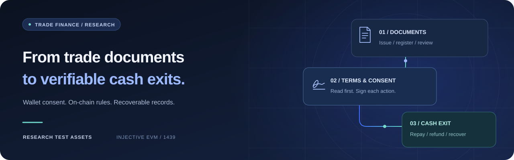
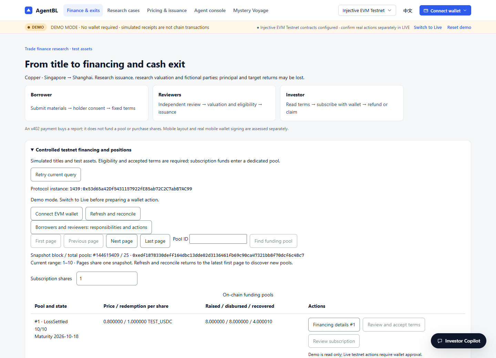
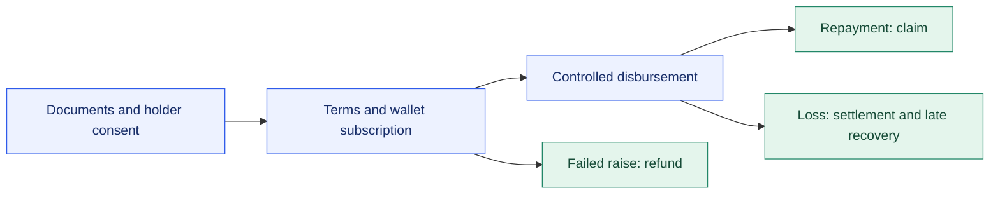

<p align="center">
  <a href="README.md"><strong>English</strong></a> | <a href="README.zh-CN.md">简体中文</a>
</p>

<h1 align="center">AgentBL</h1>

<p align="center"><strong>Trade documents. Clear consent. Verifiable cash exits.</strong></p>

<p align="center">
  A trade-finance research application that brings documents, financing terms,<br />
  wallet approvals, and test-token settlement into one auditable workflow.
</p>

<p align="center">
  <a href="https://github.com/liaboveall/Agent-BL-Upgrade/actions/workflows/ci.yml"></a>
  &nbsp; <code>Injective EVM · 1439</code> &nbsp; <code>Research test assets</code>
</p>

<p align="center">
  <a href="#quick-start"><strong>Quick start</strong></a> ·
  <a href="#the-workspace">Product tour</a> ·
  <a href="docs/architecture-current.md">Architecture</a> ·
  <a href="docs/acceptance.md">Human acceptance</a>
</p>

<p align="center">
  
</p>

## Built around the complete financing journey

From a fictional copper shipment on the Singapore → Shanghai route to an investor's final claim, AgentBL keeps each role, approval, and fund movement visible. Start with Demo, then use a registered wallet for controlled testnet financing.

<table>
  <tr>
    <td width="33%" valign="top"><h3>01 · Read before signing</h3><p>Complete, downloadable terms. Independent commitment checks. Fresh confirmation when the quote or wallet changes.</p></td>
    <td width="33%" valign="top"><h3>02 · Keep control of funds</h3><p>Role-based workflows and explicit wallet approvals. The server prepares plans; participants authorize each action.</p></td>
    <td width="33%" valign="top"><h3>03 · Make exits explicit</h3><p>Repayment, failed-raise refunds, and loss settlement. Late recovery rights survive the burning of shares.</p></td>
  </tr>
  <tr>
    <td valign="top"><h3>04 · Trace the evidence</h3><p>Encrypted materials, versioned reviews, authorized exports, and independently verifiable evidence packages.</p></td>
    <td valign="top"><h3>05 · Recover with context</h3><p>Rebuildable ledgers, fixed-block pagination, and original-transaction recovery that avoids paying twice.</p></td>
    <td valign="top"><h3>06 · Use AI with limits</h3><p>Deterministic pricing with optional AI analysis. Models explain results; they cannot sign or disburse funds.</p></td>
  </tr>
</table>

## The workspace

A bilingual interface for borrowers, reviewers, and investors, with financing pools, readable terms, positions, and the next action in one place.

[](docs/assets/financing-en.png)

<sub>Actual local v2 interface. The screenshot shows public testnet pool data in Demo viewing mode, with no wallet connected.</sub>

## One workflow, three cash outcomes



| Outcome | What participants can verify |
| --- | --- |
| **Repayment** | Test tokens enter the pool; investors claim their allocation individually. |
| **Failed raise** | The deadline passes without a successful raise; investors recover their cost. |
| **Loss and late recovery** | Fixed resolution rules allocate recovered cash, including later amounts after shares are burned. |

## Quick start

**Node.js 22.13+ and npm** are required. Node.js 24 is recommended.

```sh
npm ci
npm --prefix hardhat ci
npm run compile:contracts
npm run dev
```

Open **<http://127.0.0.1:3000/#/finance>**. Demo requires no wallet private key or model API key. `npm run dev` builds the interface before starting; `npm start` uses an existing build.

For custom settings, copy [.env.example](.env.example) to `.env` without overwriting an existing configuration. If port 3000 is occupied, choose another `PORT` and a separate `AGENTBL_RUNTIME_DIR`.

**To use controlled testnet financing:** connect a registered, eligible wallet and switch to Live. The frontend uses [application-config.json](public/application-config.json); the server's `AGENTBL_RIGHTS_CONFIG` must match [rights-instance.json](public/rights-instance.json). Administrator authentication, material encryption, and persistent state are covered in [Operations](docs/operations.md).

<details>
<summary><strong>Development and maintenance commands</strong></summary>

| Command | Purpose |
| --- | --- |
| `npm run build` / `npm run dev:web` | Build the interface or run its development server |
| `npm run lint` / `npm run check` | Check code, configuration, assets, and source consistency |
| `npm test` / `npm run test:coverage` | Application regressions and coverage |
| `npm run test:contracts` | Solidity contract regressions |
| `npm run test:capital` / `npm run test:rights` | Capital and rights flows on a real local EVM |
| `npm run test:evidence` / `npm run test:operations` | Evidence, payments, shutdown, and recovery |
| `npm run test:finance` | Role workflows and pagination across 25 pools |
| `npm run test:browser` | Bilingual browser, keyboard, and wallet-context regressions |
| `npm run build:clean` / `npm run verify:release` | Reproducible builds and complete local delivery checks |
| `npm run terms:verify -- <terms.json>` | Verify public financing terms offline |
| `npm run mcp:stdio` | MCP interface over standard input/output |
| `npm run smoke:x402` / `npm run x402:intel` | Report-payment checks and intelligence utilities |

Before the first browser test, run `npx playwright install chromium`, or set `AGENTBL_CHROMIUM_PATH` to Chrome/Edge. CI checks application code, contracts, integrations, browser behavior, builds, containers, and dependencies. Each change is assessed using its own commit's results.

</details>

<details>
<summary><strong>Repository layout and persistent data</strong></summary>

```text
src/          API, ledger, rights, pricing, Agent, and payments
web/          Bilingual React interface
hardhat/      Contracts, tests, and compiler configuration
public/       Public instance configuration and browser assets
data/         Research samples, source corpora, and runtime state
scripts/      Maintenance, validation, testnet, and backup tools
tests/        Application, integration, and browser regressions
docs/         Current references, showcase assets, and human acceptance
```

`data/runtime/`, `.env`, dependencies, builds, and test output are excluded from Git. Preserve instance materials, original transaction checkpoints, and ledgers. Do not replay historical transactions or copy legacy state into a new pool's directory.

</details>

## Documentation

| Explore | Reference |
| --- | --- |
| Understand the system | [Architecture and trust boundaries](docs/architecture-current.md) |
| Follow the fund rules | [Contracts and funding lifecycle](docs/contracts.md) |
| Run and maintain it | [Configuration, backup, and operations](docs/operations.md) |
| Inspect the inputs | [Research data and optional models](docs/data-sources.md) |
| Complete the remaining acceptance | [Human wallet acceptance](docs/acceptance.md) |

Supporting documents under `docs/` are currently written in Chinese.

## Research scope and delivery

> **Current delivery:** v2 testnet deployment, all three funding paths, late recovery, ledger reconciliation, and local container recovery have been verified. **Human wallet acceptance remains pending** and is the only remaining delivery task.

Contracts constrain registered assets, authorizations, and test tokens deposited into them. Material hashes do not prove real goods or legal claims; duplicate financing outside the registry domain is not automatically prevented. Research addresses do not represent independent organizations. Test tokens are not real dollars, and shares are non-transferable.

Real-phone acceptance, independent-host recovery, signing authority handover, and commercial admission have been removed from this delivery scope. They are not claimed as verified. The application does not process real trade financing. AI cannot authorize financing, and x402 report payments remain separate from financing funds.

<details>
<summary><strong>Existing local deployment</strong></summary>

These URLs apply when the initialized local containers are already running; a fresh checkout does not include their private materials or runtime state.

| Service | URL |
| --- | --- |
| Current v2 financing and positions | <http://127.0.0.1:3000/#/finance> |
| Legacy v1 queries and exits | <http://127.0.0.1:3001/#/finance> |

</details>

---

<p align="center"><sub>React · Node.js · ethers · Solidity · Hardhat · Injective EVM</sub></p>
