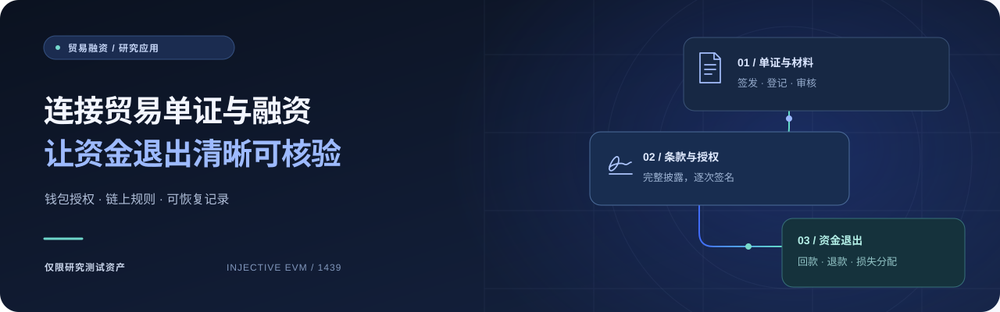
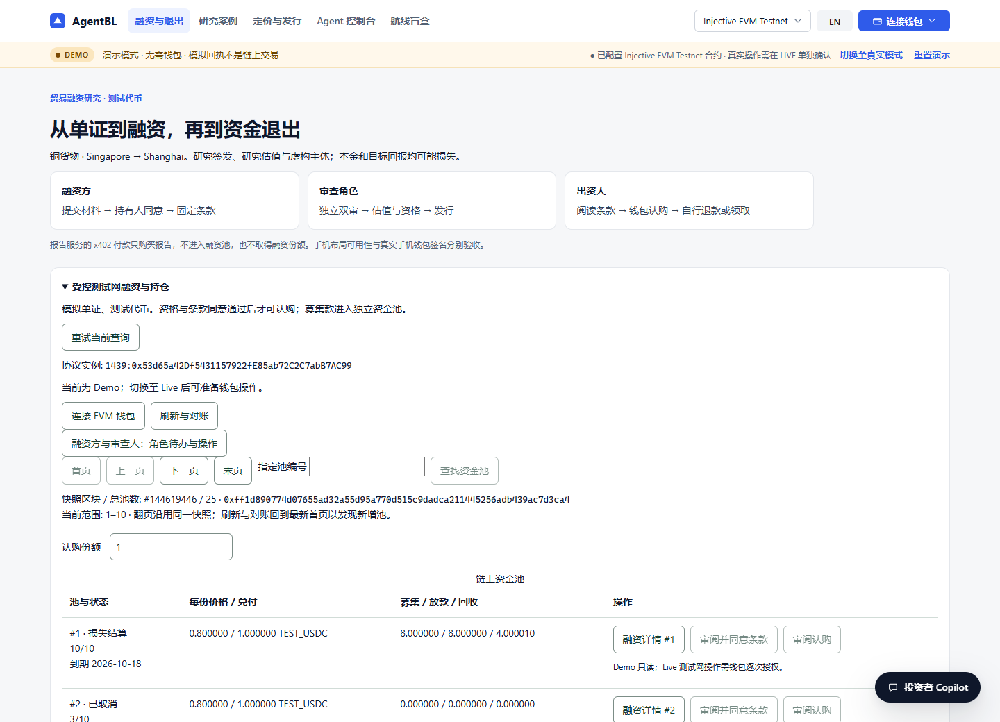
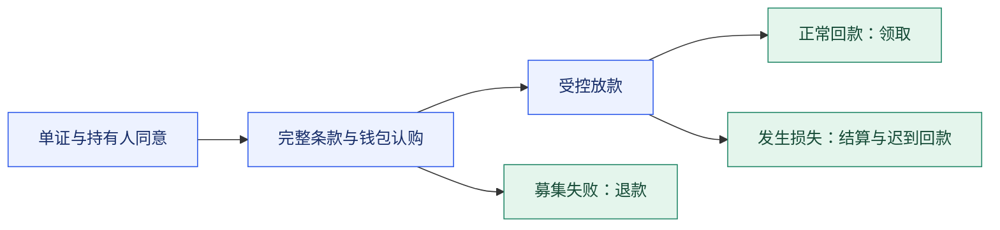

<p align="center">
  <a href="README.md">English</a> | <a href="README.zh-CN.md"><strong>简体中文</strong></a>
</p>

<h1 align="center">AgentBL</h1>

<p align="center"><strong>贸易单证 · 明确授权 · 可核验的资金退出</strong></p>

<p align="center">
  一个贸易融资区块链研究应用，<br />
  将单证、融资条款、钱包授权和测试代币结算连接成可审计的完整流程。
</p>

<p align="center">
  <a href="https://github.com/liaboveall/Agent-BL-Upgrade/actions/workflows/ci.yml"></a>
  &nbsp; <code>Injective EVM · 1439</code> &nbsp; <code>研究测试资产</code>
</p>

<p align="center">
  <a href="#快速开始"><strong>快速开始</strong></a> ·
  <a href="#界面预览">界面预览</a> ·
  <a href="docs/architecture-current.md">架构说明</a> ·
  <a href="docs/acceptance.md">人工验收</a>
</p>

<p align="center">
  
</p>

## 围绕完整融资旅程构建

从 Singapore → Shanghai 的虚构铜货物，到出资人最后一次领取，AgentBL 将角色、授权和资金流转清晰呈现。可以先体验 Demo，再用已登记的钱包进入受控测试网融资。

<table>
  <tr>
    <td width="33%" valign="top"><h3>01 · 签名前读懂条款</h3><p>完整条款可下载，承诺可独立复算。报价或钱包变化后，重新审阅并确认。</p></td>
    <td width="33%" valign="top"><h3>02 · 由钱包掌握授权</h3><p>按角色推进业务，每一步明确确认。服务端准备交易计划，参与者逐次授权。</p></td>
    <td width="33%" valign="top"><h3>03 · 让资金退出明确</h3><p>覆盖正常回款、募集失败退款和损失结算。份额销毁后，仍保留迟到回款受益权。</p></td>
  </tr>
  <tr>
    <td valign="top"><h3>04 · 让证据可追溯</h3><p>材料加密保存，审核绑定版本，按权限导出，证据包可以独立核验。</p></td>
    <td valign="top"><h3>05 · 带着上下文恢复</h3><p>账本可重建，分页固定区块快照；结果未知时核对原交易，避免重复付款。</p></td>
    <td valign="top"><h3>06 · 为 AI 明确边界</h3><p>确定性研究定价结合可选 AI 分析。模型解释结果，不能代签或自主放款。</p></td>
  </tr>
</table>

## 界面预览

面向融资方、审查角色与出资人的双语工作台，将资金池、可读条款、持仓和下一步操作放在同一流程中。

[](docs/assets/financing-zh.png)

<sub>当前本机 v2 的真实界面。截图在 Demo 查看模式下展示公开测试网资金池数据，未连接钱包。</sub>

## 一条流程，三种资金结果



| 结果 | 参与者可以核对什么 |
| --- | --- |
| **正常回款** | 测试代币进入资金池，出资人分别领取应得分配。 |
| **募集失败** | 截止后募集未成功，出资人按规则退回原成本。 |
| **损失与迟到回款** | 按固定处置规则分配实际回收款；份额烧毁后仍可领取后续增量。 |

## 快速开始

需要 **Node.js 22.13+ 和 npm**，推荐 Node.js 24。

```sh
npm ci
npm --prefix hardhat ci
npm run compile:contracts
npm run dev
```

打开 **<http://127.0.0.1:3000/#/finance>**。Demo 无需钱包私钥或模型密钥。`npm run dev` 会先构建界面再启动服务；已有构建可使用 `npm start`。

如需自定义设置，将 [.env.example](.env.example) 复制为 `.env`，不要覆盖已有配置。若 3000 端口已被占用，设置其他 `PORT` 并使用独立的 `AGENTBL_RUNTIME_DIR`。

**使用受控测试网融资：**连接已登记且具备资格的钱包，切换至 Live。前端使用 [application-config.json](public/application-config.json)，服务端 `AGENTBL_RIGHTS_CONFIG` 需对应 [rights-instance.json](public/rights-instance.json)。管理员认证、材料密钥和持久状态配置见[运行说明](docs/operations.md)。

<details>
<summary><strong>开发与维护命令</strong></summary>

| 命令 | 用途 |
| --- | --- |
| `npm run build` / `npm run dev:web` | 构建界面或单独启动前端开发服务 |
| `npm run lint` / `npm run check` | 检查代码、配置、资源和源码一致性 |
| `npm test` / `npm run test:coverage` | 应用回归与覆盖率 |
| `npm run test:contracts` | Solidity 合约回归 |
| `npm run test:capital` / `npm run test:rights` | 实际本地 EVM 的资金与权利流程 |
| `npm run test:evidence` / `npm run test:operations` | 证据、支付、停止与恢复 |
| `npm run test:finance` | 角色流程与 25 池分页集成 |
| `npm run test:browser` | 双语界面、键盘和钱包上下文回归 |
| `npm run build:clean` / `npm run verify:release` | 可复现构建与完整本地交付检查 |
| `npm run terms:verify -- <terms.json>` | 离线复算公开融资条款 |
| `npm run mcp:stdio` | MCP 标准输入输出接口 |
| `npm run smoke:x402` / `npm run x402:intel` | 报告付款检查与情报工具 |

浏览器测试首次运行前执行 `npx playwright install chromium`，或用 `AGENTBL_CHROMIUM_PATH` 指定 Chrome/Edge。CI 检查应用、合约、集成、浏览器、构建、容器和依赖，每次修改以自身提交结果为准。

</details>

<details>
<summary><strong>项目结构与持久数据</strong></summary>

```text
src/          API、资金账本、权利、定价、Agent 与支付
web/          React 双语界面
hardhat/      合约、测试与编译配置
public/       公开实例配置与浏览器资源
data/         研究样本、来源语料与运行状态
scripts/      维护、验证、测试网与备份工具
tests/        应用、集成与浏览器回归
docs/         当前说明、展示资源与人工验收
```

`data/runtime/`、`.env`、依赖、构建和测试产物不进入 Git。保留实例材料、原交易检查点和账本，不重放历史交易，也不把旧实例状态复制进新池目录。

</details>

## 文档

| 了解什么 | 阅读入口 |
| --- | --- |
| 系统如何工作 | [架构与信任边界](docs/architecture-current.md) |
| 资金遵循什么规则 | [合约与资金生命周期](docs/contracts.md) |
| 如何运行与维护 | [配置、备份与运维](docs/operations.md) |
| 数据与模型从哪里来 | [研究数据与可选模型](docs/data-sources.md) |
| 完成剩余验收 | [人工钱包验收](docs/acceptance.md) |

## 交付与范围

> **当前交付：**v2 测试网部署、三条资金路径、迟到回款、账本核对及本机容器恢复已验证。**人工钱包验收仍待完成**，这是唯一剩余交付任务。

合约约束已登记对象、授权和进入合约的测试代币。材料哈希不能证明真实货物或债权，也不会自动消除登记域外的重复融资。研究地址不代表独立组织，测试代币不等于真实美元，份额不可转让。

真实手机、独立主机恢复、签名权接管和商用准入已从本次交付范围取消，不宣称这些能力已验证。应用不处理真实贸易融资；AI 不授权融资，x402 报告付款与融资资金分别记账。

<details>
<summary><strong>已有本机部署</strong></summary>

以下地址适用于已初始化并正在运行的本机容器；新 checkout 不包含其私有材料或运行状态。

| 服务 | 地址 |
| --- | --- |
| 当前 v2 融资与持仓 | <http://127.0.0.1:3000/#/finance> |
| 旧 v1 查询与退出 | <http://127.0.0.1:3001/#/finance> |

</details>

---

<p align="center"><sub>React · Node.js · ethers · Solidity · Hardhat · Injective EVM</sub></p>
