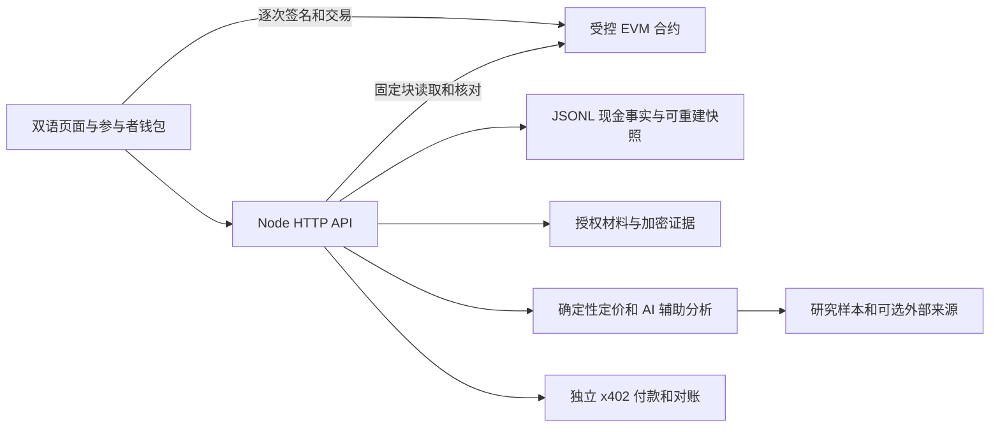

# 当前架构

本文描述当前实现；新规则、任务和完成条件统一见 [开发规划](development-plan.md)。

## 业务主线

链下材料与来源 → 单证登记与持有人同意 → 估值、资格和可核对条款 → 测试代币认购 → 固定收款人放款 → 实际回款 → 退款或领取。

`RightsGovernance` 管理延时治理；`AssetIdentityHub` 保留登记域内资产占用；`CommittedEBLRegistry` 管理签发、控制和质押；`RightsController` 约束发行和操作权限；`RWAOfferingPoolV5` 托管与分配资金；`ControlledRWAToken` 记录不可转让份额。历史别名占用仍是防重复机制的一部分。

第一阶段的本地新候选使用控制版本 2、Rights v2 签名域和独立的放款截止。代币与资金池分别部署后，资金池通过两步所有权交给固定 Controller；激活检查无既有池、无原始 executor、正确 token/registry 绑定及固定合资格门禁。资金池创建不可替换的 `RecoveryEntitlements` 保存认购槽位，首次领取烧毁份额后仍保留后续回款权利。分配由累计现金和永久槽位决定，费用为零，领取顺序不会改变权益。

到期的现金退出不依赖平台继续在线；通知 1 天，公告后最多 3 天终局。参与者最多触发一次冻结，治理和审核失联时仍可在硬截止按确定性现金规则退出。这个政策约束测试代币，不证明现实单证、货物处置或司法救济已经发生。完整角色表、威胁模型和签名数据库对照在 [N0 决策](development-plan.md#n0-决策业务角色攻击者与数据库对照)。

## 应用分工

- `src/rights/`：身份会话、角色、材料、审核、签名和交易计划。
- `src/ledger/`：按链、协议版本和资金池地址隔离的资金账本与未知交易恢复。
- `src/core/`、`src/agent/`：统一确定性融资报价、证据分析、Demo 模拟与研究建议。MCP 不再包含旧 Oracle 写入工具，也不退回旧模型报价。
- `src/x402/`：付款授权、真实回执核验、对账和已付款报告取回。
- `src/evidence/`、`src/provenance/`：材料版本、授权下载、来源说明和离线复算。
- `src/ops/`：就绪、停止新增操作、持久材料检查、监控及恢复。
- `web/`：双语研究界面、钱包和受控融资流程。

Demo 数据不自动转换为真实融资。Live 中的风险分析不会给旧协议签名；实际资金动作在受控路由逐次准备和核验。

链上约束已登记对象和进入合约的代币，不能独立证明货物、单证源、企业、债权或处置权真实。份额不可转让，不提供二级交易。防重复仅在已接入的登记域成立；研究治理地址由同一操作员保管，不能描述为独立组织治理。

现金事实先写追加日志，持仓和游标是可重建快照。账本按链、协议版本和资金池地址隔离，交易及日志位置去重，同号池不跨实例解释。每个 runtime 只允许一个写入进程。

未知交易保存意图、原 nonce、calldata 和起始块，恢复时查找原交易；确认依赖规范块，重组撤回确认但保留历史。初始化材料和关键历史缺失时停止新增风险，不把空目录当作新系统。

## 配置与数据

应用公开配置与受控部署清单分开，二者的当前资金池地址及网络必须一致。材料密钥、付款签名密钥和可选锚定密钥分开配置。

研究 Agent 使用 `research-agent/` 命名空间；受控账本保留原地址命名空间。清理源码不会删除历史持仓、付款授权、恢复记录或密钥。旧材料取回方式见 [历史材料](history.md)。

`data/runtime/` 是持久业务状态，`artifacts/` 是执行产物，`docs/` 是当前规范。部署 CLI 的只读续跑基线位于 `scripts/config/testnet-deployment-baseline.json`，最新 checkpoint 位于 `data/runtime/w5-deployment/`。基线不含私钥，也不能替代实际签名材料或最新运行历史。

现有公共配置仍指向控制版本 1。服务按实际 `controlVersion` 选择新编译产物或冻结的 `scripts/config/rights-v1-artifacts.json`，分别核验代码及签名域。旧实例的应用入口只读和退出，不能新建、认购或放款；无法据此限制用户直接调用旧链上代码。新候选须共用已有治理和 Hub、部署独立 Registry/Pool/Controller，使用新账本目录，不复用旧 checkpoint 或交易意图。

## 已知边界

当前仍是研究测试资产系统。CA-01～CA-04 的本地新候选修复与验证状态见开发计划；现有已部署实例没有热升级，也没有切换公共配置。真实单证、估值、处置、独立组织及真实资金验收仍未完成。

N2 新增经材料双审绑定的公开完整条款、API 同块核对及前端独立复算；研究定价增加资方下限、借款人/担保上限和敏感性解释。真实 provider 未验收，声明金额和规则估值不等于真实贸易事实。N3 已补齐角色流程与固定快照分页；N4 将融资与退出设为默认入口，角色待办、只读完整条款、资金池详情与持仓分别可达，桌面和窄屏布局已完成N4本地联合验收，真实手机钱包仍待N5人工验收。修改必须同步合约、签名/ABI、服务、账本与 UI，不能用界面禁用代替链上限制。

## 角色流程与读服务边界

角色工作台以同组织材料及完整条款为交接对象，显示每一步负责人和待办，支持已登记钱包会话、研究签发/估值文件签名、双审、holder同意、融资及资金退出。服务只生成无签名计划；前端明确确认后登记一次广播checkpoint，由当前钱包签名。材料版本、会话、模式代次、实例、条款与nonce改变即拒绝旧预览；恢复仅核对原交易。资金意图也绑定主体及钱包，不能用另一个组织的会话查改。被撤销主体可由原钱包取得仅退出会话，保持既有退款/领取及原资金交易恢复；该会话不恢复材料读取或新增风险。

资金池与持仓读取使用固定区块和哈希分页、指定池查询及有界RPC队列；响应返回快照、页级完整性和逐池失败。旧页的持仓金额由追加现金历史投影到同一确认块，避免新现金账配旧余额。超时占槽直到底层结束，重试只针对幂等读取；未知金额不能显示为零。读统计和本地EVM查询时延不等于公共RPC容量或商业SLA。

## 界面与授权上下文

默认 `#/finance` 展示研究场景、三类角色责任、资金池与持仓退出，研究案例、定价、Agent 及航线扩展保留独立导航。角色工作台可从融资页展开；证据与运行工具位于原生折叠区。x402 报告付款不进入融资池。

资金池支持首页/末页、前后页、指定编号、原快照重试和最新首页刷新；持仓失败不清空成功的池列表，也不显示零持仓。未知原交易记录在持仓请求前恢复，损坏记录阻止继续发送。可读完整条款可只读核验；签名前仍需独立审阅和当前授权。翻页读回后保留键盘焦点，确认区可用 Escape 取消，钱包/模式切换使原预览失效。

根布局使用流式宽度；表格在命名且可聚焦的局部区域滚动，窄屏导航换行，Copilot 入口不覆盖资金操作。390/768/1280/1440px 的浏览器布局证据不等于真实手机钱包或人工验收。
