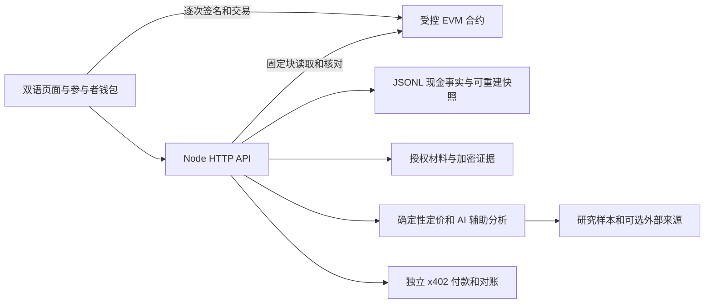

# 当前架构

本文描述当前实现；新规则、任务和完成条件统一见 [开发规划](development-plan.md)。

## 业务主线

链下材料与来源 → 单证登记与持有人同意 → 估值、资格和可核对条款 → 测试代币认购 → 固定收款人放款 → 实际回款 → 退款或领取。

`RightsGovernance` 管理延时治理；`AssetIdentityHub` 保留登记域内资产占用；`CommittedEBLRegistry` 管理签发、控制和质押；`RightsController` 约束发行和操作权限；`RWAOfferingPoolV5` 托管与分配资金；`ControlledRWAToken` 记录不可转让份额。历史别名占用仍是防重复机制的一部分。

## 应用分工

- `src/rights/`：身份会话、角色、材料、审核、签名和交易计划。
- `src/ledger/`：按链、协议版本和资金池地址隔离的资金账本与未知交易恢复。
- `src/core/`、`src/agent/`：统一确定性融资报价、证据分析、Demo 模拟与研究建议。MCP 不再包含旧 Oracle 写入工具，也不退回旧模型报价。
- `src/x402/`：付款授权、真实回执核验、对账和已付款报告取回。
- `src/evidence/`、`src/provenance/`：材料版本、授权下载、来源说明和离线复算。
- `src/ops/`：就绪、停止新增操作、持久材料检查、监控及恢复。
- `web/`：双语研究界面、钱包和受控融资流程。

Demo 数据不自动转换为真实融资。Live 中的风险分析不会给旧协议签名；实际资金动作在受控路由逐次准备和核验。

链上约束已登记对象和进入合约的代币，不能独立证明货物、单证源、企业、债权或处置权真实。份额不可转让，不提供二级交易。防重复仅在已接入的登记域成立；研究治理地址由同一操作员保管，不能描述为独立组织治理。

现金事实先写追加日志，持仓和游标是可重建快照。账本按链、协议版本和资金池地址隔离，交易及日志位置去重，同号池不跨实例解释。每个 runtime 只允许一个写入进程。

未知交易保存意图、原 nonce、calldata 和起始块，恢复时查找原交易；确认依赖规范块，重组撤回确认但保留历史。初始化材料和关键历史缺失时停止新增风险，不把空目录当作新系统。

## 配置与数据

应用公开配置与受控部署清单分开，二者的当前资金池地址及网络必须一致。材料密钥、付款签名密钥和可选锚定密钥分开配置。

研究 Agent 使用 `research-agent/` 命名空间；受控账本保留原地址命名空间。清理源码不会删除历史持仓、付款授权、恢复记录或密钥。旧材料取回方式见 [历史材料](history.md)。

`data/runtime/` 是持久业务状态，`artifacts/` 是执行产物，`docs/` 是当前规范。部署 CLI 的只读续跑基线位于 `scripts/config/testnet-deployment-baseline.json`，最新 checkpoint 位于 `data/runtime/w5-deployment/`。基线不含私钥，也不能替代实际签名材料或最新运行历史。

## 已知边界

当前仍是研究测试资产系统。2026-10-18 评估中发现的到期放款、微额回款阻断处置、重复争议和费用顺序问题，本轮清理没有修改其合约规则。真实单证、估值、处置、独立组织及真实资金验收也没有因清理而完成。

前后端尚有可读条款、列表分页和整页手机布局缺口。修改必须同步合约、签名/ABI、服务、账本与 UI，不能用界面禁用代替链上限制。
