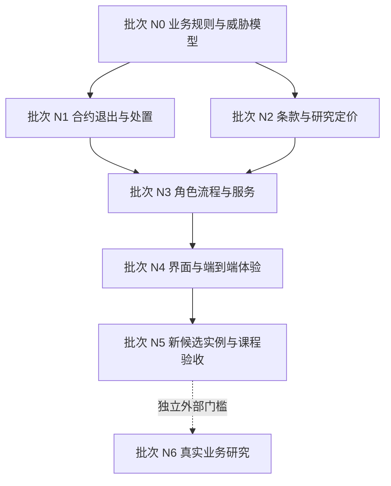

# AgentBL 新一轮开发规划

更新：2026-10-18。状态：**规划就绪，以下产品任务尚未实施**。

本轮以 `19efe4e2504fb0b9624b12def29f90eee3fceb6a` 的受控 v5 应用为开发起点，承接 2026-10-18 综合评估中的 CA-01～CA-07 和 CG-01～CG-05。旧实验入口已经退役；本次文档整理没有修复这些产品问题，也没有更新已部署合约。历史报告、反例脚本、原始失败日志和部署证据的取回方式见 [历史材料](history.md)。

以后开发先读本文，再读 [架构](architecture-current.md)、[合约](contracts.md)、[运行与验收](operations.md)。本文是唯一开发任务入口，更新任务状态、决策和验收链接，不再另起 W0～W5、逐日评审、多个版本的规划。

## 1. 本轮要交付什么

**目标：一个可审计、可恢复、权限明确，能够由不同角色完成融资和退出的贸易融资区块链研究应用。** 对课程项目，区块链应实际约束单证控制、条款、托管与资金分配；用户应能理解并独立验证这个约束。

默认演示场景收敛为铜货物、Singapore → Shanghai、研究签发方、一位融资主体及至少两位合资格出资方。使用虚构单据与明确标注的测试代币，正常回款、募集失败退款、违约损失三条路径共享同一产品定义。其他案例保留为定价和解析回归样本，不扩展成多条默认产品主线。

本轮交付应达到：

1. 到期、估值失效、微额回款、重复异议及费用顺序不会造成不合理新增风险或无界冻结。
2. 用户在签名前读到完整条款，并能把内容与钱包授权、链上版本、金额核对起来。
3. 融资方、审查角色和投资者沿明确流程操作；无需懂合约调用或翻找多个实验面板。
4. 超过十个池、RPC 故障、钱包变更、未知交易、重组和恢复均有明确行为。
5. 课程提交包含可复跑演示、独立余额核验、威胁模型、数据库方案对照以及诚实的局限说明。

本轮不新增链、币种、二级交易、自动对冲或自主放款 Agent。x402、MCP、Copilot 和趣味展示作为已有扩展保留，默认导航服从融资主线。真实贸易试点另设外部准入门槛，不作为本轮课程应用完成的前提。

## 2. 为什么使用区块链，以及仍需信任谁

| 问题 | 链上应保证 | 链外责任及边界 |
|---|---|---|
| 同一单证被占用 | 已接入登记域内的唯一控制、版本及质押约束 | 签发方提供稳定身份；跨平台和伪造单证不能由一个 Hub 自动消除 |
| 谁同意何种融资 | 钱包签名绑定链、合约、资产、角色、条款及有效期 | 用户识别、可读披露、授权材料与身份撤销由具体主体负责 |
| 资金是否真的流转 | 实际代币托管、付款与份额原子性、独立领取和退款 | 测试代币不等于美元；现实贸易回款必须由责任方送入资金池 |
| 平台是否可改账 | 参与者可独立验证状态、交易和合约约束 | 治理仍可在授权范围内操作；多个地址不代表独立组织 |
| 材料是否被换过 | 内容承诺、版本和证据复算 | 哈希不证明货物、发票、估值或处置权真实，也不保证原文可用 |
| AI 是否能控制钱 | 确定性规则及明确角色约束资金动作 | 模型抽取、解释和告警需要来源、质量评估及人工接管 |

N0.1 必须写出与“签名数据库 + 平台托管”的对照：平台离线、平台试图改账、投资者独立领取、单个治理者越权时各自会怎样。若所有业务主体都由同一操作员扮演，应如实说明这是研究角色分离，不能宣称已经实现组织间去信任。

## 3. 起点和缺口

当前已有：受控登记与 holder 同意、资格和估值检查、不可转让份额、实际测试代币托管及退出、链账重建、未知交易恢复、证据包、双语 UI、容器和 CI。它们是继续开发的基础，无需重新搭建项目。

最近主分支 `19efe4e` 有同提交 CI 运行 [39116478968](https://github.com/liaboveall/Agent-BL-Upgrade/actions/runs/39116478968)。这是清理前版本的历史证据，不给本轮或未来修改自动背书。过去反例在 `b8db411` 上生成；本轮起点的核心受控合约未修改，以下问题仍作为未关闭项管理。

| 评估编号 | 优先级 / 当前状态 | 具体问题及触发条件 | 关闭任务 |
|---|---|---|---|
| CA-01 | P1 / OPEN | 已募集但未放款，时间超过 maturity 和估值有效期后，授权运营方仍可首次放款 | N1.1 |
| CA-02 | P1 / OPEN | 处置公告及通知期完成后，任意地址回款 1 原子单位使 `recovery changed`，可重复拖延 | N1.2 |
| CA-03 | P1 / OPEN | 治理解决异议后，同一投资者用相同证据再次冻结处置 | N1.3 |
| CA-04 | P2 / DECISION_REQUIRED | 首位投资者领取后，受延时治理控制的费用扣取因 `ClaimsStarted()` 失败 | N0.2、N1.4 |
| CA-05 | P1 / OPEN | 确认主要展示 hash，缺少完整责任主体、费用、条件和处置条款 | N2.1 |
| CA-06 | P2 / OPEN | API 有分页，界面仅获取默认第一页十个池 | N3.2、N4.1 |
| CA-07 | P2 / OPEN | 页面根部 `min-width:1100px`，局部面板验收不能证明整页支持手机 | N4.3 |

P1 为本轮新候选实例发布阻断项；P2 中的费用政策和列表完整性同样必须在发布前闭合。优先级不是已发生攻击或资金损失的判断。

| 研究 / 外部门槛 | 当前状态 | 本轮处理 |
|---|---|---|
| CG-01：单证真实性、债权与实物处置责任 | VALIDATION_REQUIRED | N0.1 明确研究假设；真实业务证据留给 N6.1 |
| CG-02：资方补偿下限与借款人上限 | DECISION_REQUIRED | N2.2 建立可解释的研究约束和敏感性分析 |
| CG-03：完整角色流程和人工钱包 | VALIDATION_REQUIRED | N3.1、N5.4；自动钱包测试不能替代真实人工操作 |
| CG-04：独立组织治理和授权恢复 | VALIDATION_REQUIRED | N5.3 验证技术恢复；组织独立性留给 N6.2 |
| CG-05：多池 Live RPC 性能 | VALIDATION_REQUIRED | N3.2、N5.3；与离线 HTTP 压测分开记录 |

## 4. 先确定的业务规则

以下是本轮的推荐设计起点，由 N0.2 形成明确决策和例子后实施；不能把这一节当成现有合约行为说明。若修改选择，在本文记录理由和受影响任务。

### 时间、放款与退出

- 区分募集截止、放款截止、债务到期、估值有效期和处置通知期。截止比较使用链上时间，精确规定等于截止时是否允许，避免不同层各自解释。
- 到期或超过放款截止，不得增加已放出的本金。估值/来源被撤销或过期时重新核验；重新确认不能悄悄延长投资者已经签署的风险期限。
- 募集成功但未放款、部分放款和融资主体失联都必须有明确退出路径。部分放款时，闲置托管本金、已放出债务和实际回款分别结算，不能仅用一个 `Funded` 状态推定。
- 停止新增风险时保留已成立的退款和领取能力；单证释放须与债务或完成分配的担保责任相符。

### 处置、迟到回款与异议

- 使用可标识的处置版本和分配基准，不能要求一个任何人都可增加的累计回收值在无限等待后保持不变。
- 推荐把已通知的基准分配与增量回款分开记账。原分配在有界流程内完成，新增金额仍公平归属原受益人；不能通过忽略后续入金或长期禁止还款解决活性。
- 如采用累计每份额分配模型，应说明精度、尾差、已领与未领账户、份额销毁后受益权及零份额情形。不能为修复卡住而使后来到账的款项失去合法领取者。
- 异议绑定处置版本、异议编号、提交者和材料。已裁决同一事实不得重复冻结；换一个 hash 不构成实质新证据。
- 明确受理窗口、可延长次数、治理失联和终局规则。链上不能理解证据语义，须由有责任的审核/仲裁角色承担准入判断，并测试该角色缺席时的有界退出。

### 费用与定价

- 课程默认场景采用零平台费。若保留必要处置费或非零费用场景，须在领取开放前原子确定费用和净分配，受签署上限约束；不得依赖治理晚于首笔领取再扣取。
- 区分融资本金、实际到账、到期应付、实际回款、目标兑付、净可分配和已领取；按结算代币的原子整数计算，展示单位换算可复算。
- 区分借款人的可承受成本、资方研究补偿下限和可回收担保上限。没有共同可行区间时拒绝或降额；研究风险分不作为违约概率，目标年化不作为预期收益。
- 研究签发、研究估值和虚构企业在每个关键界面可见。真实行情只能证明某时某来源的观测，不能直接证明这批货的净处置价值。

## 5. 必须维持的不变量

新增测试应围绕下面的性质和反例，不能只复制实现分支。将实际业务规则确定后的金额例子写入测试，并覆盖直接合约调用。

| 编号 | 必须成立的性质 | 重点验收 |
|---|---|---|
| I01 | 既定标准代币范围内，逐池托管 = 认购入金 + 回款 − 放款 − 退款 − 领取 − 已付费用 | 多投资者、亏损、部分放款、迟到回款和尾差；误转单列处理 |
| I02 | 份额发行、持有、销毁及分配权守恒；相同 ID 不跨实例混用 | 两个部署的同号池、份额销毁后增量回款 |
| I03 | 每笔认购的实际付款与份额同时成功或失败 | allowance、拒签、回滚、非标准代币 |
| I04 | 没有合法权限、资格、有效条款和完整绑定时不能增加风险 | 越权、撤销、过期、旧签名和错误网络 |
| I05 | 时间经过即产生合约限制，不依赖有人先调用违约标记 | 放款截止前/等于/后、估值失效、部分放款 |
| I06 | 公告后的敌对微额回款不能无限重置原分配；新增金额不丢失 | 反复微额与大额迟到回款、多个受益人不同领取顺序 |
| I07 | 异议有救济，也有明确终局和失联规则 | 重复事实、伪新 hash、多方轮流争议、仲裁缺席 |
| I08 | 净费用及每人权益不取决于谁抢先领取 | 零费、上限、亏损、结清前后与交易排序 |
| I09 | 停止新增风险、身份撤销或服务故障不会扩大已有资金冻结 | 退款/领取可达，重新核验与链上退出约束明确 |
| I10 | 可读条款、签名、报价版本及链上承诺对应同一对象 | 材料缺失、篡改、报价变化、钱包/模式切换 |
| I11 | 未知结果不自动重签；确认绑定规范块和原交易 | nonce、漏存 hash、超时、重组、刷新和恢复 |
| I12 | 私有材料需授权；承诺不冒充真实性认证 | 会话隔离、过期、脱敏、下载、日志和静态资源扫描 |
| I13 | 页数、缓存和 RPC 部分失败不改变列表/持仓的语义完整性 | 25 个以上池、指定池、分页、同块快照、失败重试 |
| I14 | 备份与恢复保存现金事实和可核验证据；不把空目录当新系统 | 缺历史拒绝启动、错误密钥、断写、重组后重建 |

直接向合约误转、代币发行方行为和链停止等范围要写明，不能把守恒断言扩大成代码尚未保证的任意资产安全声明。

## 6. 开发批次与依赖

按相连的数据流成批完成，批次末运行统一回归；无需把每个小任务拆成一轮交付。所有任务初始状态为 `TODO`。只有实现和证据满足本节条件后才可改为完成。

### N0 / P1：先使产品规则可实现、可验证

| 任务 / 状态 | 工作与主要位置 | 完成条件 |
|---|---|---|
| N0.1 / TODO | 在本文及架构中固定资产、融资债权、角色、信任假设和攻击者能力；对照 `src/rights/`、Registry、Hub | 一页业务图和角色表；能解释链与数据库的差异、域内防重复边界、研究主体与真实组织的区别 |
| N0.2 / TODO | 定义时间、未放款退出、迟到回款、异议终局、费用、尾差和净债务政策 | 每项有正例/反例和有界时间；两位投资者、部分放款、亏损及迟到回款算例可手工复算；CA-04 决策明确 |

依赖：无。统一验收：规则逐条映射 I01～I14，注明尚待链外责任方证实的假设。此批不能用修改 UI 提示替代合约规则设计。

### N1 / P1：修复核心协议并证明资金能够退出

| 任务 / 状态 | 工作与主要位置 | 完成条件 |
|---|---|---|
| N1.1 / TODO | CA-01；`RightsController.sol`、`RWAOfferingPoolV5.sol`、签名条款与 ABI | 首次/部分放款在各时间边界被正确允许或拒绝；过期估值与撤销来源直接调用被拒；未放款本金可有界退出 |
| N1.2 / TODO | CA-02；处置分配基准、增量回款与受益权记录 | 连续多轮 1 原子单位回款不能重启通知期；正常大额迟到回款仍公平分配；已领取/销毁份额不丢后续权利 |
| N1.3 / TODO | CA-03；异议版本、受理及终局状态 | 已处理事实不再冻结；伪新 hash 和多个角色轮流重提不能无界拖延；真实新证据可按规定救济；审核/治理失联有明确结局 |
| N1.4 / TODO | CA-04；零费策略、可选必要费用及结算净额 | 签署费用上限与净分配一致；首位抢先领取、不同领取顺序、亏损、零费和费用收款失败不破坏公平或退出 |
| N1.5 / TODO | `hardhat/test/` 与本地 EVM/HTTP 集成；随机事件序列、敌对调度、资金守恒 | CA-01～04 的旧触发序列变为新规则下的反向回归；I01～I11 有跨函数验证；保留失败种子和金额轨迹 |
| N1.6 / TODO | 构造过程、字节大小、版本/部署约束；`hardhat`、`src/chain/`、部署脚本 | 标准 EVM runtime/initcode 大小限制均满足；不得调高本地上限掩盖问题；生成新部署和旧实例保留退出方案 |

依赖：N0。N1.2 与 N1.3 应一起审查，防止一个修复重新引入另一个冻结路径。统一验收：Solidity + 资金/权利本地 EVM/HTTP 回归通过；新业务规则同步到 schema、ABI、签名域、账本和计划构建器。

### N2 / P1：把链上承诺转成用户能理解的融资产品

| 任务 / 状态 | 工作与主要位置 | 完成条件 |
|---|---|---|
| N2.1 / TODO | CA-05；`src/rights/`、`src/evidence/`、controlled API、`web/src/lib/controlled.js` 与确认面板 | 提供可取回、版本化、可复算的完整条款；含责任主体、测试资产、募集/放款/到期、费用、收益/损失、处置与异议；材料缺失、hash 不匹配或报价变化即阻止旧确认 |
| N2.2 / TODO | CG-02；`src/core/pricingEngine.js`、schema、来源说明和 UI 解释 | 明确资方研究下限、借款人上限、担保和期限约束；成本/毛利来源可见；无可行区间拒绝或降额；低利润/高资金成本/高损失压力有敏感性表 |
| N2.3 / TODO | `src/provenance/`、Agent 抽取/估值、风险与数据状态 | 关键字段标明 live/stale/fixture/unavailable 及适用范围；模型失败进入可见人工接管；风险分不冒充概率，目标回报不冒充预测；未测 provider 不标为通过 |

依赖：N0，条款最终结构对齐 N1。统一验收：同一份条款从后端计算、UI 阅读、钱包签名到链上 commitment 可独立复算；定价以确定性策略约束，LLM 文本不能改资金参数。

### N3 / P1～P2：补齐角色工作流和服务读写边界

| 任务 / 状态 | 工作与主要位置 | 完成条件 |
|---|---|---|
| N3.1 / TODO | `src/app/rightsRoutes.js`、`controlledRoutes.js`、审核与计划服务，前端角色入口 | 签发→持有人同意→估值/审查→发行→认购→放款→回款/处置→领取有明确负责人和下一步；每个关键动作有可读预览、权限失败原因及回执；钱包逐次授权，服务不越权代签 |
| N3.2 / TODO | CA-06、CG-05；分页/指定池/持仓接口、链上快照、RPC 并发预算 | 本地至少 25 池，跨页无遗漏/重复；响应标注快照与时效；有边界的并发、超时、限流和重试；部分查询失败不显示为零持仓或完整成功 |
| N3.3 / TODO | `src/ledger/`、身份会话、材料权限和交易意图恢复 | 模式/钱包/链/条款变更使旧授权失效；未知交易不重复付款；重组可回退重建；租户隔离、附件授权、错误响应与日志不泄密 |

依赖：N1、N2 的业务结构稳定。统一验收：真实本地 EVM + HTTP + 钱包适配器联合完成正常、失败退款和损失路径；按实例核对链余额、事件、持仓、审计和 UI。

现有单 Node + 本地 JSONL 存储可继续使用，保留现金事实优先、快照可重建和单写入者约束。没有实际多进程/吞吐需求前不先换数据库；若变更，必须先写迁移、幂等和回滚设计，不得丢弃当前 runtime。

### N4 / P2：把功能整理成一个可用的应用

| 任务 / 状态 | 工作与主要位置 | 完成条件 |
|---|---|---|
| N4.1 / TODO | CA-06；`ControlledFinancePanel.jsx` 的分页、指定池查找、刷新和错误状态 | 页面可到达第 11、21、25 池；首/末页、新增池、重试和钱包变更不漏项；列表数据与链上快照可追溯 |
| N4.2 / TODO | 默认导航、角色待办、资产详情和融资详情 | 主路径无需理解 W 编号或实验术语；金额、角色、条件、进度、可操作步骤及受阻原因同屏可理解；x402 与融资资金保持明确边界 |
| N4.3 / TODO | CA-07；根布局、导航、表格、条款、确认框与持仓 | 修复整页固定宽度；390/768/1280/1440px 关键内容可读且操作可达，表格局部滚动不导致全页不可用；手机真实钱包未验收前不宣称已支持该能力 |
| N4.4 / TODO | 双语、可访问性及异步重绘；`tests/browser/` | 中英文完整角色流程；键盘、焦点、弹窗、加载/空/错态、钱包拒签和模式切换；以整页截图及实际操作验收，不能只测孤立面板 |

依赖：N3。统一验收：桌面与 390px 整页实测，浏览器测试无不可解释失败；未覆盖的手机钱包行为单独标为未验收。

### N5 / P1：形成可交付的新候选版本

| 任务 / 状态 | 工作与主要位置 | 完成条件 |
|---|---|---|
| N5.1 / TODO | 干净安装、完整回归、依赖审计、构建和容器 | 从新 checkout 复现；固定技术源码摘要及提交；CI 必需检查全部结束；初始失败、重跑原因和仍存在的跳过如实保留 |
| N5.2 / TODO | 新测试网候选部署、配置切换和独立只读核验 | 新合约/签名域/版本有清单；核对 runtime 与绑定；完成正常回款、失败退款、违约损失、多投资者及迟到回款；链上金额与账本一致；旧实例退出不受影响 |
| N5.3 / TODO | 真实查询容量、持久存储、停止/恢复、密钥与监控 | 对 25+ 池读路径记录 RPC 数、p95、错误率及恢复；备份/恢复与告警可复跑；不自动抢占租约；零广播恢复与签名权接管分开验收 |
| N5.4 / TODO | 人工钱包验收、课程讲解和演示入口 | 一位未参与开发的人按说明完成正常/退款路径，记录实际签名与独立余额核验；另演示损失和未知交易恢复；说明区块链作用、信任假设和未通过的外部门槛 |

依赖：N1～N4。统一验收分为本地、同提交 CI、公共测试网、部署、人工五类，分别给结论。只使用本机 Docker 与受控测试网作为部署目标；用户已经明确不部署公网服务器。

### N6 / 条件性研究：真实业务准入

| 任务 / 状态 | 进入条件 | 完成条件 |
|---|---|---|
| N6.1 / BLOCKED_EXTERNAL | 有愿意参与的签发/承运、融资、出资和法律/处置责任主体 | 对真实单证来源、适用制度、债权、估值、货物接管、回款及损失责任取得独立材料；组织明确接受业务流程与风险 |
| N6.2 / BLOCKED_EXTERNAL | N6.1 范围明确，独立组织参与 | 独立密钥保管、身份审核、撤销、失联、轮换、仲裁、值班和签名权恢复有实际演练与负责人 |

N6 不因自动化测试、模拟组织、多个地址或人工演示完成而自动关闭；它不阻止研究应用和课程成果交付。

## 7. 新旧合约、身份及数据的迁移约束

当前受控核心不是可由部署脚本热更新的代理。N1 修复必须形成新的合约实例，不能把当前地址对应的旧代码标成已修复。

1. 保存旧实例链、地址、部署块、ABI、签名域和历史资金/份额状态；旧实例保持可读与已有退出操作，不重新募集或增加风险。
2. 新实例使用独立版本和账本命名空间。新旧同号池、旧报价、旧签名和交易意图不可互认。
3. 说明新 Registry 与 Hub 的关系及跨实例防重复占用方式。共用 Hub 需审核授权；新 Hub 不能把同一真实资产重新视为无占用。研究场景也应测试迁移期间的重复登记。
4. 切换前核对 artifact、构造参数、代码大小、角色、延时、资产白名单、EIP-712 域和 runtime。更新 `public/application-config.json` 与 `public/rights-instance.json` 必须成对验证。
5. 当前部署 CLI 固定续跑既有研究实例，并拒绝在 artifact 改变后继续使用旧状态。N1.6/N5.2 须增加明确的新实例发布流程；不得删除旧 checkpoint、重用原 nonce 记录或更换密钥伪装续跑。
6. 服务器/前端回滚不等于链上交易回滚。保留配置快照、加密备份和旧镜像；失败时先停止新风险，再对账和依法定协议退出，不能以源码回退撤销既成付款。

## 8. 验收证据和状态维护

任务状态：`TODO → IN_PROGRESS → IMPLEMENTED → VERIFIED`。`IMPLEMENTED` 仅指修改完成；`VERIFIED` 必须有该任务要求的证据。真正依赖外部组织/人工且无法由代码完成的事项保留 `BLOCKED_EXTERNAL`，不要代填通过。

每次开始开发记录 HEAD、工作区和所选任务。每个相连批次结束时在本文末尾的交付记录追加：任务 ID、决策、代码提交/源码摘要、执行命令、退出码、证据位置、失败与跳过、未完成项。详细日志进入 `artifacts/<类别>/<时间>/`，不重新在 docs 下建立逐阶段报告树。

| 证据层级 | 至少记录什么 | 不应据此声称 |
|---|---|---|
| 本地 | 平台、Node、源码摘要、命令、退出码、测试跳过、金额轨迹 | 已部署、同提交 CI 或真实业务通过 |
| CI | 完整提交、运行链接、必需检查状态及 artifacts | 另一提交或重跑前的失败从未发生 |
| 测试网 | chain、地址、交易、规范块、确认数、runtime、绑定和余额复算 | 真实货权、真实美元利润或组织独立 |
| 部署/恢复 | 镜像版本、配置、持久卷、备份、密钥边界、故障与恢复结果 | 同机容器恢复就是异地组织接管 |
| 人工/业务 | 谁实际完成什么、钱包/角色、操作记录及责任材料 | 模拟钱包、机器人 HTTP 接收等于人工业务认可 |

本地常用门禁与完整验收入口见 [operations.md](operations.md)。普通 Node 套件中明确跳过的本地 EVM 场景，应由对应独立集成入口实际运行；不能把 SKIP 当 PASS。

发布阻断：CA-01～CA-05 未关闭；CA-06 导致合法池不可访问；现金/份额守恒失败；标准 EVM 大小超限；未知交易可重复扣款；缺历史仍能空启动；新部署与源码不一致；对真实业务状态作出超出证据的宣称。

## 9. 开始下一轮的具体入口

下一次直接推进 **N0 + N1 的相连批次**：先写明确规则和金额算例，把旧 A01～A04 触发序列转换成回归目标，再修改合约、签名结构、ABI、账本和本地集成。N2 的条款展示与定价规则可在这些规则稳定后接入，避免修完合约再重新定义产品。

建议读取顺序：

1. 本文第 3～5 节及 `hardhat/contracts/RightsController.sol`、`RWAOfferingPoolV5.sol`。
2. `hardhat/test/helpers/rights.js`、`rightsControl.test.js`、`protocolV5Hardening.test.js`。
3. `src/rights/typedData.js`、`src/ledger/`、`src/app/controlledRoutes.js`。
4. `web/src/features/rights/ControlledFinancePanel.jsx`、`web/src/lib/controlled.js`。
5. 历史反例脚本：在 [history.md](history.md) 指向的冻结提交中提取；将导入路径和输出位置适配当前目录后，仅在本地 EVM 重跑。

### 批次交付记录

尚无本轮产品开发批次完成。文档整理、旧材料移出和脚本输出目录整理不计为 CA 或 N 任务修复。
