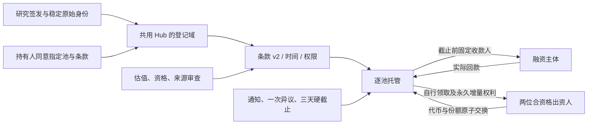
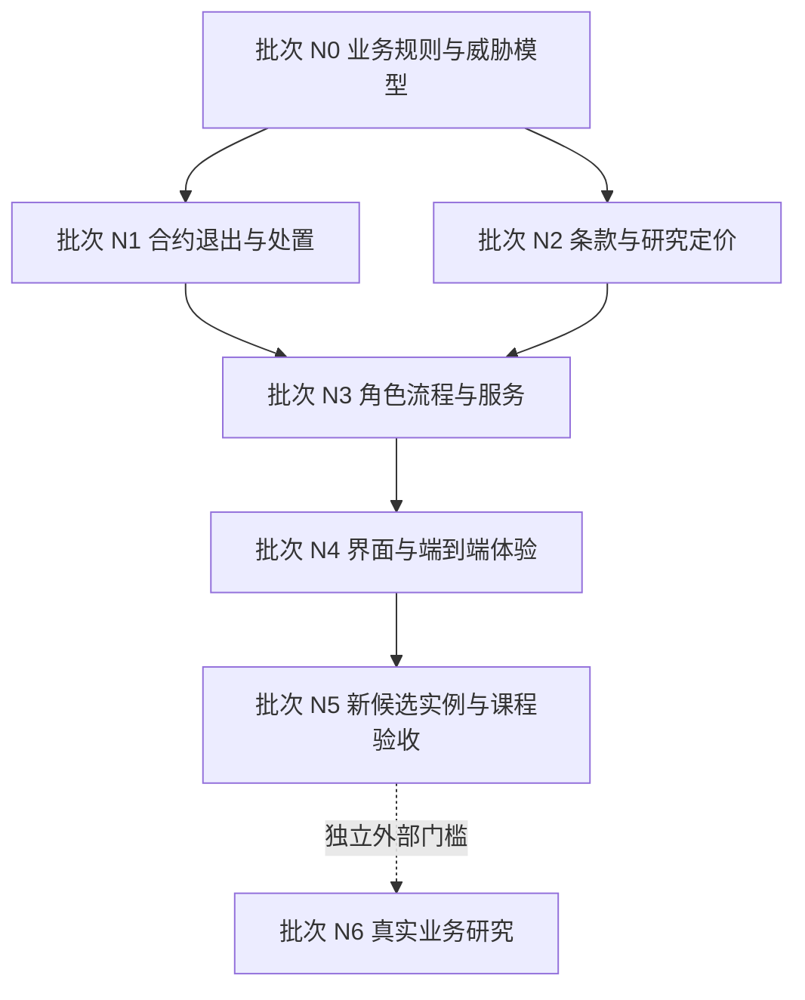

# AgentBL 新一轮开发规划

更新：2026-10-20（Singapore）。状态：**N0～N4 本地验证通过；新v2公共正常/退款/损失及迟到回款三路径通过，179笔检查点、5持仓/17现金事实已对账；两份v2配置已准备，本机服务切换及人工门槛分别验收**。

本轮以 `19efe4e2504fb0b9624b12def29f90eee3fceb6a` 的受控 v5 应用为规划起点，承接 2026-10-18 综合评估中的 CA-01～CA-07 和 CG-01～CG-05。文档整理提交 `c3a5103` 后开始第一阶段产品修改；清理本身未修复产品问题。本地新候选与已部署旧实例分别记录，历史报告、反例、失败日志和部署证据见 [历史材料](history.md)。

以后开发先读本文，再读 [架构](architecture-current.md)、[合约](contracts.md)、[运行与验收](operations.md)。本文是唯一开发任务入口，更新任务状态、决策和验收链接，不再另起 W0～W5、逐日评审、多个版本的规划。

## 1. 本轮要交付什么

**目标：一个可审计、可恢复、权限明确，能够由不同角色完成融资和退出的贸易融资区块链研究应用。** 对课程项目，区块链应实际约束单证控制、条款、托管与资金分配；用户应能理解并独立验证这个约束。

默认演示场景收敛为铜货物、Singapore → Shanghai、研究签发方、一位融资主体及至少两位合资格出资方。使用虚构单据与明确标注的测试代币，正常回款、募集失败退款、违约损失三条路径共享同一产品定义。其他案例保留为定价和解析回归样本，不扩展成多条默认产品主线。

本轮交付应达到：

1. 到期、估值失效、微额回款、重复异议及费用顺序不会造成不合理新增风险或无界冻结。
2. 用户在签名前读到完整条款，并能把内容与钱包授权、链上版本、金额核对起来。
3. 融资方、审查角色和投资者沿明确流程操作；无需懂合约调用或翻找多个实验面板。
4. 超过十个池、RPC 故障、钱包变更、未知交易、重组和恢复均有明确行为。
5. 课程提交包含可复跑演示、独立余额核验、威胁模型、数据库方案对照以及诚实的局限说明。

本轮不新增链、币种、二级交易、自动对冲或自主放款 Agent。x402、MCP、Copilot 和趣味展示作为已有扩展保留，默认导航服从融资主线。真实贸易试点另设外部准入门槛，不作为本轮课程应用完成的前提。

## 2. 为什么使用区块链，以及仍需信任谁

| 问题 | 链上应保证 | 链外责任及边界 |
|---|---|---|
| 同一单证被占用 | 已接入登记域内的唯一控制、版本及质押约束 | 签发方提供稳定身份；跨平台和伪造单证不能由一个 Hub 自动消除 |
| 谁同意何种融资 | 钱包签名绑定链、合约、资产、角色、条款及有效期 | 用户识别、可读披露、授权材料与身份撤销由具体主体负责 |
| 资金是否真的流转 | 实际代币托管、付款与份额原子性、独立领取和退款 | 测试代币不等于美元；现实贸易回款必须由责任方送入资金池 |
| 平台是否可改账 | 参与者可独立验证状态、交易和合约约束 | 治理仍可在授权范围内操作；多个地址不代表独立组织 |
| 材料是否被换过 | 内容承诺、版本和证据复算 | 哈希不证明货物、发票、估值或处置权真实，也不保证原文可用 |
| AI 是否能控制钱 | 确定性规则及明确角色约束资金动作 | 模型抽取、解释和告警需要来源、质量评估及人工接管 |

N0.1 必须写出与“签名数据库 + 平台托管”的对照：平台离线、平台试图改账、投资者独立领取、单个治理者越权时各自会怎样。若所有业务主体都由同一操作员扮演，应如实说明这是研究角色分离，不能宣称已经实现组织间去信任。

## 3. 起点和缺口

当前已有：受控登记与 holder 同意、资格和估值检查、不可转让份额、实际测试代币托管及退出、链账重建、未知交易恢复、证据包、双语 UI、容器和 CI。它们是继续开发的基础，无需重新搭建项目。

规划基线 `19efe4e` 有同提交 CI 运行 [39116478968](https://github.com/liaboveall/Agent-BL-Upgrade/actions/runs/39116478968)。这是历史证据，不给本轮修改自动背书。过去反例在 `b8db411` 上生成；CA-01～04 已在新候选本地关闭，旧实例仍执行旧代码，公共测试网发布属于 N5.2。

| 评估编号 | 优先级 / 当前状态 | 具体问题及触发条件 | 关闭任务 |
|---|---|---|---|
| CA-01 | P1 / LOCAL_VERIFIED；旧实例 OPEN | 已募集但未放款，时间超过 maturity 和估值有效期后，授权运营方仍可首次放款 | N1.1 |
| CA-02 | P1 / LOCAL_VERIFIED；旧实例 OPEN | 处置公告及通知期完成后，任意地址回款 1 原子单位使 `recovery changed`，可重复拖延 | N1.2 |
| CA-03 | P1 / LOCAL_VERIFIED；旧实例 OPEN | 治理解决异议后，同一投资者用相同证据再次冻结处置 | N1.3 |
| CA-04 | P2 / LOCAL_VERIFIED；新候选零费 | 首位投资者领取后，受延时治理控制的费用扣取因 `ClaimsStarted()` 失败；新候选拒绝非零费用 | N0.2、N1.4 |
| CA-05 | P1 / LOCAL_VERIFIED；新候选完整条款 | 确认主要展示 hash，缺少完整责任主体、费用、条件和处置条款 | N2.1 |
| CA-06 | P2 / LOCAL_VERIFIED（N3读路径 + N4整站） | 固定快照分页、指定池、首末页、刷新、新增池、失败重试及钱包变化均已本地验收 | N3.2、N4.1 |
| CA-07 | P2 / LOCAL_VERIFIED | 已修复根部固定宽度，390/768/1280/1440px整页实测；真实手机钱包仍待N5.4 | N4.3 |

P1 为本轮新候选实例发布阻断项；P2 中的费用政策和列表完整性同样必须在发布前闭合。优先级不是已发生攻击或资金损失的判断。

| 研究 / 外部门槛 | 当前状态 | 本轮处理 |
|---|---|---|
| CG-01：单证真实性、债权与实物处置责任 | VALIDATION_REQUIRED | N0.1 明确研究假设；真实业务证据留给 N6.1 |
| CG-02：资方补偿下限与借款人上限 | LOCAL_VERIFIED；商业校准待外部 | N2.2 建立可解释的研究约束和敏感性分析 |
| CG-03：完整角色流程和人工钱包 | LOCAL_VERIFIED；人工待验收 | N3.1本地角色与钱包链路通过；N5.4未参与开发者人工操作待验收 |
| CG-04：独立组织治理和授权恢复 | VALIDATION_REQUIRED | N5.3 验证技术恢复；组织独立性留给 N6.2 |
| CG-05：多池 Live RPC 性能 | PUBLIC_READ_VERIFIED（顺序25池/603秒） | 20次完整读取、8,820次实际JSON-RPC、错误比例0、全列表p95=30.66秒；不等于并发容量、单RPC时延或商业SLA |

## 4. 先确定的业务规则

以下原则由本节末尾的 N0 决策细化。新规则仅适用于控制版本 2 的新候选；控制版本 1 的已部署实例保留原代码及退出语义。

### 时间、放款与退出

- 区分募集截止、放款截止、债务到期、估值有效期和处置通知期。截止比较使用链上时间，精确规定等于截止时是否允许，避免不同层各自解释。
- 到期或超过放款截止，不得增加已放出的本金。估值/来源被撤销或过期时重新核验；重新确认不能悄悄延长投资者已经签署的风险期限。
- 募集成功但未放款、部分放款和融资主体失联都必须有明确退出路径。部分放款时，闲置托管本金、已放出债务和实际回款分别结算，不能仅用一个 `Funded` 状态推定。
- 停止新增风险时保留已成立的退款和领取能力；单证释放须与债务或完成分配的担保责任相符。

### 处置、迟到回款与异议

- 使用可标识的处置版本和分配基准，不能要求一个任何人都可增加的累计回收值在无限等待后保持不变。
- 推荐把已通知的基准分配与增量回款分开记账。原分配在有界流程内完成，新增金额仍公平归属原受益人；不能通过忽略后续入金或长期禁止还款解决活性。
- 如采用累计每份额分配模型，应说明精度、尾差、已领与未领账户、份额销毁后受益权及零份额情形。不能为修复卡住而使后来到账的款项失去合法领取者。
- 异议绑定处置版本、异议编号、提交者和材料。已裁决同一事实不得重复冻结；换一个 hash 不构成实质新证据。
- 明确受理窗口、可延长次数、治理失联和终局规则。链上不能理解证据语义，须由有责任的审核/仲裁角色承担准入判断，并测试该角色缺席时的有界退出。

### 费用与定价

- 课程默认场景采用零平台费。若保留必要处置费或非零费用场景，须在领取开放前原子确定费用和净分配，受签署上限约束；不得依赖治理晚于首笔领取再扣取。
- 区分融资本金、实际到账、到期应付、实际回款、目标兑付、净可分配和已领取；按结算代币的原子整数计算，展示单位换算可复算。
- 区分借款人的可承受成本、资方研究补偿下限和可回收担保上限。没有共同可行区间时拒绝或降额；研究风险分不作为违约概率，目标年化不作为预期收益。
- 研究签发、研究估值和虚构企业在每个关键界面可见。真实行情只能证明某时某来源的观测，不能直接证明这批货的净处置价值。

### N0 决策：业务、角色、攻击者与数据库对照

资产为虚构铜货物、Singapore → Shanghai 的研究提单，融资主体一位、出资人至少两位；标准六位小数测试代币和不可转让份额。签署条款定义的是研究合约里的现金权利，不能推定存在真实美元债权或实物处置权。直接误转代币不计入逐池现金，须独立对账。

| 角色 | 责任和权限 | 仍须信任的链外事实 |
|---|---|---|
| issuer / holder | 稳定单证身份与材料承诺、独立同意质押 | 单证来源、真实货权及接入其他系统的身份一致性 |
| valuer / compliance | 带有效期的研究估值、资格和筛查 | 可兑现的净处置价值、现实主体尽调 |
| operator / attestor | 申请截止前固定收款人放款、记录说明性证明 | 到货与资金来源；证明不能替代合约实收款 |
| disposer / reviewer / governance | 公告、独立地址审核、窗口内裁决 | 证据语义与现实处置责任；不能无限重置冻结或事后加费 |
| investor / public caller | 自己签名、退款、领取；到期现金退出 | 自己保管钱包、可用的区块链 |
| platform / guardian | 授权材料、账本重建、停止新增风险 | 不代签，停止新增风险不取消已成立退出权 |

攻击者可反复送入 1 原子单位、抢先领取、换 hash 或轮换参与者争议、重放旧签名；也考虑角色撤销/失联、平台错报、RPC 故障/重组和非标准代币。链永久停止、全部治理与签发方串谋、代币发行方冻结、未接入 Hub 的跨平台重复融资仍在信任边界之外。研究地址由同一操作员控制，不能宣称组织间去信任；真实性与独立保管证据留给 N6。

| 场景 | 本研究链上约束 | 签名数据库 + 平台托管 |
|---|---|---|
| 平台离线 | 用户可直接触发退款、到期现金退出及领取 | 签名可验证旧账，无法强迫平台托管账户付款 |
| 平台改账 | 本地改动不改变链上金额，可从事件重建 | 能发现签名不一致，托管方仍控制转账 |
| 投资者独立领取 | 固定规则只付给该受益人 | 依赖平台执行或独立托管规则 |
| 单个治理者越权 | 至少两批准及延时，无原始资金调用逃逸 | 数据库也能多签审批；差别在托管执行的独立性 |

### N0.2 决策：第一阶段可执行政策

1. **时间 / I04、I05、I09、I10**：签署 `subscribeUntil < disburseUntil < maturity`。认购可等于募集截止；放款必须严格早于放款截止与到期。每笔放款重新核验尚未到期的估值、valuer、单证、资产白名单和筛查来源。刷新来源不能延长已签期限。成功募集但未放款，任何人可在放款截止时关闭并领取本金；失败募集仍退实际成本。
2. **部分放款 / I01、I05**：P=实收认购本金，L=放款，G=已售份额×每份目标；到期现金目标 `T=P+ceil((G-P)×L/P)`，待偿债务 `max(T-(P-L+实际回款),0)`。闲置本金不计溢价。P=8,000,000、G=10,000,000、L=3,000,000，则 T=8,750,000；闲置 5,000,000 加回款 1,000,000 可分配 6,000,000，损失相对 T 为 2,750,000。L=0 则 T=P，全放款则 T=G。
3. **处置 / I06、I07、I09**：每实例每池一份不可替换的处置版本；公告固定 1 天通知期和公告后 3 天硬截止。快照保留当时现金，终局合并已收到增量，不因微额或大额回款重开。独立审核后可在通知期结束终局；最迟硬截止任何人可按确定性现金规则终局，审核和治理缺席不阻塞。放款后运营未公告，到 maturity 任何人可发起同样的现金退出。该现金结算不证明现实货物已经处置。
4. **异议 / I07**：参与者在通知窗口内最多触发一次冻结；治理可在硬截止前裁决，最多补一天通知且不越硬截止。相同事实、换 hash 或轮换参与者均不能再冻结。新材料在同一案卷由审核/治理接收并保留追加审计；hash 不作语义鉴定。终局后的新事实可以补偿性回款和链外救济，不能撤回已付分配。
5. **分配与尾差 / I01、I02、I06、I08**：认购获得永久槽位，每原子单位按槽位顺序循环归属；领取顺序不影响权益。每账户至多 32 段不连续认购，连续段合并；最多 1,000,000 份，整轮尾差小于 1 TEST_USDC，默认 10 份小于 0.000010。两人各 5 份，现金 4,000,001 时各得 2,000,001 / 2,000,000；再收到 9，累计各 2,000,005。首次领取烧毁份额，永久槽位不烧毁，后续到账继续分配。没有无人领取的公共尾差；零认购池不能接收回款。
6. **费用 / CA-04、I08**：新候选只允许 `maxFee=0`；创建时拒绝非零费用条款，资金池也拒绝扣费，无需等治理或费用地址成功接收。非零处置费不是本版本的已实现选项，未来必须另行设计原子净额结算。
7. **跨层 / I03、I10～I14**：Rights 签名域 v2 加入放款截止；Title 域仍 v1，以新 Registry 地址隔离。现金追加事件先于快照；增量领取的 `sharesBurned=0`。旧 v1 使用冻结 ABI/runtime，仅允许读取及既有退出，关闭新风险入口。未知交易、重组、材料授权与恢复沿用已有机制并联合回归；不能据此提前关闭 N2～N5。

正反例：截止前放款 / 等于或晚于截止拒绝；真实到账 / 仅证明不能造现金；公告后 1 原子回款 / 不重置通知；首次异议 / 重复及伪新 hash 不重开；首次领取 / 烧毁后仍分配迟到款；零费 / 非零签署拒绝。所有金额为测试代币原子整数，1 TEST_USDC = 1,000,000 原子单位。

## 5. 必须维持的不变量

新增测试应围绕下面的性质和反例，不能只复制实现分支。将实际业务规则确定后的金额例子写入测试，并覆盖直接合约调用。

| 编号 | 必须成立的性质 | 重点验收 |
|---|---|---|
| I01 | 既定标准代币范围内，逐池托管 = 认购入金 + 回款 − 放款 − 退款 − 领取 − 已付费用 | 多投资者、亏损、部分放款、迟到回款和尾差；误转单列处理 |
| I02 | 份额发行、持有、销毁及分配权守恒；相同 ID 不跨实例混用 | 两个部署的同号池、份额销毁后增量回款 |
| I03 | 每笔认购的实际付款与份额同时成功或失败 | allowance、拒签、回滚、非标准代币 |
| I04 | 没有合法权限、资格、有效条款和完整绑定时不能增加风险 | 越权、撤销、过期、旧签名和错误网络 |
| I05 | 时间经过即产生合约限制，不依赖有人先调用违约标记 | 放款截止前/等于/后、估值失效、部分放款 |
| I06 | 公告后的敌对微额回款不能无限重置原分配；新增金额不丢失 | 反复微额与大额迟到回款、多个受益人不同领取顺序 |
| I07 | 异议有救济，也有明确终局和失联规则 | 重复事实、伪新 hash、多方轮流争议、仲裁缺席 |
| I08 | 净费用及每人权益不取决于谁抢先领取 | 零费、上限、亏损、结清前后与交易排序 |
| I09 | 停止新增风险、身份撤销或服务故障不会扩大已有资金冻结 | 退款/领取可达，重新核验与链上退出约束明确 |
| I10 | 可读条款、签名、报价版本及链上承诺对应同一对象 | 材料缺失、篡改、报价变化、钱包/模式切换 |
| I11 | 未知结果不自动重签；确认绑定规范块和原交易 | nonce、漏存 hash、超时、重组、刷新和恢复 |
| I12 | 私有材料需授权；承诺不冒充真实性认证 | 会话隔离、过期、脱敏、下载、日志和静态资源扫描 |
| I13 | 页数、缓存和 RPC 部分失败不改变列表/持仓的语义完整性 | 25 个以上池、指定池、分页、同块快照、失败重试 |
| I14 | 备份与恢复保存现金事实和可核验证据；不把空目录当新系统 | 缺历史拒绝启动、错误密钥、断写、重组后重建 |

直接向合约误转、代币发行方行为和链停止等范围要写明，不能把守恒断言扩大成代码尚未保证的任意资产安全声明。

## 6. 开发批次与依赖

按相连的数据流成批完成，批次末运行统一回归；无需把每个小任务拆成一轮交付。未进入的任务保持 `TODO`。N0/N1 的 `VERIFIED` 仅对应本节要求的本地证据，不等于 N5 的 CI、测试网、容器或人工验收。

### N0 / P1：先使产品规则可实现、可验证

| 任务 / 状态 | 工作与主要位置 | 完成条件 |
|---|---|---|
| N0.1 / VERIFIED | 在本文及架构中固定资产、融资债权、角色、信任假设和攻击者能力；对照 `src/rights/`、Registry、Hub | 一页业务图和角色表；能解释链与数据库的差异、域内防重复边界、研究主体与真实组织的区别 |
| N0.2 / VERIFIED | 定义时间、未放款退出、迟到回款、异议终局、费用、尾差和净债务政策 | 每项有正例/反例和有界时间；两位投资者、部分放款、亏损及迟到回款算例可手工复算；CA-04 决策明确 |

依赖：无。统一验收：规则逐条映射 I01～I14，注明尚待链外责任方证实的假设。此批不能用修改 UI 提示替代合约规则设计。

### N1 / P1：修复核心协议并证明资金能够退出

| 任务 / 状态 | 工作与主要位置 | 完成条件 |
|---|---|---|
| N1.1 / VERIFIED | CA-01；`RightsController.sol`、`RWAOfferingPoolV5.sol`、签名条款与 ABI | 首次/部分放款在各时间边界被正确允许或拒绝；过期估值与撤销来源直接调用被拒；未放款本金可有界退出 |
| N1.2 / VERIFIED | CA-02；处置分配基准、增量回款与受益权记录 | 连续多轮 1 原子单位回款不能重启通知期；正常大额迟到回款仍公平分配；已领取/销毁份额不丢后续权利 |
| N1.3 / VERIFIED | CA-03；异议版本、受理及终局状态 | 已处理事实不再冻结；伪新 hash 和多个角色轮流重提不能无界拖延；真实新证据可按规定救济；审核/治理失联有明确结局 |
| N1.4 / VERIFIED | CA-04；零费策略、可选必要费用及结算净额 | 签署费用上限与净分配一致；首位抢先领取、不同领取顺序、亏损、零费和费用收款失败不破坏公平或退出 |
| N1.5 / VERIFIED | `hardhat/test/` 与本地 EVM/HTTP 集成；随机事件序列、敌对调度、资金守恒 | CA-01～04 的旧触发序列变为新规则下的反向回归；I01～I11 有跨函数验证；保留失败种子和金额轨迹 |
| N1.6 / VERIFIED | 构造过程、字节大小、版本/部署约束；`hardhat`、`src/chain/`、部署脚本 | 标准 EVM runtime/initcode 大小限制均满足；不得调高本地上限掩盖问题；生成新部署和旧实例保留退出方案 |

依赖：N0。N1.2 与 N1.3 应一起审查，防止一个修复重新引入另一个冻结路径。统一验收：Solidity + 资金/权利本地 EVM/HTTP 回归通过；新业务规则同步到 schema、ABI、签名域、账本和计划构建器。

### N2 / P1：把链上承诺转成用户能理解的融资产品

| 任务 / 状态 | 工作与主要位置 | 完成条件 |
|---|---|---|
| N2.1 / VERIFIED | CA-05；`src/rights/`、`src/evidence/`、controlled API、`web/src/lib/controlled.js` 与确认面板 | 提供可取回、版本化、可复算的完整条款；含责任主体、测试资产、募集/放款/到期、费用、收益/损失、处置与异议；材料缺失、hash 不匹配或报价变化即阻止旧确认 |
| N2.2 / VERIFIED | CG-02；`src/core/pricingEngine.js`、schema、来源说明和 UI 解释 | 明确资方研究下限、借款人上限、担保和期限约束；成本/毛利来源可见；无可行区间拒绝或降额；低利润/高资金成本/高损失压力有敏感性表 |
| N2.3 / VERIFIED | `src/provenance/`、Agent 抽取/估值、风险与数据状态 | 关键字段标明 live/stale/fixture/unavailable 及适用范围；模型失败进入可见人工接管；风险分不冒充概率，目标回报不冒充预测；未测 provider 不标为通过 |

依赖：N0，条款最终结构对齐 N1。统一验收：同一份条款从后端计算、UI 阅读、钱包签名到链上 commitment 可独立复算；定价以确定性策略约束，LLM 文本不能改资金参数。

### N2 实现决策与证据边界

- 公共融资条款采用 `agentbl-financing-disclosure-v1`，与加盐私有提单分开。铜货物及Singapore→Shanghai研究场景、责任地址、六位小数测试资产、金额、募集/放款/到期、零费、部分放款目标、损失、一次异议、三天终局、永久槽位及迟到回款共同形成 canonical Keccak 承诺；链上 `policyHash` / `disclosureHash` 再进入 Rights v2 EIP-712。修改任何内容都要新 revision、新哈希、重新绑定材料及两位当前独立地址审核。公开包不包含私有提单、salt 或业务会话。
- 创建公开包必须是材料的签发主体。发行计划只接受已审材料对应的完整包和同一 chain/controller/pool。GET `/api/controlled/offerings/:id/terms` 在同一规范块核对原始 terms、当前价格/份额/报价版本、holder、治理、valuer 与各角色；缺包、篡改、角色失效、链上报价变化及重组均拒绝。认购准备及广播检查保存的审阅哈希和报价版本。前端独立复算 canonical 哈希和 EIP-712，勾选完整审阅后才允许钱包确认；钱包/模式变化撤销审阅。已成立的退款/领取不依赖条款下载。
- `disclosureFromPricingQuote` 将可开放确定性报价的四位单价转换为六位原子整数，并固定 supply、target 和零费，拒绝暂停报价。`atomic_economics` 提供份额×单价、目标与补偿的精确整数，便于离线复算。已有经审核的研究固定金额场景仍可构建条款；这不表示任意手工条款已经通过行情或商业定价审查。完整角色创建界面属于 N3。
- 资方研究年化补偿下限 = 资金成本 300 + 运营 100 + 损失压力缓冲 100 = 500 bps；均为未校准研究假设，不能从风险分推断违约概率。借款人成本上限 = min(声明毛利×85%, 实际募集×期限年化上限)，共同上限再受担保净值减本金约束。无共同区间直接暂停；整数份额/单价确定后再次检查下限、毛利、年化、担保和短缺。参数进入证据哈希；schema 也验证可开放报价的补偿约束。
- 敏感性表固定基准、毛利降至25%、资金成本+10个百分点、损失压力缓冲+20个百分点；显示下限、共同上限和拒绝结果，不把这些情景当概率预测。invoice/cost 标为声明/研究样本，collateral 为规则估算，market 区分 live/stale/fixture/unavailable，risk 明确为压力指标。空值不能自动变成零成本；无成本时12%毛利是显式估算。
- 模型异常与未提供必要证据的输出分别标 failed/incomplete，保留可见人工接管与确定性参考；不沿用模型的无依据解释，不返回 provider 原始异常，不把回退当 provider 验收。失败/不完整估值在两个 Agent 入口中分别暂停或 HOLD_FOR_REVIEW，上传流水线保留 VALUATION_REVIEW finding，离线重放维持同一接管动作；付费估值报告透传状态并在双语报告界面提示。未执行真实 provider 质量验收，其状态始终未验证。

### N3 / P1～P2：补齐角色工作流和服务读写边界

| 任务 / 状态 | 工作与主要位置 | 完成条件 |
|---|---|---|
| N3.1 / VERIFIED | `src/app/rightsRoutes.js`、`controlledRoutes.js`、审核与计划服务，前端角色入口 | 签发→持有人同意→估值/审查→发行→认购→放款→回款/处置→领取有明确负责人和下一步；每个关键动作有可读预览、权限失败原因及回执；钱包逐次授权，服务不越权代签 |
| N3.2 / VERIFIED | CA-06、CG-05；分页/指定池/持仓接口、链上快照、RPC 并发预算 | 本地至少 25 池，跨页无遗漏/重复；响应标注快照与时效；有边界的并发、超时、限流和重试；部分查询失败不显示为零持仓或完整成功 |
| N3.3 / VERIFIED | `src/ledger/`、身份会话、材料权限和交易意图恢复 | 模式/钱包/链/条款变更使旧授权失效；未知交易不重复付款；重组可回退重建；租户隔离、附件授权、错误响应与日志不泄密 |

依赖：N1、N2 的业务结构稳定。统一验收：真实本地 EVM + HTTP + 钱包适配器联合完成正常、失败退款和损失路径；按实例核对链余额、事件、持仓、审计和 UI。

现有单 Node + 本地 JSONL 存储可继续使用，保留现金事实优先、快照可重建和单写入者约束。没有实际多进程/吞吐需求前不先换数据库；若变更，必须先写迁移、幂等和回滚设计，不得丢弃当前 runtime。

### N3 实现决策与证据边界

- 业务角色增加 `valuer/operator/attestor/disposer`，保留历史 `custodian` 兼容入口；链上权限仍逐次检查。管理员登记主体后，用户可为自己的已登记身份领取五分钟钱包挑战，钱包 EIP-712 证明后获得一小时业务会话；普通未使用挑战每身份最多三份，退出挑战复用一份并与新增风险限额分开，不能自报组织或角色。浏览器仅在内存持有会话，钱包/模式变化清除授权与预览；原交易定位符按链、池实例和钱包存储，不存会话 token。
- 角色工作台按组织列出材料，显示单证、签发、审查、holder 同意、发行、资格、认购、放款、回款/处置和退出的责任与下一步。完整公开条款和研究签发/估值包可以文件交接、钱包签名并导出；材料创建、双审、发布、链上计划、精确回款 allowance 和回执有入口。投资者通过资金池及持仓入口完成认购/退出。它仍是研究工作台，N4 负责默认导航、整体布局和完整体验整理；N5.4 负责未参与开发者的人工钱包操作。
- 权利计划在准备前检查链上权限和可执行性，明确展示授权钱包、调用合约、金额和资金收款方；签发、资格、报价同意等预览包含被授权对象与有效期，完整新条款先独立预览再保存，不把导入旧条款当作新确认。广播前必须登记一次 checkpoint，并重查主体/会话、模式代次、材料 revision、独立审查、条款/报价、实例、calldata 和 nonce。取回/附加原回执允许同主体重新登录；未知结果只查原交易，不能把恢复变成自动重发。模式切换期间的异步准备也拒绝保存授权。
- 资金意图需要同一主体的钱包会话；其他钱包/主体不能读取、附加或广播该意图。新草稿绑定模式代次、会话和创建区块，不把旧的同金额事件归给新操作；存在未对账广播时阻止该钱包再次发送。被撤销主体仍可用原钱包重新签名领取“仅退出会话”，办理已有退款、领取和原资金交易对账；此会话无材料读取/角色权限，禁止认购及权利新增风险。退款与领取无需重新下载完整条款，停止新增风险不能剥夺已成立退出权。
- 池列表支持游标分页及指定池；默认十条、最大二十条。后续页同时携带 `block_number/block_hash`，同一页所有字段及控制绑定固定于同块，末尾复查规范哈希；旧快照不包含后来新增池。结果显式返回页级 `complete`、`failures`、`total_pools`、`next_cursor`、快照/时效和读取统计，失败池不冒充零金额。基础页面已能到达第11/21/25池及按编号查询；N4.1 仍负责整站体验验收。
- 持仓逐页发现余额、保留已烧份额后的现金权利；固定历史页从追加现金事实投影到同一确认块，不用新现金事实配旧余额。重组/失败时维持未知金额与对账提示。界面聚合所有持仓页；未对账金额显示 `—`，失败响应不显示“没有发行”。
- 读调度器共享并发上限6、等待队列上限240、单读取十秒、每个读预算窗口二十秒（含排队；组合HTTP路径可能包含多个窗口）及一次瞬态重试。超时的底层 RPC 在实际结束前继续占槽，不因 HTTP 超时堆出无限后台请求；拥塞/不完整返回503或页级失败。列表/持仓有调用预算，账本重建单独保留最多10,000次读取预算，原交易恢复最多2,000次读取且仍受500块搜索范围约束。`read_metrics` 是逻辑读取尝试，不等于 JSON-RPC 传输数；N3本地 EVM另记录实际RPC数和时延，公共 RPC p95/容量留给N5.3。

### N4 / P2：把功能整理成一个可用的应用

| 任务 / 状态 | 工作与主要位置 | 完成条件 |
|---|---|---|
| N4.1 / VERIFIED | CA-06；`ControlledFinancePanel.jsx` 的分页、指定池查找、刷新和错误状态 | 页面可到达第 11、21、25 池；首/末页、新增池、重试和钱包变更不漏项；列表数据与链上快照可追溯 |
| N4.2 / VERIFIED | 默认导航、角色待办、资产详情和融资详情 | 主路径无需理解 W 编号或实验术语；金额、角色、条件、进度、可操作步骤及受阻原因同屏可理解；x402 与融资资金保持明确边界 |
| N4.3 / VERIFIED | CA-07；根布局、导航、表格、条款、确认框与持仓 | 修复整页固定宽度；390/768/1280/1440px 关键内容可读且操作可达，表格局部滚动不导致全页不可用；手机真实钱包未验收前不宣称已支持该能力 |
| N4.4 / VERIFIED | 双语、可访问性及异步重绘；`tests/browser/` | 中英文完整角色流程；键盘、焦点、弹窗、加载/空/错态、钱包拒签和模式切换；以整页截图及实际操作验收，不能只测孤立面板 |

依赖：N3。统一验收：桌面与 390px 整页实测，浏览器测试无不可解释失败；未覆盖的手机钱包行为单独标为未验收。

### N5 / P1：形成可交付的新候选版本

| 任务 / 状态 | 工作与主要位置 | 完成条件 |
|---|---|---|
| N5.1 / VERIFIED（dcf7c8c 的15项适用CI成功） | 干净安装、完整回归、依赖审计、构建和容器 | 从新 checkout 复现；固定技术源码摘要及提交；CI 必需检查全部结束；初始失败、重跑原因和仍存在的跳过如实保留 |
| N5.2 / IN_PROGRESS（公共三路径 VERIFIED；配置切换候选待部署） | 新测试网候选部署、配置切换和独立只读核验 | 新合约/签名域/版本有清单；核对 runtime 与绑定；完成正常回款、失败退款、违约损失、多投资者及迟到回款；链上金额与账本一致；旧实例退出不受影响 |
| N5.3 / IN_PROGRESS（公共25池读取及实际数据同机恢复 VERIFIED；独立接管待验） | 真实查询容量、持久存储、停止/恢复、密钥与监控 | 对 25+ 池读路径记录 RPC 数、p95、错误率及恢复；备份/恢复与告警可复跑；不自动抢占租约；零广播恢复与签名权接管分开验收 |
| N5.4 / IMPLEMENTED（材料完成；人工待验） | 人工钱包验收、课程讲解和演示入口 | 一位未参与开发的人按说明完成正常/退款路径，记录实际签名与独立余额核验；另演示损失和未知交易恢复；说明区块链作用、信任假设和未通过的外部门槛 |

依赖：N1～N4。统一验收分为本地、同提交 CI、公共测试网、部署、人工五类，分别给结论。只使用本机 Docker 与受控测试网作为部署目标；用户已经明确不部署公网服务器。

### N6 / 条件性研究：真实业务准入

| 任务 / 状态 | 进入条件 | 完成条件 |
|---|---|---|
| N6.1 / BLOCKED_EXTERNAL | 有愿意参与的签发/承运、融资、出资和法律/处置责任主体 | 对真实单证来源、适用制度、债权、估值、货物接管、回款及损失责任取得独立材料；组织明确接受业务流程与风险 |
| N6.2 / BLOCKED_EXTERNAL | N6.1 范围明确，独立组织参与 | 独立密钥保管、身份审核、撤销、失联、轮换、仲裁、值班和签名权恢复有实际演练与负责人 |

N6 不因自动化测试、模拟组织、多个地址或人工演示完成而自动关闭；它不阻止研究应用和课程成果交付。

## 7. 新旧合约、身份及数据的迁移约束

当前受控核心不是可由部署脚本热更新的代理。N1 修复必须形成新的合约实例，不能把当前地址对应的旧代码标成已修复。

1. 保存旧实例链、地址、部署块、ABI、签名域和历史资金/份额状态；旧实例保持可读与已有退出操作，不重新募集或增加风险。
2. 新实例使用独立版本和账本命名空间。新旧同号池、旧报价、旧签名和交易意图不可互认。
3. 说明新 Registry 与 Hub 的关系及跨实例防重复占用方式。共用 Hub 需审核授权；新 Hub 不能把同一真实资产重新视为无占用。研究场景也应测试迁移期间的重复登记。
4. 切换前核对 artifact、构造参数、代码大小、角色、延时、资产白名单、EIP-712 域和 runtime。更新 `public/application-config.json` 与 `public/rights-instance.json` 必须成对验证。
5. 旧部署 CLI 固定读取既有v1研究实例，不得以新artifact续跑。新N5 CLI使用独立candidate、部署目录和journal；已有 `n5-v2-20261019` 必须按原检查点恢复，不能换实例ID重新部署代替恢复。不得删除旧checkpoint、重用原nonce记录或更换密钥伪装续跑。
6. 服务器/前端回滚不等于链上交易回滚。保留配置快照、加密备份和旧镜像；失败时先停止新风险，再对账和依法定协议退出，不能以源码回退撤销既成付款。

## 8. 验收证据和状态维护

任务状态：`TODO → IN_PROGRESS → IMPLEMENTED → VERIFIED`。`IMPLEMENTED` 仅指修改完成；`VERIFIED` 必须有该任务要求的证据。真正依赖外部组织/人工且无法由代码完成的事项保留 `BLOCKED_EXTERNAL`，不要代填通过。

每次开始开发记录 HEAD、工作区和所选任务。每个相连批次结束时在本文末尾的交付记录追加：任务 ID、决策、代码提交/源码摘要、执行命令、退出码、证据位置、失败与跳过、未完成项。详细日志进入 `artifacts/<类别>/<时间>/`，不重新在 docs 下建立逐阶段报告树。

| 证据层级 | 至少记录什么 | 不应据此声称 |
|---|---|---|
| 本地 | 平台、Node、源码摘要、命令、退出码、测试跳过、金额轨迹 | 已部署、同提交 CI 或真实业务通过 |
| CI | 完整提交、运行链接、必需检查状态及 artifacts | 另一提交或重跑前的失败从未发生 |
| 测试网 | chain、地址、交易、规范块、确认数、runtime、绑定和余额复算 | 真实货权、真实美元利润或组织独立 |
| 部署/恢复 | 镜像版本、配置、持久卷、备份、密钥边界、故障与恢复结果 | 同机容器恢复就是异地组织接管 |
| 人工/业务 | 谁实际完成什么、钱包/角色、操作记录及责任材料 | 模拟钱包、机器人 HTTP 接收等于人工业务认可 |

本地常用门禁与完整验收入口见 [operations.md](operations.md)。普通 Node 套件中明确跳过的本地 EVM 场景，应由对应独立集成入口实际运行；不能把 SKIP 当 PASS。

发布阻断：CA-01～CA-05 未关闭；CA-06 导致合法池不可访问；现金/份额守恒失败；标准 EVM 大小超限；未知交易可重复扣款；缺历史仍能空启动；新部署与源码不一致；对真实业务状态作出超出证据的宣称。

## 9. 开始下一轮的具体入口

下一次从 **已完成公共资金路径的原检查点** 继续：先核对最新交付记录、当前完整提交和全部15个适用CI作业，再运行 `npm run deploy:n5 -- status n5-v2-20261019`。该实例已有25池、179笔确认交易，正常、退款、损失及迟到回款均已通过；公示期已实际届满，不再等待。原candidate和journal必须保留，已确认步骤不重新部署或重发。随后按本批配置切换收据核对实际运行的镜像、成对配置、新vault/账本及旧v1退出服务；重新核对账本、备份与容量。

N5.2资金门槛通过后，两份公共配置已准备为v2；本机切换必须同时接入新实例的`application/rights`材料vault和独立`controlled-capital-<新Pool>`账本，不能只把旧w5-app的地址换成新v2。保留旧v1配置、材料、账本及可用退出入口，并验证新旧实例隔离。本条记录时3000仍运行旧v1配置，实际切换另凭部署收据确认。数据恢复、签名权恢复和人工钱包分别验收。2026-10-19用户已明确授权本轮全部提交、推送、部署及测试广播，无需重复请求。N5.3同机恢复不代替异地接管，N5.4材料不代替人工。目标仍限本机Docker与受控测试网，不部署公网服务器。

建议读取顺序：

1. 本文N5条件和最后的N5交付记录；`artifacts/n5/2026-10-18T15-49-55-911Z/`、`artifacts/n5-release/2026-10-18T15-49-39-609Z/`，以及保留的上一候选与原始失败记录。
2. `docs/operations.md`、`scripts/test-n5.mjs`、`scripts/clean-build-w5.mjs`和CI适用检查。
3. `scripts/inspect-n5.mjs`及其无签名candidate.json、`scripts/prepare-rights-candidate.mjs`、原部署checkpoint与旧实例冻结ABI。
4. 合约artifact/runtime/构造大小、签名域、Hub与Registry绑定和两份公共配置；当前公共配置尚未切换。
5. `scripts/test-n3-evm.mjs`、`tests/browser/n4.spec.js`及角色工作台，整理可复跑课程说明与未参与开发者人工操作清单。

### 批次交付记录

#### 2026-10-18 / 第一阶段 N0 + N1 / 本地 VERIFIED

- 起点：HEAD `c3a51031e6f1d5d855e04f7fd11174882ed8833f`，开始时工作区干净；本批未提交/推送，未广播外部交易，未改两份公共配置或原 runtime。
- 完成：N0.1、N0.2、N1.1～N1.6。决策与金额算例见第 4 节；新 Controller v2、独立放款截止、来源复核、未放款退出、部分放款净债务、固定处置基准/三天终局、一次异议、零费、永久回款槽位及零份额增量领取已连通 Solidity、签名/schema、ABI、计划、HTTP、钱包和追加账本。
- 精确技术源码摘要：`bfc25f4ee61e41feda63ff15a8a72584378f8c9f59e99a67d4d7ec47443daea3`；源码清单、Windows x64 / Node v26.8.1 环境、12 条命令的退出码、开始/结束时间见 [统一结果](../artifacts/n1/2026-10-18T12-17-02-759Z/result.json)。回归前后技术源码摘要相同；本记录等 docs 叙述不在技术摘要范围。
- 执行 `npm run test:n1`：lint/check/build、应用、合约、W2/W3/W4/W5、浏览器、Agent、preflight 共 12 项命令均退出 0。应用 1,111 PASS / 2 SKIP（W2/W3 套件及 W4 EVM 场景另由独立入口执行）；合约 79 PASS；W2 5、W3 5、W4 21、W5 13 均 PASS/0 SKIP；浏览器 18 PASS；Agent 20/20，live LLM SKIP；预检 66 PASS / 0 WARN / 4 SKIP / 0 FAIL。4 项跳过为 Live 配置前提、facilitator、RPC 和 Live gas 就绪，未计为通过。
- 代码大小：Controller runtime 23,757、完整 initcode 26,204 bytes；Pool runtime 23,658、完整 initcode 25,445；RecoveryEntitlements runtime 1,207、initcode 1,254。保持 Solidity 0.8.24 / Paris / viaIR / optimizer 200，不提高 24,576 / 49,152 标准限制。未签名新部署计划实际在本地 EVM 执行并验证地址、所有权、门禁和共用 Hub 防重复。
- 旧实例连续性：冻结的七份 artifact 与原部署基线摘要全部匹配；重新编译后用冻结 v1 加载、拒绝新风险计划并完成旧退款的真实本地 EVM 回归通过，见 [基线核对](../artifacts/n1/2026-10-18T12-17-02-759Z/legacy-artifact-baseline-check.json)。这不是本轮公共链只读运行或新部署证明。
- 初始失败没有覆盖：[失败历史](../artifacts/n1/2026-10-18T12-17-02-759Z/failure-history.json) 保留最初大小超限、optimizer-only 未解决、旧预期断言、unused import、finally lint、退役 matcher、Node 零执行及缺 Chromium 的日志/摘要。首轮统一结果为 FAIL；修正后使用安装的 Edge 实测，不通过补填结果关闭失败。
- 浏览器：[证据目录](../artifacts/n1/2026-10-18T12-17-02-759Z/browser/) 保留中英文 1280/390px 零份额增量领取、键盘确认和钱包变化撤销截图；材料为受控 HTTP/钱包桩，无浏览器真实签名。整页 1100px 最小宽度仍存在，CA-07/N4.3 未关闭。

| 不变量 | 本批可复跑的验收入口 |
|---|---|
| I01～I03 | `hardhat/test/nextProtocol.test.js` 三个种子 17 / 20261018 / 11259375、逐原子独立分配模型；原有多池/多资产、实付/份额原子回滚回归；W2 对账 |
| I04、I05 | 截止前/等于/之后、首次/部分放款、估值失效、角色/来源撤销；未放款和无运营角色现金退出 |
| I06～I09 | 连续微额及大额迟到回款、烧毁后受益权、不同领取顺序、一次异议/伪新 hash/轮换角色、审核和治理失联、零费及精确尾差 |
| I10、I11 | JS/Solidity v2 条款哈希、v1 旧签名拒绝；W3/W5 实际 HTTP + 本地钱包交易、丢 hash 恢复与规范块重组；不重复签名 |
| I12～I14（维持既有边界） | W4 授权证据/真实本地 ERC-3009 和锚定；W5 加密备份、丢历史拒启动、断写/重组与独立 OS 恢复；不推定真实组织验收 |

未完成且不随本批关闭：N2～N6、同提交 CI、干净安装/容器全验收、新公共测试网候选、人工钱包、真实组织与真实资金。下一入口为 N2；旧实例本身的已知合约问题需由新实例发布及保留退出政策处理。

#### 2026-10-18 / 第二阶段 N2 / 本地 VERIFIED

- 起点：HEAD `c3a51031e6f1d5d855e04f7fd11174882ed8833f`，继承工作区中已完成 N0/N1 的未提交修改，未回退或覆盖；本批仍未提交/推送，未改两份公共配置、原部署 checkpoint 或开发者 runtime，未广播外部交易。
- 完成：N2.1～N2.3。完整公共条款、私有材料双审绑定、canonical / EIP-712 复算、同块角色与参数检查、签名前/认购准备/广播时重验、报价到原子金额条款构建、双方研究定价约束、敏感性表、字段来源和模型人工接管均已实现。默认铜货物及 Singapore→Shanghai 场景进入文档承诺，单证登记编号和材料承诺可读；其他资产不得冒用默认研究说明。
- 最终技术源码摘要：`3f1915c18b57454aad0d609f965e32768d993bab87d6bd6303c8dae96c5e72f4`。`npm run test:n2` 12条命令均退出0，回归前后源码一致；Windows x64 / Node v26.8.1 / 系统 Edge。精确清单、命令、时间和结果见 [统一验收](../artifacts/n2/2026-10-18T13-18-38-218Z/result.json)，详细失败及两轮被后续代码审阅变更淘汰的结果见 [追加失败历史](../artifacts/n2/2026-10-18T13-18-38-218Z/failure-history.json)。docs 叙述不在技术摘要范围。
- 验证：应用 1,119 PASS / 2 SKIP；合约79 PASS；W2=5、W3=5、W4=21、W5=13，均 PASS/0 SKIP；浏览器24 PASS；Agent 20/20 gates（44段对话/100回合、1,350定价检查、26注入案例），live LLM SKIP；预检66 PASS / 0 WARN / 4 SKIP / 0 FAIL。应用中的独立 EVM 套件跳过由对应 W2/W3/W4 入口实跑；预检跳过为 Live 配置/facilitator/RPC/gas 前提，不计通过。
- 条款证据：W3 实际本地 EVM + 已认证 HTTP + 本地钱包逐次签名，完成材料、发布、下载、链上 commitment 比对、缺审阅哈希拒绝、nonce 检查、实际认购及独立领取；W5 使用实际钱包适配器与受控资金路由覆盖未知结果/重组/回款。8项N2专题测试包含角色撤销、跨实例/同块重组、公开材料篡改、确定性报价原子金额、160个压力组合、来源和两个 Agent 入口的失败接管。未用浏览器钱包桩代替实际本地 EVM 验收。
- 浏览器：[最终截图与JSON](../artifacts/n2/2026-10-18T13-18-38-218Z/browser/) 实测中英文桌面/390px的完整条款、键盘勾选、取消、下载链接、缺包/篡改/改价阻断，以及研究定价敏感性表；截图已目视复核。浏览器为 HTTP/Ethereum 桩，没有真实浏览器签名；390px 整页仍受既有1100px根布局影响，N4.3/CA-07未关闭。测试服务退出，4187端口无监听。
- 离线复算：实际执行 `npm run terms:verify -- artifacts/n2/2026-10-18T13-18-38-218Z/offline-fixture-terms.json` 退出0，见 [结果](../artifacts/n2/2026-10-18T13-18-38-218Z/offline-verification.log)。独立输出本金8,000,000、目标10,000,000原子单位，并保留 `chain_state_verified:false`、`external_rights_verified:false`。
- 初始问题均保留：继承 NODE_TEST_CONTEXT 导致零执行的结果未计通过；计划器新字段白名单、Hardhat并发缓存冲突、schema诊断覆盖以及同步异常测试写法均有原日志。前两轮12条命令虽全部退出0，因审阅中补充人工接管透传及场景绑定而 `source_unchanged:false`，未拿来作为最终验收。最终本轮固定源码后重新完成全部检查。
- 未关闭：N3～N6、同提交CI、覆盖率/干净安装/容器整体验收、新公共测试网候选、真实provider质量、人工钱包、真实组织与资金。旧实例未热升级；本地VERIFIED不自动变成公共测试网或真实业务VERIFIED。下一入口为N3.1～N3.3的角色流程、多池读服务与授权恢复批次。

#### 2026-10-18 / 第三阶段 N3 / 本地 VERIFIED

- 起点：HEAD `c3a51031e6f1d5d855e04f7fd11174882ed8833f`，继承N0～N2的未提交工作区，保留原修改。本批未提交/推送，未改两份公共配置或原部署checkpoint，未广播公共链交易；所有实际资金交易都在本地Hardhat测试代币实例中完成。
- 完成：N3.1～N3.3。角色工作台与材料交接、签发/估值钱包签名、双审发布、holder同意、发行/资格/放款/回款/处置的无签名计划和可读预览；25池同块分页/指定池/持仓聚合；RPC并发/排队/超时/预算/一次瞬态重试及部分失败；主体/钱包/会话/模式代次/材料/实例/条款与nonce绑定；未知原交易恢复、重组历史和错误隐私。业务主体撤销后可由原钱包取得仅退出会话，退款/领取和原资金意图恢复仍可达，不恢复材料或新增风险权限。
- 最终技术源码摘要：`9e9a846a024d8613a04bd100e75a15127937d5681c542f48a8720046ac3ca16b`，604个技术输入文件。`npm run test:n3`串行13条命令均退出0，`source_unchanged:true`、`passed:true`；Windows x64 / Node v26.8.1 / 系统Edge。完整清单、命令与时间见 [统一验收](../artifacts/n3/2026-10-18T14-12-19-861Z/result.json)，docs叙述不在技术摘要范围。
- 验证：应用1,125 PASS / 2 SKIP；合约79 PASS；W2=5、W3=5、W4=21、W5=13、N3实际EVM=4，均PASS/0 SKIP；浏览器28 PASS；Agent 20/20 gates（44段对话/100回合、1,350定价检查、26注入案例），live LLM SKIP；预检66 PASS / 0 WARN / 4 SKIP / 0 FAIL。应用中明确跳过的EVM场景通过对应独立入口实际运行；4项预检跳过为Live配置/facilitator/RPC/gas前提，不计通过。
- 资金和角色证据：[本地EVM轨迹](../artifacts/n3/2026-10-18T14-12-19-861Z/evm-observations.json)记录两位出资人实付合计8,000,000、正常回款/领取10,000,000；失败募集退款2,400,000；损失场景初始回款4,000,001与迟到回款9，最终每人领取2,000,005、逐池escrow归零。另实际撤销业务主体，以原钱包的仅退出会话退回池2的800,000，且新增认购与私有材料访问被拒绝。单位均为六位小数测试代币原子整数。
- 查询证据：25个实际本地链池跨三页无重复/遗漏且固定区块199；指定池25、新增第26池、旧快照不含新池、逐池故障等均实跑。三页实际JSON-RPC分别165/165/111次，约713/698/511毫秒；读调度并发上限6。仅3次本地测量，不推导公共RPC p95、容量或商业SLA；队列/超时/重试/限额使用故障注入独立覆盖。
- 浏览器：[截图与JSON](../artifacts/n3/2026-10-18T14-12-19-861Z/browser/)已目视复核中英文桌面/390px的角色、完整条款、原子金额预览及整页截图；实际操作覆盖第11/21/25池、部分失败、钱包拒签、键盘勾选、钱包切换失效及仅退出登录不读材料。浏览器为HTTP/Ethereum桩，无真实浏览器资金签名；实际资金证据来自独立本地EVM钱包适配器。390px整页固定宽度/导航遮挡仍留N4.3，不能宣称整站手机或真实手机钱包验收。Playwright自动服务已退出。
- 初始失败与中间候选保留：[失败历史与原日志/trace](../artifacts/n3/2026-10-18T14-12-19-861Z/failure-history.json)包含NODE_TEST_CONTEXT零执行、before-hook夹具、钱包kind/public ABI遗漏、重复翻译键、分页先于钱包恢复的时序失败，以及两轮源码变更淘汰的运行；其中一轮13命令全绿仍因源码变化未计最终证据。另一轮在旧构建中查找新增仅退出按钮导致4个浏览器超时，明确属于混合源码的中间运行。最终固定源码后重新串行完成全部13项。
- 边界：N4～N6、同提交CI、覆盖率/干净安装/容器整体验收、新公共测试网候选、公共RPC容量、真实provider质量、人工钱包、真实组织/单证及资金均未因此关闭。下一入口为N4.1～N4.4；旧实例未热升级。

#### 2026-10-18 / 第四阶段 N4 / 本地 VERIFIED

- 起点：HEAD `c3a51031e6f1d5d855e04f7fd11174882ed8833f`，继承N0～N3未提交工作区。本批未提交/推送，未改两份公共实例配置、原部署checkpoint或开发者runtime，未广播外部交易。
- 完成：N4.1～N4.4。默认融资与退出入口、三类角色责任和待办、只读核验完整公开条款、融资详情、受阻原因及持仓退出；首页/末页、指定池、同快照前后页、原查询重试和最新首页刷新；持仓失败不清空成功列表、不冒充零余额，原交易记录在持仓请求前恢复。根布局移除1100px固定下限，导航换行、复杂表格局部滚动；翻页焦点恢复、确认区Escape取消和焦点返回、原生弹窗双向Tab包围、钱包拒签/变化与模式变化撤销旧预览。研究扩展和x402付款与融资主线区分，页脚不再笼统宣称所有数字实时且已锚定。
- 最终技术源码摘要：`d14ce9e9ec03e35a4e5d02341365228f4ff49ac73866a079739c0d9a76940403`，607个技术输入文件；Windows x64 / Node v26.8.1 / 系统Edge。[最终验收汇总](../artifacts/n4/2026-10-18T14-47-42-940Z/acceptance.json)为`passed:true`、`source_unchanged:true`，保存原命令、有效命令、日志摘要及完整源码清单引用。
- 统一门禁：`npm run test:n4`执行13项，12项首跑通过；lint因额外验收脚本`artifacts/n4-extra-checks.mjs`缺浏览器全局声明失败。仅修正这个不属于技术源码的证据脚本，在同一607文件源码下`npm run lint`补跑退出0。原始[result.json](../artifacts/n4/2026-10-18T14-47-42-940Z/result.json)保持`passed:false`，原始lint失败日志保留；[补跑记录](../artifacts/n4/2026-10-18T14-47-42-940Z/lint-retry.json)和acceptance.json追加汇总13项有效门禁全部通过，不覆盖首跑失败。未为此重复未变更的合约和资金检查。
- 验证：应用1,125 PASS / 2 SKIP；合约79 PASS；W2=5、W3=5、W4=21、W5=13、N3实际EVM=4，均PASS/0 SKIP；浏览器44 PASS / 0 FAIL / 0 SKIP / 0 FLAKY；Agent 20/20 gates，live LLM SKIP；预检66 PASS / 0 WARN / 4 SKIP / 0 FAIL。应用中的EVM跳过由独立入口实际运行；预检4项为Live配置/facilitator/RPC/gas前提，不计通过。覆盖率、干净安装、依赖审计、容器与同提交CI仍留N5。
- 浏览器：[整站截图与JSON](../artifacts/n4/2026-10-18T14-47-42-940Z/browser/)已目视复核；中英文390/768/1280/1440px覆盖完整条款、从默认融资页进入的角色操作、原子金额预览、25池/新增26池、首末页/指定池/固定快照/故障重试/未知余额、所有导航整页宽度和原生弹窗。两种语言的[补充实际浏览器检查](../artifacts/n4-extra/2026-10-18T14-56-42-721Z/result.json)覆盖未配置实例、空发行/持仓、确认区Escape与焦点、延迟条款返回期间切换Demo阻止旧确认；补充脚本摘要记录在最终汇总。浏览器使用HTTP/Ethereum桩，无真实浏览器资金签名；实际代币收付来自独立本地EVM钱包适配器。
- 资金与查询：[同源码本地EVM轨迹](../artifacts/n4/2026-10-18T14-47-42-940Z/evm-observations.json)再次验证正常回款与独立领取、失败募集退款、双出资人损失及份额销毁后迟到回款、旧授权/越权拒绝、25池固定块完整分页与新增池隔离。公共RPC容量、真实手机钱包和人工操作不在这些本地结果内。
- 初始失败：[追加失败历史](../artifacts/n4/2026-10-18T14-47-42-940Z/failure-history.json)保存390px统计栏及英文航线按钮溢出、翻页焦点丢失、summary定位歧义、诊断断言语法、钱包自动恢复重置详情选择的时序失败，以及未包含原生summary的焦点断言。混合源码中间轮明确排除，并在发现系统性旧用例不适配后中止浏览器子进程；原日志/trace保留在该轮`browser-at-interruption/`。修正后固定技术源码完成最终有效验收。4187/4198/4199测试端口均确认无监听。
- 边界与下一入口：N5～N6、同提交CI、新公共测试网候选、公共RPC容量、部署/恢复、真实provider质量、真实手机及人工钱包、组织/单证与真实资金均未因此关闭。旧实例未热升级；下一批为N5.1～N5.4。

#### 2026-10-18 / 第五阶段 N5 / 本地候选与分层交付

- 起点：HEAD `c3a51031e6f1d5d855e04f7fd11174882ed8833f`，继承N0～N4未提交工作区及N4的607文件基线。本批未提交/推送，未读取原交易签名密钥，未广播公共链交易；两份公共配置、旧部署checkpoint及原runtime未切换。
- 实现：`test:n5`在全新本地clone覆盖候选公开源码，逐文件核对后重装两套锁定依赖；凭据、`.env`及runtime不进入副本。Docker补齐完整条款的前端模块依赖，镜像绑定基线提交和实际源码摘要；增加实际镜像启动/停止/重启、丢卷拒绝、合成加密恢复及清理。CI新增N3角色与25池实际EVM作业，保留原有门禁。课程说明、资金整数对照、未参与开发者操作步骤和[人工PENDING收据](../artifacts/n5/2026-10-18T15-20-43-307Z/human-acceptance.pending.json)已准备。
- 最终技术候选：`9a86459bd08c7347685f011f192dbb807b12a5b19cdecddab6752698742a688b`，611个技术文件；基线Git提交仍为c3a5103，不能把未提交修改称为该提交已通过CI。Windows x64 / Node v26.8.1 / 系统Edge；源码清单、环境、日志及退出码见[本次目录](../artifacts/n5/2026-10-18T15-20-43-307Z/)。docs/README叙述在技术摘要之外。
- 固定源码复跑：`npm run test:n5`全部21项命令退出0，[最终结果](../artifacts/n5/2026-10-18T15-20-43-307Z/result.json)为`passed:true`、`fresh_clone_matches:true`、`source_unchanged:true`；固定同一611文件摘要完成，不将外部门槛代填VERIFIED。应用1,125 PASS / 2 SKIP；合约79 PASS；W2=5、W3=5、W4=21、W5=13、N3实际EVM=4，均PASS/0 SKIP；浏览器44 PASS/0 FAIL；覆盖率行92.14%、分支84.21%、函数90.28%。Agent 20/20，live LLM SKIP；预检66 PASS / 0 WARN / 4 SKIP / 0 FAIL。普通应用的EVM跳过由独立入口实际运行；预检的Live配置/facilitator/RPC/gas四项不计通过。
- 构建/审计：生产依赖与合约工具链审计均0漏洞；两次全新安装的web及八份合约规范化产物相同。[实际镜像产物复核](../artifacts/n5/2026-10-18T15-20-43-307Z/image-artifact-check.json)将镜像内八份ABI/bytecode/runtime与干净构建逐一比较，全部匹配；Controller runtime23,757、Pool23,658、RecoveryEntitlements1,207 bytes，未抬高标准EVM限制。
- 容器/恢复：[容器收据](../artifacts/n5/2026-10-18T15-20-43-307Z/container/result.json)记录镜像`agentbl:n5-9a86459bd08c`及ID、Linux Node v22.23.3、非root/只读根/回环端口/持久卷、ready、同卷重启及正常停止后的租约释放。原卷缺失时启动失败；只挂加密包和两份独立临时密钥，在源目录离线情况下恢复合成两人共10份、8,000,000原子成本，错误备份密钥/错误vault密钥/缺历史均拒绝。原签名私钥和源runtime未挂载；同机Linux容器不等于独立物理机、组织接管或新测试网数据恢复。W5另有真实业务会话/私有证据及本地EVM恢复，告警接收仅loopback自动HTTP，不代表真人值班确认。
- 连续运行：[容量收据](../artifacts/n5/2026-10-18T15-20-43-307Z/capacity.json)记录20并发、2,000请求、0失败、p95=33.39ms；600秒目标实际运行约605.9秒，600次就绪/业务读取观察0失败，最大RSS约217.4MiB。1,000条合成现金事件重复输入后仍只有1,000条，份额1,000、成本800,000,000原子单位。关闭限流以测量容量，仅覆盖离线HTTP及合成持久账本，不代替公共RPC容量、长期稳定性或商业SLA。
- 真实本地资金：[EVM轨迹](../artifacts/n5/2026-10-18T15-20-43-307Z/evm-observations.json)记录两人本金8,000,000，正常回款/领取10,000,000；失败募集退款2,400,000；损失与迟到款共4,000,010，最终每人2,000,005，逐池escrow归零；撤销主体仍可退出，25池同块分页及新增池隔离通过。这些是本地链实际测试代币交易，不是人工钱包或公共v2部署。
- 公共只读/无签名候选：`npm run inspect:n5`未加载`.env`或私钥。[最终只读收据](../artifacts/n5-readonly/2026-10-18T15-21-05-089Z/result.json)在1439核对旧v1六份runtime、治理/Hub/签名域及绑定，五次固定块全列表读取共388次实际JSON-RPC（含额外绑定检查），错误比例0，p95约9,897ms；只有2个现有池，公共25池及持续容量门槛仍未验收。首次只读p95约11,133ms保留在旧目录。nonce104的latest/pending相等时形成[七笔未签名候选](../artifacts/n5-readonly/2026-10-18T15-21-05-089Z/candidate.json)，保留原Hub及治理、独立新实例和账本命名空间；nonce只是当时观察值，执行前必须重查，不是预留或已部署地址。
- 初始失败：[失败历史](../artifacts/n5/2026-10-18T15-20-43-307Z/failure-history.json)保留首轮Docker重启动态端口变化、验证器仍访问旧端口造成的readiness失败。该轮[原result.json](../artifacts/n5/2026-10-18T15-06-06-251Z/result.json)保持FAIL，修正进入技术源码后也因source变化不计最终证据。先在新摘要上独立验证端口变化50329→51749及全部恢复步骤，再在新clone完整复跑；不把补写JSON当重跑。原N4遗留CSS末尾空行的可选`git diff --check`观察另行保留，N5涉及路径的检查通过。
- 状态：N5.1本地实现与检查已完成，同提交CI待提交推送后的全部15个适用作业；条件式异地主机恢复作业另列，不把SKIP算通过。N5.2只读/候选准备已完成，实际新部署、治理/角色/资产配置、三条公共资金路径和成对切换待明确授权及实跑。N5.3本机恢复及600秒连续运行已验，公共25池/公共RPC故障恢复/原签名权与独立组织接管未验。N5.4材料完成，未参与开发者的实际签名、余额独立核对及真实手机钱包PENDING。N5未整体VERIFIED，N6外部准入保持原状态。
- 可审阅交付：[候选源码包](../artifacts/n5/2026-10-18T15-20-43-307Z/candidate-source.tar)包含611个技术文件及7份当前文档，按基线clone覆盖后可复现；不含实际.env、原runtime、操作者密钥、node_modules或Git对象。包与[交付清单](../artifacts/n5/2026-10-18T15-20-43-307Z/delivery.json)仅保存在本机忽略目录，SHA-256及证据文件摘要由清单记录，未对外发布。复现/门槛说明见同目录REVIEW.md。

#### 2026-10-19 / N5 发布前源码一致性与交接 / 本地 VERIFIED；发布门槛仍待验

- 起点：HEAD仍为`c3a51031e6f1d5d855e04f7fd11174882ed8833f`，继承N0～N5全部未提交修改。旧611文件摘要`9a86459b…`与工作区核对一致，原交付源码包及196份证据文件逐一验哈希全部匹配。远端main也仍是c3a5103，查询到的是历史14个成功作业与1个条件式恢复跳过，不能给新候选背书。核对记录见[发布准备](../artifacts/n5-release/2026-10-18T15-49-39-609Z/preparation.json)。
- 修复：按`.gitattributes`发现26个技术输入（含新文件）存在CRLF或混合换行，提交会改变已验证字节。保留原字节备份后只转换为LF，并清除CSS末尾多余空行；`npm run check`和`test:n5`增加LF检查，遵守原单据、vendor和冻结部署收据的`-text`例外。新增两项回归使用真实Git clean过滤器核对发布字节；未跟踪且含空格的临时源码另做CRLF拒绝/LF接受反例，两者通过。与原包比较为25份纯换行、1份换行/末尾空行、3份发布检查脚本和1份新增测试，不改变融资业务规则；见[技术差异](../artifacts/n5-release/2026-10-18T15-49-39-609Z/technical-delta.json)。
- 新候选：612个技术文件，精确摘要`89f097b238ae2b6d44469f1dd952ef6adcd4790e0b81c2012b9905a719838380`。独立临时index逐文件核对待发布Git blob，全部等于实际验证字节；真实暂存区未改变，没有创建commit或push。[预期Git tree及比对](../artifacts/n5-release/2026-10-18T15-49-39-609Z/prospective-tree.json)、完整候选补丁、拟提交说明及[15项CI待验清单](../artifacts/n5-release/2026-10-18T15-49-39-609Z/ci-acceptance.pending.json)可审阅。tree不是commit，也不是CI结果。
- 固定新摘要重新执行`npm run test:n5`，全新clone/依赖安装及全部21项命令退出0；[最终结果](../artifacts/n5/2026-10-18T15-49-55-911Z/result.json)为`passed:true`、`fresh_clone_matches:true`、`source_unchanged:true`。Windows x64 / Node v26.8.1 / 系统Edge；应用1,127 PASS / 2 SKIP，合约79 PASS；W2=5、W3=5、W4=21、W5=13、N3实际EVM=4均PASS/0 SKIP；浏览器44 PASS，Agent 20/20且live LLM SKIP；覆盖率行92.16%、分支84.13%、函数90.28%。预检66 PASS / 0 WARN / 4 SKIP / 0 FAIL，四项Live前提跳过仍不计通过。生产与合约工具链审计均0漏洞。
- 构建/运行：两次干净安装构建相同，镜像`agentbl:n5-89f097b238ae`、ID`sha256:7409bc79f0d3fe19a90d4e8c5dc025a07477ded02a82e976474c79c1bee0cb67`；[镜像产物核对](../artifacts/n5/2026-10-18T15-49-55-911Z/image-artifact-check.json)与两次干净构建逐份比较八份ABI/bytecode/runtime。Controller23,757、Pool23,658、RecoveryEntitlements1,207 bytes。容器非root/只读根/回环端口、同卷重启、释放租约、丢卷拒绝和合成加密恢复均通过；错误backup/vault密钥及缺历史拒绝。仅同机Docker，不是异地组织或原签名权接管。
- [连续运行](../artifacts/n5/2026-10-18T15-49-55-911Z/capacity.json)：20并发、2,000请求、0失败，p95=78.15ms；600秒目标实际606.01秒，600次观测0失败，最大RSS约220.7MiB。合成现金事件幂等输入1,000+1,000后保留1,000份事实、1,000份额、800,000,000原子成本。限流为容量测量关闭；不代表公共RPC或商业SLA。本地真实资金路径另由[EVM记录](../artifacts/n5/2026-10-18T15-49-55-911Z/evm-observations.json)核对正常10,000,000回款/领取、2,400,000退款、损失/迟到款每人2,000,005以及25池固定块分页。
- [公共只读复核](../artifacts/n5-readonly/2026-10-18T15-50-26-571Z/result.json)：旧v1 runtime/绑定通过，5次完整读取共388次实际JSON-RPC，错误比例0，p95约7,045ms；仍只有2池，不关闭公共25池容量门槛。latest/pending nonce均为104时重新生成七笔无签名候选，执行前须再查；未读原签名私钥、未广播、未切换两份公共配置或旧checkpoint。
- [新交付包与复现说明](../artifacts/n5/2026-10-18T15-49-55-911Z/REVIEW.md)、[交付清单](../artifacts/n5/2026-10-18T15-49-55-911Z/delivery.json)及新摘要人工PENDING收据在本机保留；旧候选、首轮失败和历史CI不覆盖。本轮无新失败，原Docker动态端口失败继续关联原日志。测试容器与临时卷已清理，4187/4198/4199端口无监听。
- 下一入口：明确授权提交推送后固定一个完整SHA并等待全部15个适用CI作业；条件式异地主机恢复另列。新v2公共部署、角色/资产治理、三条公共资金路径、成对切换、公共25池持续测量、人工/手机钱包及独立签名权接管仍未完成；N5整体不标VERIFIED，N6外部门槛原样保留。

#### 2026-10-19 / N5 授权发布与执行器 / IN_PROGRESS

- 用户明确授权本轮全部提交、推送、部署和测试广播；部署目标保持本机Docker与Injective 1439研究测试网，不部署公网服务器。
- 将原612文件候选提交为 `97db2466218f4812ae0c85c5cd7ebb08c2582019` 并推送origin/main，本地/远端SHA一致，实际tree `f27f56bc133a949896f8a2f1be4936b9bdc8be6a` 与预期tree完全匹配，技术摘要仍为 `89f097b238ae2b6d44469f1dd952ef6adcd4790e0b81c2012b9905a719838380`。
- 首次[同提交CI 39148105946](https://github.com/liaboveall/Agent-BL-Upgrade/actions/runs/39148105946)浏览器37 PASS / 7 FAIL，不能称发布通过。Linux英文系统字体暴露1280px导航栏溢出和390px详情操作最小宽度；保留[原始作业日志及截图/trace](../artifacts/n5-publish/97db2466218f4812ae0c85c5cd7ebb08c2582019/)。修正为按实际内容换行及详情子项可收缩，不降低溢出断言；修正后本机Edge全部44项PASS，Linux仍须等后续CI实际结果。
- 增加明确执行的N5 CLI与独立journal，保留共享Hub/治理和旧实例，重查nonce、runtime、成员、15项同提交CI及干净工作区。真实本地EVM验证七步部署、13项双人治理、提前执行拒绝、七份runtime/域/绑定、旧登记保留、重复准备/激活无新增广播，以及RPC接受后丢响应只恢复原交易；[最终本地日志](../artifacts/n5-deployment-second.log)PASS。首轮本地链默认gas超过公共测试网1gwei上限导致拒绝，另保留[原始失败](../artifacts/n5-deployment-initial.log)；仅本地31337使用2gwei上限，1439仍为1gwei，未放宽公共链限制。
- `npm run lint`首次扫描忽略目录中的历史字节备份，41项为归档源码不匹配现行浏览器globals；保留原日志。将artifacts与runtime一样排除后lint/check通过，不删除或修改旧证据。
- 本条记录时尚未公共广播、激活或切换配置。公共治理需真实等待1小时，损失终局需真实等待1天通知期；这两种等待不能用本地推进时间代替。人工及组织独立性门槛继续PENDING。

#### 2026-10-19 / N5 同提交CI与公共候选准备 / CI VERIFIED；治理待时限

- 发布提交 `f108b40e6b7913cba93cc38bd589ab5b6004a703` 已推送origin/main并核对远端相同；技术摘要 `6b2cb3ad95940cde4bd5f2134d30d7d4ab4a3fba346941f74290f12beba4577f`，615个技术文件。[同提交CI 39148720500](https://github.com/liaboveall/Agent-BL-Upgrade/actions/runs/39148720500)全部15项适用作业成功，条件式独立主机恢复跳过；[原始CI及源码清单](../artifacts/n5-publish/f108b40e6b7913cba93cc38bd589ab5b6004a703/)保留。之前97db246运行因浏览器7项失败而被新提交替代取消，原失败及取消结果不覆盖。
- Linux Chromium浏览器44 PASS / 0 FAIL / 0 SKIP / 0 FLAKY，390px和1280px英文截图已目视复核；N3实际EVM的正常/退款/损失/撤销退出及25池证据随CI归档。W5离线HTTP为2,000请求、0失败、p95=113.89ms，600秒目标实际600.74秒、601次观察0失败；这不是公共RPC容量。新提交本机Docker镜像 `agentbl:n5-6b2cb3ad9594`，ID `sha256:24cd917ca6c1c3f35a2c76a3b7d2611655a17c028462016796c630c8845a3609`，启动/停止/重启/加密恢复通过，仍只代表同机Docker。
- 实际执行 `npm run deploy:n5 -- prepare n5-v2-20261019 --execute`，仅Injective 1439。确认33笔规范交易，每笔至少3确认；4份新部署、3笔绑定/初始化、13项治理提议及第二成员批准；没有主网或真实资产操作。原加密保管中的13个角色地址全部匹配部署清单，原签名密钥未导出；原v1状态和两份公共配置的字节哈希核对未变。
- 新Registry `0x7cD3485d87b00e4F9154C19750DfCC3C8394C671`、Token `0xDbEf424638154AA595308A45f62898CE9aF2aE17`、Pool `0x53d65a42Df5431157922fE85ab72C2C7abB7AC99`、Controller `0xdfF4E824764c6Ff858CAF28d74F026D9E97624aF`；继续使用原治理、Hub和明确标注的研究TEST_USDC。候选8份runtime（含测试代币和RecoveryEntitlements）均匹配，治理配置尚未生效，不能提前称全绑定激活或资金验收通过。
- 最早执行时间：2026-10-19 02:31:08 Singapore（链时间18:31:08Z）；[部署收据](../artifacts/n5-deployment/n5-v2-20261019/2026-10-18T17-31-12-552Z/deployment.json)及`data/runtime/n5-deployment/n5-v2-20261019/`原candidate/journal必须保留。`active:false`，本轮准备阶段没有改旧Hub占用，没有广播认购/放款，也没有成对切换公共配置。
- 等待治理时补齐可续跑资金与600秒公共容量入口，扩展同一真实本地EVM回归至三条资金路径、两地址审阅、完整条款、逐交易独立USDC余额核验和完整重跑无新增广播；[集成日志](../artifacts/n5-funding-integrated.log)PASS，lint/check通过。早期草稿的模块路径、夹具代币类型和累计领取mapping参数次序问题均仅发生在本地，原始日志保留在`artifacts/n5-funding-draft-*.log`。这些新增执行代码仍需其自身提交CI，不能借f108b40的CI背书。

#### 2026-10-19 / N5 公共原交易恢复及证据标签修正

- `e30bcdfd9e15bec4a95b97277e4051a1050b1830` 已推送，617个技术文件摘要 `bd00ad6e5bd2eac1a0331f5095ffb1217d81533a2ee65ef4d6e82dad8c571854`；[同提交CI 39150262855](https://github.com/liaboveall/Agent-BL-Upgrade/actions/runs/39150262855)15项适用作业成功、条件式独立主机恢复跳过。[本机镜像验证](../artifacts/n5-publish/e30bcdfd9e15bec4a95b97277e4051a1050b1830/container/result.json)通过。此时本机常驻服务仍是原版本，新镜像尚未替换常驻容器。
- [公共激活前只读审计](../artifacts/n5-deployment/n5-v2-20261019/preactivation-audit.json)在同一规范块复查13项双人批准、8份runtime、核心所有权/域、33笔原交易，以及旧Registry的两个永久Hub占用，均通过；新Registry仍未登记、intake仍关闭，符合治理时限。审计没有读取私钥或广播。
- 经已授权测试，在1439对两原治理研究地址之间1 wei测试gas的原交易模拟“RPC已经接受，客户端响应丢失”。[真实公共恢复收据](../artifacts/n5-deployment/n5-v2-20261019/public-unknown-result.json)记录原nonce124、hash `0xfce5efe1e3a47de3a1d156df8070e275938ff1ff645dcf1b2ca49122364d2467`；广播前hash已持久化，恢复后仍是同hash，nonce124→125、广播次数严格1，规范块/3确认核验通过。这是原操作员的原签名权和原交易恢复，不是独立组织接管或浏览器钱包失联验收。
- 另按原journal补足6个研究角色测试gas，共18,350,127,360,000,000 wei TEST_INJ，低于独立0.04测试gas转账上限；原0.05交易费用总上限保留。只有研究地址的测试native gas变化，旧v1逐池现金和两份公共配置未改。当前新候选共40笔确认交易，治理13项最早执行时间仍为02:31:08 Singapore。
- 补跑新资金入口的25池实际本地EVM、完整重跑及5次固定快照全列表；首轮在第12池发送前触发0.05 gas预算拒绝，保留[原日志](../artifacts/n5-25pool-local.log)。本地gas报价高于当时公共报价，仅将本地31337夹具预算调整至1.0以完成覆盖；公共限制不变。补验通过，但其旧报告含固定public scope标签，发现后[追加说明](../artifacts/n5-25pool-local/SCOPE-CORRECTION.md)，原JSON不覆盖。
- 修正容量源码为显式chain_id/public_testnet/base_head及测量计数范围，并让资金CLI明确输出等待状态；不修改合约或融资规则。在新技术摘要 `3654b3ac1823168c9cf0ad22166ed57b0bb9c79bd6df1cec1535c3dfb5d60b85` 下，[25池正例](../artifacts/n5-25pool-local-v2/capacity.json)chain_id31337、public_testnet:false、5次无错误、p95约1,646.61ms；只有约8秒本地观测，绝不代替公共600秒。另[集成负例](../artifacts/n5-capacity-scope-integration.log)确认3池不得获得25池容量通过，整体测试PASS；其中5行FAIL是预期不达标的测量，不是把失败改写成功。lint/check通过，后续提交仍需自身CI。

#### 2026-10-19 / N5 公共历史冷恢复修复 / 本地与旧公共链 VERIFIED

- 在等待治理期间对旧v1实例做只读冷恢复，使用新的隔离账本，不加载.env或签名密钥，不改原runtime。首次[公共失败](../artifacts/n5-history-replay/2026-10-18T17-57-13-628Z/result.json)跨157,071块，在约21,344.63ms、119次实际RPC后因读取时间预算中断；未将空/不完整账本当作恢复成功。问题是冷历史同步沿用20秒页面预算，且余额页的预算在等待同步前已启动。
- 将历史同步上限独立为120秒，保留10,000调用、逐段2,000块、单读和共享队列限制；余额页在同步完成后才创建原短预算。没有改变现金事件、守恒、旧状态、合约或签名语义。
- 相同公共实例从部署块全新冷重放，[修正后原始证据](../artifacts/n5-history-replay/2026-10-18T17-59-50-790Z/result.json)覆盖157,354块、191次实际RPC、34,282.89ms，重建正常领取10,000,000、失败退款2,400,000原子单位，PASS；这是旧公共实例的冷重放，不是新v2三路径或独立物理机接管。
- 新增真实EVM用例：历史读取刻意长于当前余额页预算，仍必须恢复10份、8,000,000成本并与链余额一致。`npm run test:w2`现在6 PASS / 0 SKIP，见[日志](../artifacts/n5-cold-replay-w2.log)；lint/check通过。技术摘要 `e7aeb3a6f37be1bb599e1cdb15143aef1795ae43203ed25fa68f7e57702f3fc7`，617个技术文件；此修正须在自身提交上跑完整CI后再替换常驻容器或继续签名。
- 905bb60的运行在本条记录时14项适用作业成功、W5持续运行尚未结束；新提交替代后可能取消，不宣称其15项通过。原CI进度、已完成的本机镜像验证和外部失败仍保留在`artifacts/n5-publish/905bb60b2b7b78b7fd116133f315a065231ab58a/`。治理最早时间02:31:08 Singapore不变，公共配置尚未切换。

#### 2026-10-19 / N5 公共激活、两条资金路径与实际恢复 / 分层交付

- 代码提交`dcf7c8c885af73a78a0adb9a5eb8b247b382ed94`已推送origin/main；617个技术文件摘要`e7aeb3a6f37be1bb599e1cdb15143aef1795ae43203ed25fa68f7e57702f3fc7`。[同提交CI 39152261732](https://github.com/liaboveall/Agent-BL-Upgrade/actions/runs/39152261732)15项适用作业全部成功，条件式独立主机恢复SKIP单列。浏览器44 PASS / 0 FAIL / 0 SKIP / 0 FLAKY；离线HTTP 2,000请求0失败、p95=123.38ms，持续600.78秒/601次观察0失败；依赖审计、构建及真实EVM套件随CI通过。[完整CI与源码](../artifacts/n5-publish/dcf7c8c885af73a78a0adb9a5eb8b247b382ed94/)保留。
- [本机常驻部署](../artifacts/deployment/local-n5/2026-10-18T18-15-19-815Z/result.json)完成：`http://127.0.0.1:3000`运行镜像`agentbl:n5-e7aeb3a6f37b`，ID`sha256:bd6e5fcf29cbad87f27b10328d12e7e513ec4e5971da67b1ad7251135e807252`；原runtime持久卷保留，旧容器停止后保留作回退，37文件加密快照未覆盖。ready及原v1只读链路通过。这是应用代码更新，公共合约配置尚未切换。
- [实际部署浏览器检查](../artifacts/n5-live-browser-v2/result.json)：真实zh/en语言断言、390/1280px整页无横向溢出，公开旧v1的2池可读；0次钱包签名。首轮脚本只改localStorage而未真实切语言，原产物和[纠正说明](../artifacts/n5-live-browser/SCOPE-CORRECTION.md)保留，不能把该首轮当双语通过。最终截图已目视复核；仍不是人工钱包或真实手机验收。
- 等待真实1小时后，原候选13项治理执行成功，[激活与绑定收据](../artifacts/n5-deployment/n5-v2-20261019/2026-10-18T18-32-50-884Z/)确认v2 runtime、域及绑定。新Pool`0x53d65a42Df5431157922fE85ab72C2C7abB7AC99`、Controller`0xdfF4E824764c6Ff858CAF28d74F026D9E97624aF`使用原共享Hub与治理；新旧实例分离，没有热改旧合约。
- [激活后只读审计](../artifacts/n5-deployment/n5-v2-20261019/active-audit.json)在固定规范块确认13项治理均已执行、新旧Registry均登记；旧2份和新25份永久Hub占用分别仍归原Registry，两份公共配置与候选保存的前身配置相同。审计未读取签名密钥、0广播。
- [公共资金第一轮](../artifacts/n5-deployment/n5-v2-20261019/2026-10-18T18-43-36-133Z/deployment.json)：正常池两人各认购4,000,000、总放款8,000,000、实际回款10,000,000后各独立领取5,000,000；失败募集池实际退回2,400,000且份额/escrow归零。新实例已有25个独立虚构单证和池，容量池未认购/放款。全部金额为TEST_USDC原子单位；研究角色签名自动执行，同一操作员保管，不能代填人工或组织独立性。
- [账本核对](../artifacts/n5-ledger/2026-10-18T23-31-49-129Z/result.json)在新Pool隔离目录从公共事件重建5个持仓、12份现金事实，两个资方的正常领取、退款和未终局损失均与链一致；重复同步不增加事实，零签名/广播。`loss_finalized:false`保留。
- 到达真实maturity后使用原journal续跑，[第二轮收据](../artifacts/n5-deployment/n5-v2-20261019/2026-10-18T23-33-26-823Z/deployment.json)只新增违约、公告和审核3笔交易，总计172笔；此前169笔沿原hash核验。损失本金8,000,000、已回款4,000,001；公示至**2026-10-20 07:33:17 Singapore**。`funding_status:WAITING_FOR_CHAIN_TIME`、`loss:false`和整体`passed:false`均如实保留；尚未广播最终分配或9原子单位迟到回款。
- [实际数据恢复](../artifacts/n5-actual-recovery/2026-10-18T23-33-42-023Z/result.json)通过：停止候选CLI后加密备份184文件/2,136,560字节，在同机全新Linux容器仅凭备份与独立密钥恢复5持仓、12现金事实和172笔确认检查点；原runtime未挂载、未提供交易签名密钥、0广播，规范cursor、链余额和vault密文哈希一致。错误backup/vault密钥及缺历史拒绝；8,664ms，仅同机Docker，不是独立物理主机或独立签名权接管。备份密钥位于仓库外，不纳入交付包。
- [公共25池持续读取](../artifacts/n5-capacity/n5-v2-20261019/2026-10-18T23-30-54-480Z/capacity.json)：实际Injective1439，603,265.33ms、20次完整25池分页、8,820次测量阶段实际JSON-RPC、错误比例0、每次完整列表p95=30,661.89ms，PASS；固定块分页内哈希一致，无重复/漏池，0广播。初始化/runtime查询不在该RPC计数内；它是顺序全列表测量，30.66秒不是单RPC或并发用户的p95，也不是商业SLA。
- 未关闭：N5.2损失终局/迟到回款及成对配置+数据切换，N5.3独立接管，N5.4人工/手机钱包，N6真实组织、单证与真实资金。N5整体不标VERIFIED。下一入口见第9节；本批文档提交的CI另在其完整SHA交付收据记录，不借代码SHA的CI代替。

#### 2026-10-19 / 定时 CI 固定行情时间修复 / LOCAL_VERIFIED

- [定时 CI 39226436866](https://github.com/liaboveall/Agent-BL-Upgrade/actions/runs/39226436866)在`056e540472c895941eb8e36c1ef7c4797192b1a5`的三个应用作业均因同一断言失败：测试报价固定在2026-10-16 02:15 UTC，却使用运行当天的时钟判断是否`live`；10月19日02:15 UTC起超过72小时有效期，正确返回`stale`。原始CI日志与本地修复前的失败均保留，同提交昨夜的成功不能覆盖这次失败。
- 测试改用固定时钟和独立同钟缓存，补验72小时到期前1毫秒、恰好到期及到期后1毫秒；成功重新获取不能延长原始观测有效期。只修改测试，生产新鲜度规则保持原有72小时限制。
- 本地Windows / Node v26.8.1：定向34 PASS；完整应用1,131 PASS / 2 SKIP，lint与源码检查通过。覆盖率、发布字节检查及新提交全部CI结果在[本轮收据](../artifacts/ci-fix/2026-10-19-realdata-freshness/result.json)绑定实际源码和精确提交；不沿用旧提交CI。N5测试网、部署及人工门槛状态不因本次测试修复改变。

#### 2026-10-20 / 公示届满后的公共资金终局与配置候选

- 从`0606a3ceeaba0bf893ec3c8406f9f5fab2d3e58e`干净工作区续跑；该提交仅修复行情测试时钟，[CI 39228957743](https://github.com/liaboveall/Agent-BL-Upgrade/actions/runs/39228957743)15项适用作业成功，独立主机恢复SKIP单列。技术摘要`9580da5bdb647f256ca0f4fe972047cbb1a14bbc2d8d42a9ed099803e8dd4702`，仍为617文件；此前代码及原部署candidate未替换。
- 确认真实公示边界后使用原ID和journal运行`funding`；[公共终局收据](../artifacts/n5-deployment/n5-v2-20261019/2026-10-20T05-24-31-780Z/deployment.json)为`funding_status:VERIFIED`，正常/退款/损失均通过。从172到179笔，仅新增终局、两笔初始领取、迟到回款approve/repay及两笔增量领取。初始4,000,001按2,000,001/2,000,000分配，9原子单位迟到款按4/5分配；两人份额均为0后各累计领取2,000,005，escrow归0。均为Injective1439研究TEST_USDC，不是人工钱包、独立组织或真实业务。
- [新账本核对](../artifacts/n5-ledger/2026-10-20T05-26-07-463Z/result.json)通过：5个持仓、17份现金事实，`loss_finalized:true`，正常/退款/损失余额均与链一致；重复同步不增加事实，0广播。
- 发现原本机容器已退出，重启因残留单写租约被拒；核对租约持有者就是已停止的原容器，保留原租约并建立[停止写入加密快照与恢复前证据](../artifacts/n5-completion/2026-10-20/v1-recovery-before.json)。首轮恢复未通过ready，进一步定位到`research-agent/agent-anchors.json.lock`仍指向旧PID1。证明锁早于当前进程，停机后保留该锁再恢复；[最终旧v1恢复](../artifacts/n5-completion/2026-10-20/v1-anchor-recovery.json)ready通过。原失败日志保留；未放宽自动跨主机抢占锁，也未改旧实例现金/签名语义。
- [成对配置候选](../artifacts/n5-completion/2026-10-20/public-pair-preparation.json)仅在资金门槛通过后形成：新v2地址/域/真实部署块一致，共享Hub、治理、测试代币及原支付/锚定合约保留；ABI使用当前共享v5接口。原两份公开配置已存档。本条记录时尚未切换常驻服务；新提交须取得全部15项适用CI，再核验新材料vault和独立账本、本机新旧实例入口、停止/重启及真实双语页面。
- 初次配置检查发现应用配置使用Pool部署块144364667、候选清单沿用Controller部署块144364676，违反成对扫描起点一致约束；[原始失败](../artifacts/n5-completion/2026-10-20/check.log)保留。两份公开配置统一为更早的Pool真实部署块144364667，原candidate及CLI清单未覆写；没有放宽断言。修正后check、lint及9项配置/退役单测通过，最终配置摘要另存`public-pair-final.json`。
- 配置提交`31e64eb959205910b7d81d8cc8698b30b46136d8`的[CI 39375195417](https://github.com/liaboveall/Agent-BL-Upgrade/actions/runs/39375195417)15项适用作业成功；镜像及179笔真实数据恢复通过。暂存HTTP核对25池、三份条款和两钱包退出余额通过，实际Edge四组双语390/1280px及末页键盘分页通过。公共25池复测609.997秒/19轮、8,379次实际RPC、0错误，全列表p95=36.505秒；均为顺序测量。
- 首次正式切换的资金/页面检查通过，但重启前的停止阶段留下根租约；[失败及成功回退](../artifacts/n5-completion/2026-10-20/deployment/promote-2026-10-20T05-41-26-221Z/result.json)保留，未将该发布标通过。旧v1主入口已恢复，179笔公共资金交易未变。代码的10秒强制退出与最长120秒同步不匹配；新增真实子进程/HTTP/监控读取回归，12秒在途读取使[旧代码退出1](../artifacts/n5-completion/2026-10-20/shutdown-before.log)，修复后按probe完成→释放租约顺序退出0，并可重新获取写入权。关停上限调整为180秒、Docker/Compose停止窗口210秒；停止监控不会新开读取或重新启动定时器，超限仍保留租约等待人工核对，不自动抢占。
- 修复后本机Windows/Node26运行`test:w5`全套14 PASS / 0 FAIL / 0 SKIP（含真实本地EVM、HTTP、钱包适配器、未知交易及新关停回归）；check、lint及发布字节门禁通过，618份技术文件摘要`65fd4cd202a35e49c1fc02d69d425eba7bc0ff3e03be8b328ac8d0eaf171025b`。旧租约仅在核对具体失败容器已停止、无同卷写入者后保留迁移，见[保全证据](../artifacts/n5-completion/2026-10-20/v2-stopped-owner-retirement.json)。后续须在新提交上跑完整CI并重新部署/重启验证，不能沿用31e64eb的发布结论。
