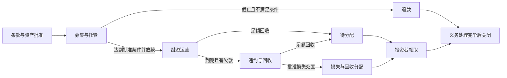

# AgentBL 全面评估与优化实施报告

日期：2026-10-17，Asia/Singapore。代码基线：`cc09644fb652d5a995342a083362e7b95e8dd8b1`。用途：下一阶段设计、实现、回归与验收的统一依据。

本文整合当前源码、[Qoder 区块链报告](project-blockchain-review-2026-10-17.md)、[独立复核](project-blockchain-review-audit-2026-10-17.md)、[前轮全面评估](project-review-2026-10-17.md)、[已实施整改](project-remediation-2026-10-17.md)及[协议 v3 部署证据](evidence/protocol-v3-deployment-2026-10-17/README.md)。历史问题、已修复行为、尚存缺陷和后续设计要求分别标明。本文提出的接口、状态及方案均为建议，未表示已经实现。

**阅读入口**：先读第 1–5 部分确定目标和优先级；第 6–8 部分是逐项任务；第 9–13 部分定义不变量、实施批次和验收；第 14–16 部分说明迁移、原报告校正和证据。

**1. 总体结论与近期目标**

AgentBL 已具备可解释定价、单证处理、风险监控、人工审批、合约状态机、链上监听、回执核验和审计承诺等基础。项目值得沿现有结构继续完善，无需因发现问题而整体推倒重写。

当前主要短板集中在同一笔融资的跨层一致性：报价期限、募集阶段、实际回款、违约恢复、投资者持仓与抵押释放尚未形成一个完整且可恢复的业务闭环。合约测试绿色、测试网部署成功、Demo 显示 Repaid，均不能补足这些业务条件。

建议近期目标为：**一个商品、一条航线、一种测试网结算资产、一组明确角色，跑通正常融资、募集失败、违约、多笔回收、兑付及故障恢复。** 不以扩充场景、增加 Agent 接口或接入交易所为本轮主目标。

| 交付层级 | 目标 | 当前判断 |
|---|---|---|
| 研究 / 课程 / 展示原型 | 业务解释清楚、Demo 无隐式真实交易、已有流程可复现 | 已有较好基础；仍需关闭 A 类一致性问题 |
| 受控测试网融资闭环 | 测试代币实际流转、资产占用和持仓可核验、异常能退出、记录能恢复 | 尚未完成；作为建议的下一阶段交付目标 |
| 真实业务 / 真实资金 | 托管与兑付、可执行权利、治理、身份、数据及独立恢复均有证据 | 尚无充分证明；不可由前两级自动推导 |

链下托管、银行支付及法律执行可以是未来架构的一部分。选择这些方式时，应说明托管人、对账、争议与投资者权利；不能仅凭缺少链上 escrow 断言所有现实融资安排无效。当前材料也没有证明这些替代安排已经成立。

**2. 基线、验证与置信范围**

本次编制报告时，重新核对了上一轮审查快照中的 31 个文件，摘要全部一致；因此沿用此前独立反例和固定区块读取，未将其改写为本次新跑的结果。新补读了工作区访问、文件存储、版本计算、付款证据、CI、容器与既有整改记录。证据文件见第 16 部分。

| 证据类别 | 结果 / 时点 | 说明 |
|---|---|---|
| 独立合约回归 | 同一会话前轮：92/92 通过 | 本地 Hardhat；不是缺陷不存在的证明 |
| 独立定向 Node 回归 | 同一会话前轮：105 项通过 | opening / settlement / watcher / v3 deployment 四个文件 |
| 独立反例 | 同一会话前轮：8 项本地 EVM + 4 项真实 JS 函数 / 合成回执观察 | 验证当前问题存在；不属于修复后通过 |
| 固定区块读取 | Injective testnet 1439，区块 `144160220`；新加坡 2026-10-17 17:58:26 | 是采集时快照；本次未再次查询最新区块 |
| 部署字节码 | 上述区块下 7/7 与本地 artifact 精确匹配 | 未重做干净目录编译或编译器审计 |
| v3 部署后的全量结果 | 历史交付记录：1311 Node、92 合约、8 Chromium、20 评测闸门 | 不是本次重跑，且当前尚有未提交的 UI / 图片改动 |
| 当前远程 CI、全量构建、全站浏览器、负载、灾备、真实提供方 | 本次未重新验收 | 后续每个交付批次须绑定其最终源码重验 |

固定区块值：protocolVersion=3；accessMode=0；complianceGate=0；nextPoolId=1；nextEblId=1；emergencyStopped=false；AgentDecisionLog.batchCount=0、lastSeq=0；PaymentOracle.attestationCount=2。六份带 owner 的合约 owner 相同且该地址无部署代码。当前 v3 为空，没有证据说明已发生抢份额或资金损失。两条付款 attestation 的计数也不等于本次重新证明了两笔真实付款。

证据标记：**E** 为本地真实 EVM 反例；**J** 为真实 JS 函数与合成 provider 回执；**S** 为当前源码确认；**R** 为上述固定区块读取；**H** 为已有历史验收记录；**U** 为未充分验收的设计、业务或外部条件。源码存在不能代替实际运行证据，合成回执不能代替真实付款。

**3. 当前系统的职责与信任边界**

| 层 | 已有职责 | 目前不应由它单独证明 |
|---|---|---|
| 单证 / 数据层 | 提取、规则核对、来源与风险提示 | 货物真实存在、承运人签发真实、全球没有重复融资 |
| 确定性定价 | 在输入和规则下复现价格、供给、风险说明 | 市场公允价、违约概率、保险可赔或保证收益 |
| Agent / 审批层 | 生成提案、执行策略、人工批准和回执验证 | 链上管理员必须遵守同一套服务端策略 |
| Registry / Pool / Token | 登记、占用、状态、不可转让份额凭证 | 已收认购款、已放款、投资者已兑付、抵押权已可执行 |
| Pricing / Payment Oracle | 受角色约束地记录报价或付款声明 | 输入客观真实、付款证明中的交易必然有效 |
| DecisionLog | 版本、序列和 Merkle 批次承诺 | 所有事件都已记录、证据永久可取、模型真的执行了声称的版本 |
| 前端 / Copilot | 展示、偏好、动作确认和钱包交互 | 交易最终成功、单凭浏览器状态即可确定资金和持仓 |

必须继续明确三条路径：Demo 仅模拟；浏览器 AgentBLRWA 是独立上链实验；v3 是受角色与审批约束的协议。它们可以共存，但不能混用池编号、持仓、付款和法律权利。

核心标识建议统一为：协议实例 `(chainId, offeringPoolAddress, protocolVersion)`；链上资产 `(chainId, registryAddress, eblId)`；融资池 `(chainId, offeringPoolAddress, poolId)`；业务提单以可信签发主体和原始提单标识关联。单独的 `pool #2` 或 case ID 不足以识别跨部署资产。

**4. 已完成的整改：保留并回归，不重复当成新缺陷**

| 已有改进 | 当前处理要求 |
|---|---|
| 最终价格钳制和供给取整后复查利润、净利润、年化与融资缺口 | 保留低 / 零 / 负利润、精度、边界回归；不能把原 F01 重新列为未修复 |
| 重定价保留 Open / Subscribed / Funded / InTransit，暂停恢复原阶段 | 保留全阶段回归；本轮补的是退出活性及违约链下路径 |
| title-v2 身份、旧提单阻止重铸、旧池身份兼容 | 保留；继续补可信签发和跨系统控制，不能声称全球去重已经成立 |
| 足额清偿、追加回收、Defaulted / LossSettled、Registry owner 不得直接解押 | 保留；追加回收与链下审批尚不一致，损失结清也未完成真实处置 / 兑付 |
| 私有上传与工作区隔离、公开样本和私人材料分离 | 保留；不是企业身份体系，也不意味着链上明文具有隐私性 |
| Demo / LIVE 确认、报价与偏好隔离、统一可认购条件、数据时效与风险恢复 | 作为后续桌面交互回归基线；当前 UI dirty 改动需另绑定最终源码验收 |
| v3 独立地址、runtime 命名空间、旧资产 / 旧游标保全 | 保留；不得把旧 #1/#2/#3 的含义带到新地址 |
| 两步所有权、角色撤销 API、字节码与精确回执核验、未知广播恢复基础 | 在此基础上完善治理、演练和证据，不重做已经存在的能力 |

**5. 优先级与统一任务清单**

优先级分两轴：**P1** 为应在下一次扩大协议使用前关闭的正确性 / 防护问题；**P2** 为近期产品一致性和可维护性改进；**G0** 为所选融资 / 真实业务范围的准入条件，不能用其他测试通过抵消；**P3** 为可延后优化。G0 不表示当前存在外部任意盗币漏洞。每项同时注明“缺陷 / 防护缺口 / 能力缺口 / 信任模型 / 待验证”，避免把所有问题都叫 P0。

| ID | 优先级 | 性质 | 任务 | 建议批次 |
|---|---|---|---|---|
| A01 | P1 | 缺陷 | Liquidation 缺少收尾路径 | W1 |
| A02 | P1 | 缺陷 | Frozen 退出条件不完整 | W1 |
| A03 | P1 | 缺陷 | Defaulted 后证明录入的跨层规则不一致 | W1 |
| A04 | P1 | 缺陷 | 多笔回款与结算审批模型不一致 | W1 |
| A05 | P1 | 缺陷 | 报价期限未绑定链上到期日 | W1 |
| A06 | P1 | 缺陷 | 到期后仍可新增认购 | W1 |
| A07 | P1 | 防护缺口 | Oracle 无报价时效 / 顺序前置条件 | W1 |
| A08 | P1 | 防护缺口 | 认购无链上价格 / 版本 / 截止前置条件 | W1 |
| A09 | P2 | 功能缺口 | Live 认购不进入统一持仓视图 | W2 |
| A10 | P2 | 一致性缺陷 | v3 文档、事件和状态语义未同步 | W1 |
| B01 | G0 | 能力缺口 | 原子认购与按池资金隔离 | W2 |
| B02 | G0 | 能力缺口 | 募集目标、截止、放款与退款 | W2 |
| B03 | G0 | 能力缺口 | 兑付、费用、损失分配与防双领 | W2 |
| B04 | G0 | 信任模型 | 可信签发、持有人控制与资产唯一性 | W3 |
| B05 | G0 | 能力缺口 | 抵押处置与损失结清的权利安排 | W3 |
| B06 | G0 | 信任模型 | 可信估值、条款承诺与链上金融边界 | W3 |
| B07 | G0 | 信任模型 | 治理、密钥、可更换 minter 的供应完整性 | W3 |
| B08 | G0 | 设计决策 | 投资者资格范围及持续准入 | W3 |
| B09 | G0 | 能力缺口 | 业务主体身份、权限与发布审批 | W3 |
| B10 | G0 | 隐私设计 | 链上商业字段最小披露 | W3 |
| B11 | P1 | 审计缺口 | 证据 schema、可取回性和锚定运行验收 | W4 |
| B12 | G0 | 能力缺口 | 可恢复融资账本与事务一致性 | W2 |
| C01 | P1 | 待验证 | 行情适用性、估值与经济参数校准 | W4 |
| C02 | P1 | 待验证 | 真实单证 / LLM / 合规效果与人工接管 | W4 |
| C03 | P1 | 信任 / 验证 | x402 独立付款核验及失败恢复 | W4 |
| C04 | G0 | 待验证 | 运行监控、容量、密钥备份与异机恢复 | W5 |
| C05 | P1 | 交付验证 | 可复现构建、迁移与同 SHA 发布证据 | W5 |
| C06 | P2 | 产品改进 | 三路径、权利、资金状态与操作恢复展示 | W1–W5 |
| C07 | P1 | 验证策略 | 跨层属性、活性与故障注入回归 | W1–W5 |
| C08 | P3 | 产品决策 | 主流程收敛及 Injective 能力取舍 | W0 |

G0 的适用范围需在 W0 固定：测试网可以使用明确标识的虚构单证和测试代币，但仍须验证技术资金守恒；真实业务则必须补真实权利、身份、来源、治理和恢复证明。选择保留纯模拟范围时，应关闭相关真实融资宣称与入口。

**6. A 类：当前缺陷与直接防护缺口**

<a id="a01"></a>
**A01 · Liquidation 无收尾路径｜P1｜E + S**

位置：`hardhat/contracts/RWAOfferingPool.sol:373,383,420,506`，`EBLRegistry.sol:121`。有权限的 Oracle 触发 Liquidation 后，现有取消、清偿、违约、损失结清和恢复等接口均无法使其结束；owner 不能直接解押，holder 不能转移。反例检查了 12 条操作，抵押仍锁定。影响是可用性与资产占用永久卡住；当前没有托管资金，不能将其表述为已锁住认购款。

修复方向：定义清算开始、回收记录、处置完成与最终分配的状态和证据；允许符合条件的足额回收结束或显式损失处置。新接口不能以“补救”为名绕过既有投资者债权直接解押。若近期不实现处置，应在协议中拒绝进入不支持的状态，并在产品中停止宣称支持清算。

关闭条件：从所有允许进入 Liquidation 的阶段，都有业务允许且权限明确的结束路径；足额、零回收、部分回收、错误处置、重复执行和全局停止均测试。安全性不变量仍保持，退出过程不能提前释放抵押。需要合约新部署；应用修改不能改变现有地址的行为。

<a id="a02"></a>
**A02 · Frozen 的退出条件不完整｜P1｜E + S**

位置：`RWAOfferingPool.sol:276,336,373,414,465`。已复现两种组合：零认购者被冻结后不能取消；足额回款且欠款为零后被冻结，既不能 settle，又不能 markDefault。Frozen 且已到期、有投资者、有欠款时仍可 markDefault，不能误称所有 Frozen 都没有出口。

修复方向：按认购量、债务、已回收金额、到期和争议分别定义出口；允许无债权的取消、核验后足额结束、到期欠款违约，及有明确审批依据的风险解除。冻结原因、解除权限和全局 emergency stop 的作用分别记录。

关闭条件：组合矩阵覆盖零 / 部分 / 满额认购 × 零 / 部分 / 足额回款 × 到期前后；每格说明允许路径或合理禁止原因。不能通过统一 owner 强制解押代替这套规则。需要合约新部署及消费者同步。

<a id="a03"></a>
**A03 · Defaulted 后录入证明的跨层规则不一致｜P1｜E + J + S**

位置：`RWAOfferingPool.sol:506`，`src/agent/runtime/poolRules.js:56`，`src/agent/pipelines/settlementPipeline.js:121`。合约允许 Defaulted 后付款、追加回收和到港，再完成 Repaid；链下 RECORD_PAYMENT / RECORD_ARRIVAL 只允许活动阶段，因此标准审批路径返回 `illegal_transition`。

修复方向：统一合约、规则表、owner plan、Agent 提案和前端的允许阶段；违约后的处置继续按既定人工审批执行。把 markDefault、追加回收、settleLoss 作为清楚的操作类型接入，不因新增入口而交给 Agent 无人值守执行。

关闭条件：标准应用 / CLI 路径能够从 Defaulted 完成迟到付款与到港、足额结清及部分损失处理；停机、过期审批、权限不足和重复回执都按预期拒绝。不能以直接调用合约的成功代替应用验收。

<a id="a04"></a>
**A04 · 多笔回款与结算审批的金额模型不一致｜P1｜E + J + S**

位置：`RWAOfferingPool.sol:362`，`settlementPipeline.js:51,125`，`runtime/settlementEvidence.js:25`，`ownerTxPlan.js:16`。合约允许累计金额；链下结算仍以一个交易核验累计总额。反例中的两笔 0.4 / 0.6 USDC 累计为 1 USDC，SETTLE 计划却失败于 `payment_transfer_mismatch`。这说明多笔回款路径缺失，不表示原单笔核验应被放宽。

修复方向：为每个回收分录保存资产、付款方、收款方、原子金额、交易、log index、规范区块与用途；逐笔独立核验后汇总。定义单交易多条 Transfer 是否支持，以及防重复的分录粒度。更正通过可审计调整项表达，保留旧记录和累计关系；明确付款、保险和清算回收是否有不同分配顺序。

关闭条件：一笔、多笔、不同付款来源、超额、重复、撤销 / 更正、重组和重启后仍能对账；未确认或已用于另一债务的分录不能进入累计值；不能为了结算伪造一笔“等于总和”的付款。

<a id="a05"></a>
**A05 · 报价期限未绑定链上到期日｜P1｜E + J + S**

位置：`src/core/pricingEngine.js:80,484`，`runtime/openingPlan.js:135`，`RWAOfferingPool.sol:224,348`。原油案例报价为 30 天；开盘三步未包含期限，合约一律默认创建后 60 天。年化解释、债务条款和违约触发时间可能不一致。

修复方向：先明确期限起点是融资生效、装船、交付还是承兑，区分自然日和工作日；把确定后的 startsAt / maturityAt 作为已批准发行条款写入承诺和创建参数。在已出售份额后，经济条款修改必须遵守原有权益安排。避免“创建后再发一笔 setMaturity”留下可被认购的窗口。

关闭条件：同一案例的 quote、审批内容、calldata、链上时间、年化和 UI 解释完全一致；覆盖跨日、延迟开盘、已过去的原定到期日、不同付款条款及剩余期限。建议在新创建接口中原子绑定；涉及合约新部署。

<a id="a06"></a>
**A06 · 到期后仍可新增认购｜P1｜E + S**

位置：`RWAOfferingPool.sol:230`。创建 61 天后仍能 subscribe。页面是否禁用不影响钱包直接调用。

修复方向：分别定义募集截止和债务到期；链上要求认购窗口有效，deadline 不晚于发行条款允许的时间。已到期没有认购者时可走关闭，已有投资者时按债务状态处理。前端和 Copilot 共用明确禁用原因。

关闭条件：截止前、截止秒、截止后、债务到期、链下缓存旧时间和直接钱包调用分别验证；接口拒绝时不得铸造份额或产生成功付款记录。需要合约新部署。

<a id="a07"></a>
**A07 · Oracle 去重不提供报价时效和顺序保证｜P1｜E + S**

位置：`RiskPricingOracle.sol:68`，`RWAOfferingPool.sol:394`。现有 guard 确实阻止已处理的相同参数组合；但较早准备、从未提交的报价仍可覆盖新报价。反例先执行 700000，再提交旧 900000，执行成功。前提是调用者具备 updater 权限；不是任意钱包可改价。

修复方向：报价包含 asset / pool / deployment 域、有效期、预期 quoteVersion 或单调 decision sequence、完整经济条款；链上检查前置版本与有效期。按批准的风险模型决定价格边界及应急角色；服务端保留重验，但不能作为唯一防护。链上约束应允许业务合理的风险恢复，不能简单硬编码所有操作最大 200 bps。

关闭条件：旧报价、未来报价、过期报价、跨池 / 跨合约复用、乱序并发、重复提交被区分处理；签名前静态预检后状态变化也不能绕过链上前置条件。需要 Oracle / Pool 新部署和 ABI 同步。

<a id="a08"></a>
**A08 · 认购无链上价格、版本及有效期前置条件｜P1｜S**

位置：`RWAOfferingPool.sol:230`，`web/src/lib/web3.js:727`。浏览器做了钱包、网络、供给、当前价格和 staticCall 检查，也在回执后检查 paidAmount；但这些不能原子锁定签名到落块之间的条款。当前没有付款腿，不能称其已造成实际多扣款。

修复方向：若固定份额认购，接口接受 maxCost / maxUnitPrice、expectedQuoteVersion 和 deadline；若按预算买份额，接受 minShares、maxCost 和同等版本条件。份额受益人、付款人及币种都要绑定确认意图。不要把失败后的事件比较当作回滚保护。

关闭条件：批准后由另一个合法更新改变价格、版本、容量或截止条件，交易要么按用户允许的条件原子成功，要么完全回滚；未知广播进入对账状态且不能提示直接重复购买。需要合约新部署；接入付款腿时必须一起验收。

<a id="a09"></a>
**A09 · Live 认购不进入统一持仓视图｜P2｜S**

位置：`src/app/server.js:1079`，`src/app/store.js:12`，`monitorPipeline.js:243`。组合接口主要读内存 investments；链上订阅事件在 monitor pipeline 是 informational。它不等于链上镜像完全不更新，但当前组合查询没有形成完整的 Live 投资账本。

修复方向：独立建 Live 投资读模型，按协议实例、池、钱包、交易和份额关联；Demo 保持单独账本。链上余额和认购分录共同用于读回，不从 Demo 记录补造链上持仓。

关闭条件：钱包认购、追加认购、重启、从部署点重建、相同 poolId 不同地址和回执被重组后，持仓、成本及状态正确；未知余额来源明确提示对账，而非自动归为已付款融资。

<a id="a10"></a>
**A10 · v3 文档、事件和消费者语义未同步｜P2｜S**

位置：`docs/contracts.md:71,89,109`，`RWAOfferingPool.sol:348,414`，`runtime/sources/chainWatcher.js:12`。文档仍有 REPRICE 改成 Repriced、Defaulted 仅链下、Registry owner 可解押的旧说明；setMaturity 没有事件，FREEZE 也发 OfferingPaused。watcher 没有订阅全部新增回收专用事件，但它会读取已知池快照，不能据此断言所有金额镜像一直过期。

修复方向：同步当前规范和状态分支图，区分旧地址历史；审查每个事件的主语、amountDue / paid / recovered、旧 / 新状态及消费者。明确以哪些状态事件为权威。补充期限、追加回收、损失和关键角色变更的审计事件及消费策略。

关闭条件：部署版本、ABI、枚举、规则表、文档、索引器、前端和测试有统一契约校验；每项关键业务变更能够从交易 / 事件 / 账本恢复含义。事件签名变更需提供兼容方案，不能篡改历史回执。

**7. B 类：融资与真实业务的准入条件**

<a id="b01"></a>
**B01 · 原子认购与按池资金隔离｜G0｜E + S；实现未具备**

现状：subscribe 不调用稳定币转账，只铸份额并报告 paidAmount；陌生账户可占满供给。这是明确的原型设计边界及未来开池后的干扰路径，不是已经发生的盗币事件。

建议：选定明确的结算资产与精度，在同一交易完成资金收取和份额发放；每个池的资金责任单独计量。资产白名单之外的币、带转账扣费或可变余额语义是否支持要明确，不能按任意 ERC-20 假定到账等于参数。可采用成熟的安全转账封装，但仍须验证本项目的资金和业务约束。[OpenZeppelin SafeERC20 文档](https://docs.openzeppelin.com/contracts/5.x/api/token/erc20#SafeERC20)

关闭条件：资金失败无份额、份额发放失败无扣款；跨池不能动用他池负债资金；并发认购不超供给；错误资产、重入、返回 false / 无返回值及余额差异按约定处理。测试代币闭环和真实资金上线是两项不同验收。

<a id="b02"></a>
**B02 · 募集、放款和退款规则｜G0｜S + U**

现状：部分认购可 markInTransit，但有认购者不能 cancel；没有 funding target / subscription deadline / minRaise、托管放款和退款闭环。它们尚未形成投资者可执行的募集条件。

建议：发行前固定最低募集、最高供给、募集截止、是否允许部分融资、出口商身份、费用和放款条件。认购资金先托管；达到条件才放款，失败则按实际支付成本退款。部分募集是否发运由条款决定，不能由任意操作员临时解释。

关闭条件：截止前成功、截止后不足、恰好达标、超额竞争、部分放款、退款失败重试及重复退款都可验证；暂停 / 冻结期间已取得的退款权如何行使有明确规则。退款按投资者实际出资，不按目标兑付金额计算。

<a id="b03"></a>
**B03 · 兑付、费用、损失分配与防双领｜G0｜S + U**

现状：settle 记录清偿状态，不给投资者转账；RWAToken 无 claim / redeem。单凭 Repaid 不证明投资者收到资金。

建议：先固定费用、利息 / 收益、同级或分层份额、保险与清算回收的分配顺序，再选择 pull-based claim、redeem / burn 或不可转让凭证 + 累计领取记录。不可转让本身可以是合理选择，burn 也不是唯一防双领方式。存量份额的原始权利不随未售份额重定价改变。

关闭条件：足额 / 部分 / 零回收、迟到回收、超额、最小单位舍入和收款失败均有确定结果；重复领取不多付，恶意收款人不阻塞别人；已分配 + 可领取不超过可分配实际回收。LossSettled 应与投资者分配和余款处理相符，不能仅关状态。

<a id="b04"></a>
**B04 · 可信签发、控制权与资产唯一性｜G0｜S + H + U**

现状：Registry owner 登记；V2 cargoHash 由 caller 给出，V1 / V2 派生空间不同。title-v2 和旧资产限制已改善应用级身份，不能证明世界范围没有重复融资。当前 openingPlan 还以 Registry.owner 作为新 eBL holder，尚未表达真实出口商的独立控制关系。

建议：定义可信签发方身份、原始提单号、修订 / 作废 / 换单关系、实际持有人及授权；持有人质押同意应可验证。建立登记版本和部署间的同单关联，跨平台防重复依赖真实 eBL 控制和合作系统，不靠换一套哈希完成。不要把 mletr / eucp / dcsa 布尔值当作认证。

关闭条件：同单不同 case、V1 / V2、文档修订、换名、跨部署不能在受控系统重复占用；真实来源验签、背书、交回和失效可验证。MLETR 的核心涉及可识别记录、完整性和可归属的排他控制，并不等于“上链就完成货权法律安排”。具体适用性须由业务伙伴和法律专业人员确认。[UNCITRAL MLETR 官方说明](https://uncitral.un.org/en/texts/ecommerce/modellaw/electronic_transferable_records)

<a id="b05"></a>
**B05 · 抵押处置、损失结清与再次融资｜G0｜S + U**

现状：pledge 可以限制转移，pool 不是 holder，也无已实现的扣押 / 变卖能力；settleLoss 记录损失后释放质押。当前注释说明 resolutionHash 承诺链下回收 / 分配证据，因此不能仅凭解押断言发生违法处置；问题是这些外部安排尚无验收证明。

建议：明确谁能处置、触发条件、通知 / 争议流程、保险或托管人职责、回收款接收和分配证据；链上保存结果和引用。若增加 seize / transferByPledgee，必须受被批准的担保安排约束。违约后再次融资应有剩余权利核对、风险标记和经批准恢复流程，不能简单删除历史，也不宜未经业务论证永久禁止同资产。

关闭条件：违约、争议、部分回收、处置失败、超额回收和最终解押都具备对应业务证据；未完成分配不能仅靠 owner 声明抹掉义务。测试网可验证技术处置，真实处置须另有合法控制权和参与方材料。

<a id="b06"></a>
**B06 · 可信估值、条款承诺与链上金融边界｜G0｜S + U**

现状：创建只校验基本数量 / 价格 / 质押；不读取可信抵押估值，也不直接保存完整 quote / evidence 条款。metadataHash 间接承诺了部分材料，不能替代完整可取回、可验证的发行条款。

建议：定义带版本的 OfferingTerms 和 ValuationAttestation，包含资产 / 协议域、币种、估值时点、净回收估值、coverage、估值人、有效期、供给、兑付目标和时间。对批准的估值与最大风险敞口实施链上检查。申报货值可作为输入之一，但不可直接替代可信估值；哈希只能约束提交内容，不能证明内容真实。

关闭条件：单位 / 精度、过期估值、跨资产复用、超覆盖、极端输入、算术上界和调整条款均拒绝或按批准规则处理；报价承诺可以从保存材料重算。真实业务还需要估值方法、误差和回收成本的业务验证。

<a id="b07"></a>
**B07 · 治理、密钥和份额供应完整性｜G0｜S + R + U**

现状：owner 集中；链上角色可绕过服务端审批。已有两步所有权与撤权 API。RWAToken.owner 可随时 setPool，新的 minter 可以对历史 poolId mint，因此仅依赖当前 Pool 的 supply 校验不足以约束管理员改 minter 后的总供应。

建议：列出治理、发行、估值、执行、证明和应急角色；关键变更采用符合团队条件的多方批准与必要等待期，紧急保护具有独立且受限的权限。对 minter 采用固定绑定、按发行版本隔离或受控迁移。签名 key 不回退 owner，提供撤权、轮换与遗失恢复操作手册。

关闭条件：低权限账户不能改变角色或供应；旧 key 撤权后无法写入；迁移不改变已有权益；关键变更有事件与可观察等待条件；应急停机不会无理由永久剥夺已确定的领取权。多签本身不证明安全，还需实测执行和接管。

<a id="b08"></a>
**B08 · 投资者资格与持续准入｜G0，依产品范围适用｜R + S + U**

现状：v3 为 Permissionless、无 attached compliance gate。源码同时支持可替换 gate；测试网开放模式是明确设计，不等于当前系统完全没有准入能力，也不能据此直接作法律违规结论。

建议：在 W0 决定开放教学测试或受限业务；实际金融发行需由适用规则决定资格、地域和筛查要求。资格记录包含来源、主体 / 钱包关联、有效期及撤销。未配置 gate 或外部服务异常时，真实融资发行不可默认为已合规。

关闭条件：资格过期、钱包变更、撤销、名单变化和服务失效均验证；明确拒绝“新增认购”是否影响已经取得的退款 / 兑付权。不能把一次 KYC 勾选或演示名单当作持续合规证明。

<a id="b09"></a>
**B09 · 业务主体、权限与发布审批｜G0，依产品范围适用｜S + H + U**

现状：工作区 cookie 的 capability 隔离、Live 管理授权和私人材料过滤已实现；源码明确不是企业 IdP。它不能单独表达发行人、投资者、审核员、承运人和托管人之间的身份、代理权限和责任。

建议：定义组织 / 人员 / 钱包关系、最小权限、会话撤销、关键操作授权与发布审批。公开发行摘要采用批准后的独立投影，私人上传不会因为一个前端 flag 变成公开材料。签署动作应绑定对象、条款版本和有效期，而非仅证明“连过钱包”。

关闭条件：跨组织 / 工作区、管理员和普通用户、HTTP / SSE / MCP / A2A / 文件下载均按权限矩阵检查；失效会话不再访问；公开摘要不泄漏私人字段。本次未声称已有工作区隔离再次被攻破。

<a id="b10"></a>
**B10 · 链上商业信息最小披露｜G0，真实单证上链前｜S + U**

现状：EBLMetadata 明文包含船、航次、港口、货物、数量、HS code、货值等。前端隐藏或服务端工作区权限不能阻止链外读取公开链数据。

建议：为每个字段列公开必要性、链下保存位置、访问人、保留期和授权依据；默认只公开业务必要承诺。敏感原始材料采用加密及受控访问，需证明的字段采用适合业务的选择性披露。公开 CID 不是访问控制，哈希也不总能抵抗可枚举内容的推测。

关闭条件：使用真实单证前完成数据流和字段审查；浏览器、合约 storage / calldata / event、日志、证据下载和错误响应均无未经批准的披露。已经上链的明文不能通过删数据库“撤回”。

<a id="b11"></a>
**B11 · 证据 schema、可取回性与锚定运行验收｜P1｜S + R + U**

现状：pricing 只哈希部分摘要且使用普通 JSON.stringify；decision / x402 的部分路径已有排序序列化，不能说全项目无 canonical 格式。DecisionLog 有实现和本地证明能力，但快照下 batchCount=0，首次实链批次及后台运行尚未证明。

建议：分别版本化原始材料、估值、发行条款、审批、执行和付款的 evidence schema；统一金额字符串、时间、空值、字段顺序与哈希域。保存可验证且有权限的完整材料包和不可变引用。锚定覆盖率、延迟和遗漏检测与包含证明分开；启用前核对当前 code / policy / model 版本注册，禁止自动把旧注册称为新源码承诺。

关闭条件：另一台机器无需原进程即可重算关键哈希、获取被授权证据并验证包含；材料缺失明确失败；敏感字段不进入公共叶子；版本变更、批次失败、未知广播、重启与备份恢复可核验。首次链上批次按独立授权执行，不能由报告自动触发。

<a id="b12"></a>
**B12 · 可恢复融资账本与事务一致性｜G0｜S + H + U**

现状：Demo 池和 investments 在内存中；多种操作日志 / 收据已持久化，原子写文件和单进程写队列有价值，但不能据此认定跨进程资金事务已经具备唯一约束或锁。

建议：建立协议实例、发行、份额、认购支付、放款、退款、回收、领取、手续费和调整分录的持久账本。事务内保存业务事实、唯一占用和待发布事件；广播意图、交易哈希和回执状态分开。数据库选型可按部署规模决定，先确保一条事实只有一个权威写入者和可验证恢复流程。

关闭条件：断电 / 崩溃发生在付款前后、落库前后、消息发布前后均不会重复付款或丢份额；独立进程竞争不能双占同一付款；从链和保存材料重建的余额与原账本一致。真实资金版本不得用空内存初始化掩盖恢复失败。

**8. C 类：数据、Agent、运营和产品完善**

<a id="c01"></a>
**C01 · 行情适用性、估值和经济参数校准｜P1｜S + H + U**

现状：已修复空值误当零、观测与获取时间混淆、旧风险无法恢复等具体问题。免费数据、参考价、规则年率和风险分数的业务适用性仍未得到充分实证。

建议：为不同商品确定品级、单位、地区、币种、现货 / 期货基差、市场日历、变现成本和保险扣除；区分申报值、规则估计和独立核实。FAST 等参数标注来源和校准版本；风险 bps 不表述成违约概率，快速到账选项没有资金服务前不承诺实际 SLA。

关闭条件：缺失、过期、跨源冲突、市场停盘和极端波动不产生虚假 CLEAR / 恢复；独立数据集给出估值误差、拒绝率和经济边界；实际年化和剩余期限使用 A05 的同一时间模型。

<a id="c02"></a>
**C02 · 真实单证、模型和人工接管｜P1｜S + H + U**

现状：schema、来源支持、OCR_REQUIRED、注入防御、审批和确定性价格已有基础；现有 deterministic 评测和 fake-provider 测试不能证明真实模型、扫描件或制裁筛查质量。

建议：冻结独立、脱敏、未参与开发的单证与异常样本集，覆盖不同语言、扫描质量、错页、缺成本、来源冲突及恶意内容。量化关键字段错误、误放行、误拒绝、转人工率和证据忠实度。LLM 不越权签名，也不替代真实合规服务；审批界面呈现来源、缺口和影响。

关闭条件：真实提供方评测与本地确定性回归分别记录；关键错误达不到预先约定门槛则保留人工复核；超时、服务失效、版本变化和应急接管有可重放记录。报告不擅自设一个没有业务依据的“99% 即可上线”。

<a id="c03"></a>
**C03 · x402 付款真实性与交付恢复｜P1｜S + H + U**

现状：已有 V2 授权域、时间窗和请求绑定检查、付款状态机、幂等及部分未知结算恢复；不是完全没有 nonce / deadline 防护。但生产 PaymentCoordinator 主要依赖 facilitator verify / settle 响应，PaymentOracle 也只是受信 attestor 日志。本次未重新逐笔核对历史两个 attestation。

建议：服务端在解锁 / attestation 前按既定信任模型独立核对付款资产、付款方、收款方、金额、授权与规范回执；明确已付款但报告生成 / 交付失败的免费重取或退款策略。若未来把授权用于合约托管 wrapper，单独验证授权被抢先使用、收款人和受益人绑定；不能把当前付费报告授权直接复用为认购授权。[ERC-3009 安全说明](https://eips.ethereum.org/EIPS/eip-3009#security-considerations)

关闭条件：假成功响应、错误网络 / 资产 / 金额、重复 nonce、已用授权、超时后实际到账、进程重启、报告生成失败及重复取回分别验证；不重复收费、不将支付报告的钱计入 RWA 融资，也不凭任意 tx hash 解锁。

<a id="c04"></a>
**C04 · 运行监控、容量与独立恢复｜G0，长期服务 / 真实业务前｜S + H + U**

现状：容器有非 root、只读运行方案和进程健康检查；已有监听健康 / 滞后控制。尚无本次同源码的容量、长稳运行、独立主机恢复和密钥接管验收。

建议：区分 liveness、readiness、链确认滞后、数据时效、审批 / 执行积压和账务对账；给出操作员能处理的告警。明确单写者约束后再扩容。加密材料及其解密 key、签名恢复和账本备份分别受控；同目录 sidecar key 不能被当作源主机失陷后的独立防护。

关闭条件：先定义用户量、事件量、证据体量和延迟目标，再验证；磁盘满、写失败、RPC 中断、重组、提供方限流及源机器丢失都有演练。新机器恢复后可对账和核验权利，不依赖原机器仍在线；告警实际到达值班方。

<a id="c05"></a>
**C05 · 可复现构建、迁移与同 SHA 发布｜P1｜S + H + U**

现状：现有 CI 含应用矩阵、合约、浏览器、容器和依赖审计；不能再沿用旧全面报告“CI 无浏览器任务”的历史说法。当前工作区有未提交改动，既有提交的 CI 不覆盖这些字节。

建议：每批冻结源码、锁文件、构建环境、artifact、ABI 和配置摘要；在干净目录重建并验证运行字节码。非代理合约修改要计划新部署；按部署实例保留老池、老资产、老审批和老持仓，禁止自动重铸和按数字 ID 迁移。单进程 nonce 队列不能替代独立 CLI 同时使用同 key 的运行控制。

当前构建配置为 Solidity 0.8.24、viaIR、Paris EVM、优化 200 runs；后续更换编译器、库或参数要记录原因并重新冻结产物。CI 依赖审计任务当前允许失败；资金候选的发布门槛需明确哪些公告必须阻断、哪些可经记录接受，不能把工作流整体绿色解释为所有安全检查都通过。

关闭条件：最终源码、全部必须 CI job、镜像、部署配置、角色和回执对应同一版本；没有依赖绿色历史记录替代当前结果。广播未知先只读对账；回滚应用不得把新资金池误指向旧协议。真实交易计划在完成本地审查后单独取得授权。

<a id="c06"></a>
**C06 · 路径、权利和资金状态的决策界面｜P2｜S + H + U**

现状：桌面 UI、双语、模式提示和并发请求已有整改；本次未重新走当前 dirty UI 的浏览器流程，因此下面是验收要求，不是又发现相同前端漏洞。

建议：市场、发行、详情、审批和持仓共同呈现协议实例、模拟 / 实验 / 协议身份、条款版本、报价时间、到期、支付 / 放款 / 回款 / 可领取状态。投资确认说明买到何种权利、钱到哪里、损失如何分担。主要页面使用业务语言，技术日志放详情；Mystery / Passport 保持教育定位。

关闭条件：中英文、1280 / 1440 桌面宽度、键盘 / 焦点 / 对比度、慢请求 / 快切、钱包 / 网络变化、未知广播及失败恢复均实测。已记录 Repaid 但未兑付时不能显示“投资者已到账”。当前约定不以手机适配作为本轮范围。

<a id="c07"></a>
**C07 · 跨层属性、退出活性与故障测试｜P1｜S + H + U**

现状：已有 6 个固定种子、各 300 步的随机模型，及 v3 定向回归；模型未包含全部新增 Defaulted / LossSettled 和追加回收操作，对状态可达、资金和退出活性的验证不完整。

建议：维护独立的业务规范模型，以合法操作序列检查状态 / 资金 / 权利，而非逐行复制实现；引入时间推进、跨角色、乱序、重复、重启和故障。静态分析、更多种子 / 边界、变异测试和必要的外部审查各有用途，不以工具名代替业务断言。

关闭条件：A01–A10 具备修复后会因原缺陷而失败的正式回归；资金版满足第 9 部分不变量。反例观察脚本仍作为历史证据保存，不直接把“缺陷仍存在”的绿色断言当作生产通过门槛。结果包含 seed / 操作轨迹及最小反例。

<a id="c08"></a>
**C08 · 主流程收敛与链特性取舍｜P3｜产品决策**

建议保留现有确定性定价、审批、监听和证据结构，把独立演示合约、正式协议和游戏化发现清晰分开。MCP / A2A 复用同一政策与业务服务，不发展另一套资金账本。

普通 EVM 可以承载当前主流程；bank / exchange precompile、黄金对冲及二级市场不是补齐融资正确性的前置条件。只有能说明抵消何种敞口、成本和执行权限，并完成独立风险验收时再接入。Injective 的具体网络参数按官方资料与实际 RPC 交叉核对。[Injective 网络资料](https://docs.injective.network/developers-evm/network-information)

关闭条件：W0 有明确保留 / 隔离 / 延后清单；新功能不抢占核心退出、资金、持仓和恢复工作的验收资源。

**9. 必须写进设计与测试的不变量**

这些是验收约束，具体字段名可以在 W0 调整。整笔融资必须使用同一套金额、时间和标识定义。

| ID | 不变量 | 主要测试 |
|---|---|---|
| I01 | 每个受控提单身份同时最多对应一个未解除的融资占用；跨版本关联不能创造第二项抵押 | 换 case、修订、V1 / V2、新部署、并发开盘 |
| I02 | 链上托管的资金与份额原子对应；外部托管须先验资并绑定唯一确认；已发行量不超批准供给，不能由替换 minter 额外增发 | 收款 / mint 任一失败、无款声明、重入、并发、换 minter |
| I03 | 每个池、每种结算资产单独满足资金守恒；不存在跨池挪用来完成账面兑付 | 多池、内部转账、手续费、舍入、退款与赔付 |
| I04 | 原始已售份额的权利不因未售份额价格变化而重写 | 多价认购、恢复涨价、部分发行、调价后结算 |
| I05 | 每个付款 / 回收分录只能占用一次；证明真实性与实际可花资金分别计量 | 重复事件、多个 log、跨池复用、外部证明未入库 |
| I06 | quote、签名 / 审批、calldata、链上条款和 UI 时间 / 金额一致 | 过期、乱序、时区、延迟开盘、浮点 / 取整 |
| I07 | 每个允许进入的非结束状态，在规定前提及有权限者配合下存在有限步骤的合法退出 | Liquidation、Frozen、Defaulted、全局停止 |
| I08 | 抵押释放必须对应已定义的债务 / 损失 / 处置条件；不能用关状态抹掉义务 | 小额回款、争议、部分回收、owner 强行释放 |
| I09 | 累计已领取与待领取不超过分配给该池的实际可分配资金 | 双领、分层份额、舍入、收款拒绝、迟到回收 |
| I10 | 低权限主体不能通过 HTTP、MCP、A2A、钱包或日志路径越过同一业务权限 | 无身份、跨工作区、直接合约、模型注入 |
| I11 | 同一链事实重复、乱序、重组或重启后，不会重复资金动作；保留旧观察与规范状态 | 重放、进程崩溃、持久化失败、规范区块变化 |
| I12 | UI、账本与链的不同步必须显式呈现并阻断依赖该事实的危险动作 | watcher 失效、旧报价、未知 tx、账户切换 |
| I13 | 内容承诺可由授权独立方重算；证据不可用和未验证不能呈现为通过 | 失去源主机、过期材料、旧 schema、损坏备份 |
| I14 | 实际部署、ABI、角色、配置和被验收源码属于同一候选版本 | 干净构建、地址替换、旧池保留、回滚 |

资金守恒的一个可实现定义（按池、按资产原子单位）：

```text
投资者累计入金 + 实际累计回收入金 + 其他已分类入金
= 当前托管余额 + 出口商累计净放款 + 投资者累计退款
  + 投资者累计回收领取 + 已付费用 + 其他已分类出金
```

内部 vault 间转账只能计算一次；意外转入的代币应单独记 surplus，不能据此增发投资者权利。外部银行回款声明或任意 paymentProof 不能直接算作链上可支配余额。若采用链下托管，应为对应银行 / 托管资产另建可审计守恒账，并明确跨系统结算桥梁。

当前 whole-share / 六位金额模型下，原始目标债务可按 `已认购份额 × 原始每份目标兑付值` 计算；增加份额 decimals 后必须显式缩放，不能沿用未经换算的乘法。损失核销是独立分录，法律追索权是否终止不能仅由一个链上状态决定。

若同池份额同级，回收可按个人余额 / 总余额比例分配；原始成本不是这种计算的必需输入。但退款、多价格认购收益解释、费用和税务需要保存个人实际支付成本。不能因缺成本就声称所有按份额兑付都不可实现，也不能因此省略资金账。

**10. 建议的业务模型与接口边界**

建议把“融资阶段”“风险控制状态”“报价版本”分别表达：阶段记录募集 / 运营 / 违约 / 回收 / 分配；风险记录暂停 / 冻结及原因；quoteVersion 只描述有效报价。可以增量实现并保留旧枚举兼容层，不要求把整个系统重写。

下面是目标流程示意，**不是当前合约的合法转换表**：



风险暂停不是自动终点。对暂停 / 冻结状态，仍须明确哪些核验、回收、退款、领取和应急操作可执行；是否禁用应由保护哪类权利来解释。

建议的数据对象及权威来源：

| 对象 | 内容 | 权威 / 保存位置 |
|---|---|---|
| AssetIdentity | 签发主体、原始提单标识、修订关系、控制人、占用 | 真实来源证明 + Registry / 受控资产账 |
| OfferingTerms | 份额、原始权利、时间、募集和费用、协议实例 | 被批准且可重算的条款包 + 链上承诺 / 必要执行字段 |
| ValuationAttestation | 净回收估值、coverage、币种、时间、有效期、估值人 | 可信来源和签名；链上只执行可验证边界 |
| TransactionIntent | 对象、操作、金额、版本、deadline、批准和签名域 | 持久操作意图；不能用当前 UI 值替换批准值 |
| CashEntry / RecoveryEntry | 实际入出金、用途、分录来源、调整和规范状态 | 资金账本 + 交易 / 托管回执 |
| Position | 份额、成本、可领取、已领取、风险与协议身份 | 链上权利 + 持久读模型；Demo 另存 |
| EvidenceBundle | 原始材料摘要、来源、schema、版本、引用和访问权限 | 可恢复受控存储；公共承诺不包含秘密 |

接口设计应满足以下语义，而不必拘泥于名称：创建时原子固定到期和募集条款；认购时原子检查批准价格 / 版本 / deadline；每笔回款独立收取或核验；追加回收、违约、损失及处置有各自审批；投资者领取幂等且资金有来源。接口先写明前置条件、后置条件、事件和失败恢复，再实现 ABI。

若外部付款采用 attestation，必须把“已由受信方声明”与“已获得可兑付资金”分开。普通合约不能通过一个历史 tx hash 自行读取 Transfer 日志；应使用直接资金调用、被验证的日志 / 区块头证明或明确的受信机制。[Solidity Events 官方说明](https://docs.soliditylang.org/en/v0.8.24/contracts.html#events)

角色职责建议如下；同一人在研究环境可兼任，但必须记录兼任的信任前提：

| 角色 | 可以批准 / 执行 | 不应单独具备的能力 |
|---|---|---|
| 签发 / 登记方 | 可信资产登记与修订 | 无持有人授权质押真实资产 |
| 持有人 / 出口商 | 质押同意、融资条款 | 未履行条件就解除占用 |
| 估值 / 定价 updater | 期限内有效报价 | 任意改存量投资者权利、伪造资金 |
| 运营 executor | 批准的物流 / 回收操作 | 改自己的证明、单方核销并提走回收 |
| 付款 / 到港证明方 | 提交可核对事实 | 仅凭声明创建无限可领取资金 |
| 治理 / 应急方 | 角色轮换、保护性暂停和经规则批准的升级 | 以应急名义无限增发或任意转移客户资产 |
| 投资者 | 按资格认购、退款及领取 | 操作他人份额或复用他人付款 |

**11. 分批实施计划与交付物**

以下是相关任务的批次，不是按单个按钮拆分。每批完成后冻结源码和证据，再进入依赖批次；W2 与 W3 的设计可以相互校正，资金版本部署前必须共同验收。

| 批次 | 任务范围与交付物 | 进入 / 完成条件 |
|---|---|---|
| W0 · 范围与业务规范 | 固定近期交付层级；角色、权利、币种、时间、募集、分配、处置政策；确定保留 / 隔离 / 延后项（C08） | 形成可评审的业务规范、状态表、接口草案和 I01–I14 解释；不需先完成所有法律外部安排才能写本地原型 |
| W1 · 当前正确性批次 | A01–A08、A10；同步 Pool / Oracle / rules / owner plan / Agent / ABI / UI；接入退出、迟到证明与多笔回收 | 所有已复现问题变成正式回归，正常 / 违约 / 冻结路径走通；部署影响清单完成，但不自动广播 |
| W2 · 资金与账本批次 | A09、B01–B03、B12；认购、托管、募集、放款、退款、回款、分配、持仓和恢复 | 本地真实 EVM + 实际 JS 适配器走完整生命周期；I02–I05、I09、I11 通过，不能只靠合成 provider |
| W3 · 权利与控制批次 | B04–B10；可信资产、持有人同意、估值、治理、资格、身份、隐私 | 测试网有明确模拟前提；真实业务另需可信来源、控制权、法律和身份材料。资金候选不能在这些条件尚未定义时对外使用 |
| W4 · 证据与来源批次 | B11、C01–C03；证据版本、可取回性、真实提供方评测、x402 独立核验和恢复 | 来源 / 模型 / 付款 / 决策分别有证据；失效行为和人工接管可复现；未运行的链上锚定保留待授权 |
| W5 · 交付与运营批次 | C04–C07；最终浏览器、负载 / 灾备、干净构建、部署、回执和同版本 CI | 第 12–14 部分的适用门槛全部满足；外部阻断项单列，不能因本地全绿而自动转成真实业务发布 |

建议第一个实现批次直接选择 W1 的整组相关缺陷：退出活性 + 违约回收路径 + 时间 / 报价前置条件 + 文档 / ABI / 规则同步。它们共享同一状态机和审批边界，适合一次实现、一次整体回归；无需先增加更多案例或新链功能。

每批交付至少包含：更新的业务规范与接口、改动清单、风险与兼容影响、正式测试、失败和修复记录、冻结源码摘要、未完成事项、后续部署计划。没有修复的条目保持 OPEN；因范围选择延期必须记录适用条件，不能直接写 FIXED。

**12. 验收场景与证据等级**

| 场景 | 必须验证 | 最低技术证据 |
|---|---|---|
| 正常融资 | 登记 → 批准条款 → 实际认购 → 放款 → 回款 → 领取 | 本地真实合约 + 应用路径；授权后再补测试网逐笔证据 |
| 募集失败 | 部分认购、截止、不可放款、按实付退款 | 托管余额、个人成本、退款回执与最终义务对账 |
| 多价募集 | 旧份额权利不变，新认购按批准新价，截止与供给检查 | 合约状态、分录和 UI 确认金额一致 |
| 暂停 / 冻结 | 零认购、部分 / 满额、零 / 部分 / 足额回款均可按规则处理 | 组合测试与有限退出路径；保留合理禁止条件 |
| 违约后恢复 | Defaulted 后录入付款和到港，多笔累计足额清偿 | 应用审批 / CLI 实际执行，不仅是 raw contract 调用 |
| 损失与处置 | 未足额不能误称 Repaid；处置与回收分配、最终解押有依据 | 损失分录、权利安排、领取及抵押状态 |
| 并发 / 条款变化 | 签名后变价 / 版本 / 容量 / 时间不超出用户条件 | 原子回滚或符合原意的成功；无部分扣款 |
| 付款真实性 | 错资产、错付款人、错收款人、重放、多 log、假 facilitator 成功 | 独立分录核验和资金余额，不只检查 tx hash 格式 |
| 中断 / 重启 | 每个广播 / 持久化边界断开后不重发不丢账 | durable intent、规范回执及新进程恢复结果 |
| 重组 / RPC 异常 | 规范状态改变、日志重复 / 丢失、超时期间不错误动作 | 保留旧观察，阻断待对账操作，恢复后状态一致 |
| 身份 / 隐私 | 跨主体和跨协议不能看到或操作未授权材料 | HTTP / SSE / MCP / A2A / 文件 / 链上披露矩阵 |
| 桌面体验 | 双语、慢请求、焦点 / 键盘、钱包变化、失败恢复 | 最终源码下 1280 / 1440 浏览器记录与必要截图 |
| 来源 / Agent | 真单证、真模型、真筛查、数据失效和人工接管 | 提供方 / 模型 / 样本版本、错误分布和拒绝边界 |
| 异机恢复 | 源机器丢失后账、证据、配置和密钥安排可恢复 | 独立机器恢复、哈希复算、资金 / 份额对账 |

验收分为四层，报告和 UI 均不得越级表述：**本地模型 / mock → 本地真实 EVM 与应用 → 授权测试网实际代币与钱包 → 真实业务 / 外部主体证明**。每层应写源码摘要、环境、输入、过程、实际观察、失败、未验证项。测试网代币不是实际美元兑付，测试网 eBL 操作不是承运人承认的真实货权执行。

对 A 类修复的验收不是“反例脚本还能运行”，而是新正式测试要求正确业务行为、旧错误不再可达；历史反例输出保留，不能覆盖成修复后的样子。

**13. 发布门槛与停止条件**

| 门槛 | 达标要求 | 未达标时允许的范围 |
|---|---|---|
| G-LOCAL | A 类 P1 关闭；相关正式回归、应用 / 合约跨层路径和适用不变量通过 | 继续本地开发；不能称资金候选已验收 |
| G-TESTNET | W2 / W3 适用设计通过，冻结候选、部署计划、角色 / 资产 / 支出范围明确，授权后的实际闭环可对账 | 可做已批准的受控测试，不对外接受真实资金 |
| G-EVIDENCE | 当前版本 / 原始材料 / 付款 / 决策证明可复算、可取回，关键外部来源已验证 | 未完成的功能明确禁用或显示未验证 |
| G-OPS | 同版本完整 CI、部署 / 配置、运行监控、容量和异机恢复达到约定目标 | 保持受限实验；HTTP 200 不代表可运营 |
| G-BUSINESS | 真实资产控制、托管 / 清算 / 追索、身份准入、治理及投资者权利有独立材料与适用专业确认 | 保持研究 / 测试网定位，不能用技术结果替代业务条件 |

若出现实际资金 / 份额不平、无法确定广播是否成功、关键证据不可取、未授权访问、部署地址 / 角色不符或无合法退出状态，应停止依赖该事实的新增操作，进入只读对账和人工处置；不通过重新初始化账本、删除旧审批或换 case ID 隐藏问题。

真实广播、资金转移、旧资产迁移和首次锚定各有独立执行范围。本文是优化报告，不是这些外部动作的授权；完成本地实现与可审查计划后再进行相应授权步骤。

**14. 合约和应用迁移约束**

当前核心合约不是通过修改本地源码即可升级的代理。A01 / A02 / A05–A08 及资金能力通常需要新部署。命名为 v4 或其他版本，应以最终设计决定，本文不预先承诺 ABI 或版本号。

迁移顺序：冻结目标源码和 artifact；只读盘点所有旧协议实例及资产 / 份额 / 占用 / 欠款 / 证明；审查身份关联及角色 / 初始化计划；逐笔部署和核验；切换新实例 runtime 与 ABI；保留旧协议历史入口；按明确方案处理必要的权利 / 资金迁移；独立复核并保留回退配置。

必须满足：旧池 / 旧投资记录不覆盖；相同编号不跨地址混用；不以新 Registry 的 isUnique=true 重铸旧提单；pending tx 不盲重发；旧审批不在新地址执行；升级索引器不能重放扣款；应用回滚不能切回不兼容资金接口。当前 v3 在快照中为空有利于规划，但执行前仍须重新盘点，不能把空池历史快照当永久事实。

**15. 对原报告的校正与落实原则**

- 保留其对资金、权利、清算和管理员信任的核心判断；不沿用“四组全 P0”的混合分级。
- 已有随机模型、角色撤销、canonical 序列化、浏览器 CI 与 v3 地址隔离，应作为基础继续完善，不再写成完全不存在。
- 免费认购和默认 Permissionless 已被现有测试明确接受；应改变目标规范和测试条件，而非只补一条重复当前实现的断言。
- 不可转让凭证、多签 / 时间锁、链下托管、独立证据存储都有不同实现路径；先定义权利、信任和关闭条件，再选工具。
- 不能以 PaymentOracle 的 attestation 代替付款事实，不能以 declaredValue 代替可信估值，不能以 Merkle 包含代替证据完整和输入真实。
- 本轮不把历史整改已关闭的问题重新计为未修复，也不把当前未重跑的 UI、真实提供方或远程 CI 宣称为通过。

**16. 证据索引与任务跟踪**

| 材料 | 用途 |
|---|---|
| [原 Qoder 报告](project-blockchain-review-2026-10-17.md) | 原始观点与观察，保持原文 |
| [独立复核](project-blockchain-review-audit-2026-10-17.md) | 对结论、遗漏及分级的逐项校正 |
| [已整改记录](project-remediation-2026-10-17.md) | 旧 F01–F11 的实施与边界，不把历史错误重新算作当前缺陷 |
| [v3 部署记录](evidence/protocol-v3-deployment-2026-10-17/README.md) | 7 笔历史部署 / 初始化、旧资产保全及当时验收 |
| [审查源码快照](evidence/blockchain-review-audit-2026-10-17/snapshot.json) | 前轮 31 文件摘要、HEAD 和验证范围 |
| [本地 EVM 观察](evidence/blockchain-review-audit-2026-10-17/local-contract-probes.json) | 8 项当前行为，附同目录复现脚本 |
| [跨层观察](evidence/blockchain-review-audit-2026-10-17/cross-layer-probes.json) | 4 项真实函数 / 合成回执结果，附同目录脚本 |
| [固定区块快照](evidence/blockchain-review-audit-2026-10-17/live-readback.json) | 读取时点、地址、区块、角色、字节码及只读方法 |
| [定向 Node 日志](evidence/blockchain-review-audit-2026-10-17/targeted-node-tests.log) | 105 项通过及命令范围，不能代替全量验收 |
| [失败尝试](evidence/blockchain-review-audit-2026-10-17/attempts.md) | 平台依赖和反例解码的历史失败，不改写为产品修复 |
| [30 项任务清单](evidence/blockchain-comprehensive-2026-10-17/issue-register.json) | 初始状态、优先级、证据、批次和验收位置；实施时逐项补修复证据 |
| [本报告编制快照](evidence/blockchain-comprehensive-2026-10-17/report-manifest.json) | 本次源码重核对结果、材料摘要、报告及清单版本 |

每项关闭记录至少写：ID、最终设计、改动文件、修复提交 / 源摘要、正式回归、实际部署适用范围、对应回执 / 外部材料、剩余边界和复核人。状态从 OPEN / DECISION_REQUIRED / VALIDATION_REQUIRED 进入 IMPLEMENTED，再经适用验收进入 VERIFIED；本地实现尚未部署时，不把链上条目直接写为 VERIFIED。

本文交付的是当前已知问题、设计要求和验收框架，不声称穷尽所有代码缺陷。下一阶段应按 W1 开始实现，并以每批冻结源码和新增反例持续更新该清单，而不是等待一份“没有任何未知项”的报告才推进。

