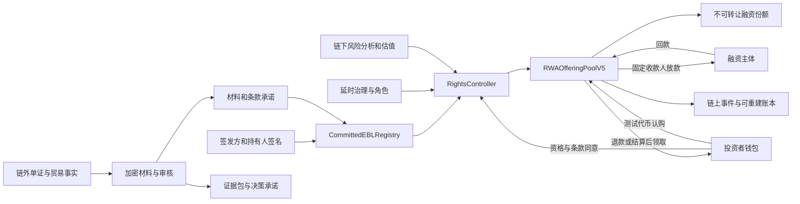

# AgentBL 当前版本综合评估

评估日期：2026-10-18，新加坡时间。评估对象：`b8db411de044b1132f14419a432be6da6ff1501b`，分支 `feat/w2-capital-ledger`。起始工作区干净。本轮只增加评估报告和证据，未修改产品代码、提交、推送或发送外部链上交易。

**结论：AgentBL 已经是一个有实质区块链功能、具有较完整工程验证的贸易融资研究应用，足以成立为区块链课程项目。但它仍属于受控测试网原型；目前还不能认定为成熟、可承担真实贸易融资责任的产品。**

它最有价值的部分是：把受控单证登记、持有人同意、融资条款、真实测试代币托管、回款分配和可核验证据连成了流程。主要不足则是：真实货权和金融定价尚未成立，关键处置流程仍有可复现的活性问题，完整业务流程尚未统一到一个易用的界面。

这里的“活性”是指：在合法参与者按规则操作时，系统最终能完成放款、退款或分配，而不会被到期遗漏、重复争议或小额干扰长期卡住。

本报告依据当前源码、本轮本地执行、固定区块只读核验、同提交 CI 和恢复收据作出判断。旧报告用于识别曾经的问题；没有把旧版本的缺陷直接算到新版本头上。没有课程评分细则，因此不预测具体分数。

## 1. 应如何定位这个项目

| 评价对象 | 当前判断 | 主要依据 |
|---|---|---|
| 是否是区块链应用 | 明确是 | 合约掌握资金和份额状态，链上权限与签名约束实际生效，并非只有哈希存证 |
| 课程选题是否合理 | 合理，有充分讨论空间 | 多方贸易、单证唯一控制、共同账本、托管与条件结算都适合展示区块链作用 |
| 课程实现是否充分 | 已有充足技术深度，但主线需要收敛 | 钱包、多个合约、状态机、真实测试代币、异常恢复、治理、证据验证和测试均存在 |
| 受控测试网应用是否可运行 | 是，基本闭环已有实证 | 当前链上已完成一个正常融资及一个失败募集退款；同提交 CI 通过 |
| 产品是否较成熟 | 工程基础较强，产品和协议边界仍未闭合 | 本轮复现 4 个合约行为问题，另有条款披露、分页和主界面移动端问题 |
| 是否具备真实贸易业务效用 | 方向有用，效果未被真实业务验证 | 缺少真实企业/承运人/资方流程、真实净回收估值、真实处置与独立组织运行证据 |
| 能否据此承载真实资金 | 当前不应作为已完成验收的能力 | 业务门槛仍关闭；测试币流转不能证明现实货权、信用风险或商业合规 |

更准确的项目描述是：

> **一个面向贸易融资的受控区块链应用：用链上条款、份额与托管账户管理融资过程，用链下材料和受信参与者连接现实贸易事实，AI 辅助分析，关键操作由明确角色批准。**

“AI 自主完成真实货权融资”“完全去中心化贸易金融”“随时可交易的 RWA 投资市场”都超过了当前实现与证据。

## 2. 设计初衷是否合理

贸易融资确有现实需求。ADB 的 2025 年调查估计全球贸易融资缺口为 2.5 万亿美元；这支持选题的现实背景，但不能直接证明 AgentBL 有客户、具有定价优势或能降低违约损失。[ADB 原始调查](https://www.adb.org/publications/adb-global-trade-finance-gap-survey)

这个项目合理的业务假设是：出口商在收款前需要资金；出资方需要了解贸易、回款和担保状态；承运人、持有人、估值方、资金方与操作方之间需要共享可信的状态记录。单证重复使用、事后篡改、资金去向不透明和多方对账成本，都是值得研究的问题。

但应把三件事分清：

1. **eBL 的控制权**：谁能背书、交回或质押这份电子记录。
2. **融资债权/收益权**：谁欠谁钱，投资者享有何种付款请求及损失分担规则。
3. **实物货物及处置权**：违约时谁有权实际接管、销售货物并回收款项。

当前代码对第 1 项的协议内控制和第 2 项的测试代币分配做了较多工作；第 3 项仍依赖链外制度和可信主体。把 eBL 录入 Registry 或给材料加哈希，不会自动形成可执行的实物处置权。

MLETR 强调可靠的电子记录、完整性、排他控制以及控制人的识别，并保持技术中立；它不要求所有实现都用区块链，也不自动改变相关实体法。新加坡 TradeTrust 是可以参考的现实方向：它区分文件真实性验证和可转让单证控制，并提供跨系统转移框架。**这不是认定 AgentBL 已符合相关法律的依据。**[UNCITRAL MLETR](https://uncitral.un.org/en/texts/ecommerce/modellaw/electronic_transferable_records)，[IMDA TradeTrust](https://www.imda.gov.sg/how-we-can-help/international-trade-and-logistics/tradetrust)

对于课程项目，建议固定一个可解释场景：一种货物、一条贸易路线、一个可信签发方、一个融资主体、若干合资格出资方，以及正常回款和违约两条结局。这样更容易证明设计成立，也更容易说明研究假设。

## 3. 区块链是否用在了正确的位置

| 能力 | 区块链带来的实际作用 | 尚需信任的部分 |
|---|---|---|
| 单证登记、修订、背书、质押 | 多方可核对统一状态，防止同一登记域内重复占用，签名绑定具体条款 | 原单证是真实的；签发方正确使用稳定身份；跨平台不会另行融资 |
| 认购与份额发行 | 一笔交易中付款与记份额同时成功或同时失败 | 结算代币及其发行主体；资方资格认定 |
| 退款、回款、领取 | 从实际链上余额分配，不依赖服务器声称“已付款” | 现实回款是否进入该资金池；最终结算时机和处置报告 |
| 治理与权限 | 限制谁可改权、停止或处理资产，延时与操作历史可查 | 多个地址背后是否是独立组织，成员是否串通或失联 |
| 决策及材料承诺 | 可验证某个版本的材料与决策是否被改动 | 原材料真实性、模型质量、材料是否可持续取回 |
| AI、OCR、行情 | 更适合链下执行；链上只使用经约束的结果或承诺 | 外部数据、模型、操作员和审核员 |

**区块链的必要性是有条件的。** 如果所有签发、估值、治理、服务器和资金参与者始终由同一个操作员控制，带签名审计的数据库也能实现很多功能，链带来的主要价值变成公开可验证和合约执行约束。若未来确有相互独立的参与方、无需完全信任平台的资金托管，以及独立验证状态的需求，链的理由才更强。

建议答辩明确回答“去掉区块链会失去什么”：会失去参与者可独立验证的共同资金/份额状态、钱包直接执行的条件领取、平台无法单独改写的历史与合约约束。不要把回答仅限于“不可篡改”。

当前采用 Injective EVM 测试网，Chain ID 1439，与官方网络说明一致；但核心业务主要依赖通用 EVM 能力，没有证据表明必须在 Injective 才能成立。现有 Injective 预编译及对冲探索可以作为扩展研究，不能据此声称所有货物都有可用对冲。[Injective 网络文档](https://docs.injective.network/developers-evm/network-information)，[对冲策略源码](E:/NUS/BlockChain/Project/Agent-BL-Upgrade/src/injective/hedgingPolicy.js:36)

## 4. 当前系统实际有三条路径

| 路径 | 作用 | 评估结论 |
|---|---|---|
| Demo | 模拟案例、定价、Agent、模拟认购与报告 | 适合无钱包课堂演示；金额、公司和融资成功不能当成真实业务 |
| 历史实验 / v3 | 旧合约、旧资产和原有实验记录 | 必须按历史地址解释；当前源码不会自动升级已部署合约 |
| 受控 v5 | 独立控制器、身份和资格约束、实际测试代币资金池 | 是当前最值得作为课程主线的路径；仍有本轮发现的问题 |

不能再概括整个项目为“认购没有资金支付腿”：这一结论对新受控 v5 已不成立。也不能反过来拿 v5 的能力证明旧实验入口同样具备资金托管。



图中的“链外事实 → 可信角色 → 链上约束”是信任边界。签名能够识别谁作出声明，不能替代事实核验。

## 5. 合约与资产设计的长处

当前实现已经包含多项对课程项目很有价值的设计：

- `CommittedEBLRegistry` 用 EIP-712 签名绑定发行、版本和持有人，质押需要 holder 同意；被占用的记录不能随意背书或交回。
- `AssetIdentityHub` 在明确加入的登记域中保留资产占用，包括历史映射；没有把内部 case ID 当成全部经济身份。
- `RightsController` 固定持有资金池的 owner/oracle 权限，没有开放任意转账、替换 minter 或任意调用入口；测试资产、估值、资格、条款接受均有边界。
- 认购使用 `SafeERC20`、重入保护和余额差校验；失败时不会只扣钱不发份额，并拒绝转账扣税代币。
- 存在募集失败退款、部分募集完成、实际放款、实际回款、多笔付款证明、亏损结算及独立领取。
- 资金使用原子整数，服务器保存 chain ID、合约地址、协议版本和 pool ID 的组合身份，避免把不同版本的同号池混用。
- 正常结清与实际领取分开。只要兑付资金已经留在合约，释放担保并不等于投资者必须已经点过领取；这比把“settled”当“已兑付到钱包”准确。
- 对未知交易结果不自动重发；支持原 nonce/calldata 找回、附加原 hash、规范区块核对和重组后撤回确认。
- 两个不同治理成员批准后还有一小时延时；角色撤销、来源撤销和资格过期有实际测试。

主要源码：[受控登记](E:/NUS/BlockChain/Project/Agent-BL-Upgrade/hardhat/contracts/CommittedEBLRegistry.sol:78)、[控制器](E:/NUS/BlockChain/Project/Agent-BL-Upgrade/hardhat/contracts/RightsController.sol:99)、[实际托管](E:/NUS/BlockChain/Project/Agent-BL-Upgrade/hardhat/contracts/RWAOfferingPoolV5.sol:475)、[退款](E:/NUS/BlockChain/Project/Agent-BL-Upgrade/hardhat/contracts/RWAOfferingPoolV5.sol:559)、[账本服务](E:/NUS/BlockChain/Project/Agent-BL-Upgrade/src/ledger/service.js:11)。

需要准确描述两项限制：

**份额不是通用可交易代币。** `ControlledRWAToken` 是每池不可转让的整数份额账本，没有 ERC-20/1155 的通用转账接口。这对受控融资是合理选择，但不能宣称已经提供二级交易、流动性或广泛 DeFi 可组合性。[份额实现](E:/NUS/BlockChain/Project/Agent-BL-Upgrade/hardhat/contracts/ControlledRWAToken.sol:4)

**防重复只在给定身份与登记域内成立。** 资产身份仍需签发方稳定地提供组织和原始单证标识。另一个系统、另一条链、另一份假身份或不同编号下的同一批货，不能只靠这个 Hub 自动识别。这个边界需要写进威胁模型，而不是再增加一个哈希字段就视为解决。[身份算法](E:/NUS/BlockChain/Project/Agent-BL-Upgrade/src/rights/typedData.js:34)

## 6. 本轮新发现：协议仍有四个可复现问题

以下均在独立的本地 Hardhat EVM 上用当前源码复现，没有操作外部测试网资产。优先级按影响和触发条件判断；它们不是已有攻击事件的报告。

完整复现：[脚本](E:/NUS/BlockChain/Project/Agent-BL-Upgrade/docs/evidence/current-assessment-2026-10-18/contract-probes.mjs)、[结果](E:/NUS/BlockChain/Project/Agent-BL-Upgrade/docs/evidence/current-assessment-2026-10-18/contract-probes.json)。

### CA-01 / P1：到期后仍可进行首次放款

**复现**：发行 10 份、募集 8 测试币，保持 `Funded`；把时间推进到 maturity 之后，此时估值也已过期；授权 OPERATOR 仍能通过控制器把全部 8 测试币付给融资主体，状态仍为 `Funded`。

**原因**：控制器只检查 intake 和 title 活跃；底层放款检查状态及可用金额，没有检查到期时间。`markDefault` 需要另外有人调用，时间经过不会自动改变状态。[控制器放款](E:/NUS/BlockChain/Project/Agent-BL-Upgrade/hardhat/contracts/RightsController.sol:199)，[资金池放款](E:/NUS/BlockChain/Project/Agent-BL-Upgrade/hardhat/contracts/RWAOfferingPoolV5.sol:526)

**影响**：这是授权角色可执行不合理操作的边界缺失，不是任意外部地址盗走资金。在本应进入回收/退款判断的时间点仍增加资金暴露。即使正常前端不提供该按钮，链上角色仍可直接调用。

**建议及验收**：规定独立的放款截止时间，并在链上拒绝到期或超过截止的新增放款；明确估值撤销/过期后的再确认政策。覆盖到期前后、无人执行违约标记、部分放款、来源撤销和直接合约调用，确认未放款本金有合法退出路径。

### CA-02 / P1：一原子单位回款可反复打断违约分配

**复现**：正常放出 8 测试币，违约后回收 4；处置者公告、审核者批准并等完一天；无特权地址通过 `repay` 加入 `1` 个原子单位，即 0.000001 测试币；`finalizeResolution` 返回 `recovery changed`。重新公告并再次等待一天后，再加一原子单位仍可重复阻止完成。本轮实际重复了两次。

**原因**：任何人都可以回款，而最终处置要求回收额与公告值完全相同。重新公告会重新开始一天通知期。[开放回款](E:/NUS/BlockChain/Project/Agent-BL-Upgrade/hardhat/contracts/RWAOfferingPoolV5.sol:543)，[公告](E:/NUS/BlockChain/Project/Agent-BL-Upgrade/hardhat/contracts/RightsController.sol:229)，[最终金额检查](E:/NUS/BlockChain/Project/Agent-BL-Upgrade/hardhat/contracts/RightsController.sol:256)

**影响**：原本用于保护投资者的“新增回收需复核”，可以成为低额干扰退出的手段。它不让攻击者拿走钱，但会拖延合规分配。现有测试验证了“回款变化使旧审核失效”，没有验证敌对持续变化下仍能最终退出。

**建议及验收**：设计有界的结算快照与迟到回款处理，例如关闭本期后进入另一期增量分配；或者将不会减少任何人收益的单调增加纳入明确审核政策。不要简单忽略新增资金。验证多轮微额回款、正常大额迟到回款、零回收、满额回收，证明不会漏账且原结算能在有界时间内完成。

### CA-03 / P1：相同证据可以重新开启已处理的争议

**复现**：投资者对处置提交某一 evidence hash；治理完成 `resolveDispute`；同一投资者立即使用完全相同 hash 再次调用 `disputeResolution`，再次将 `disputed` 置为 true。

**原因**：没有争议轮次、已裁决证据去重或终局裁决状态；只要尚未 finalized 且仍有份额，就能重新提出。[争议与解除](E:/NUS/BlockChain/Project/Agent-BL-Upgrade/hardhat/contracts/RightsController.sol:238)

**影响**：单个现有参与者可以反复恢复结算阻断。保留真实异议权是合理的，但“有异议通道”和“无界否决权”需要分开设计。

**建议及验收**：绑定 resolution revision、争议编号和证据；明确新证据门槛、受理期限和终局仲裁权限。已处理的相同争议不能重复冻结，同时新证据仍有受控救济路径。对连续重提、改一个 hash 的伪新证据、多个参与者轮流争议进行测试。

### CA-04 / P2：费用扣取与投资者领取存在顺序竞争

**复现**：回收并结清 10 测试币后，投资者先领取全部金额；之后治理尝试扣取 0.1 测试币费用，即使低于签署的 1 测试币费用上限，仍因 `ClaimsStarted()` 失败。

**原因**：结清后领取立即可用；费用是另一个受延时治理控制的动作。第一次领取后禁止再扣费用，保护了领取者之间的公平，但没有保证费用可以按业务规则收取。[领取](E:/NUS/BlockChain/Project/Agent-BL-Upgrade/hardhat/contracts/RWAOfferingPoolV5.sol:640)，[费用](E:/NUS/BlockChain/Project/Agent-BL-Upgrade/hardhat/contracts/RWAOfferingPoolV5.sol:658)

**影响**：若费用本就可选，这是一项应披露的政策；若将其当成平台稳定收入或处置成本来源，当前执行不可靠。不是投资者本金被窃取的问题。

**建议及验收**：结算时原子确定净分配额与费用，或者在开启领取前锁定费用；若业务决定免费，则删除或显式标记可选费用。覆盖零费、上限、第一笔抢先领取、多投资者顺序和亏损场景。

上述问题说明：大量测试与绿 CI 很有价值，但它们验证的是已写入断言的性质。金融协议还要专门测试“在对手持续操作、参与者缺席和时间推进时，资金是否最终退出”。本轮不构成正式第三方安全审计，也没有证据支持“已无其他漏洞”的结论。

## 7. 定价与 AI：有可解释策略，还没有被验证的金融定价能力

当前核心定价是纯确定性函数，主要取以下两种融资成本的较小者：

```text
融资成本 = min(出口商毛利 × 策略利润份额, 融资额 × 年化上限 × 期限 / 365)
发行价   = 融资额 / (融资额 + 融资成本)
```

之后检查抵押覆盖、份额取整、实际融资缺口、利润占比和年化上限。过去“最终价格截断后不再检查盈利”的问题已经有最终条款复核；不能仍把旧反例视为当前未修复缺陷。[当前计算](E:/NUS/BlockChain/Project/Agent-BL-Upgrade/src/core/pricingEngine.js:337)

这套实现的长处是可复算、可解释、便于版本承诺和回归，不依赖模型随口输出一个价格。让 AI 辅助抽取、找证据、解释异常，让确定性策略约束钱，是合理分工。

但它尚不足以回答“资方应该以什么价格承担风险”：

- 出口商付得起多少，与资方至少需要多少补偿，是两个不同条件。取较小值会保护借款人，却没有证明资方收益覆盖资金成本、预期损失和运营成本。
- 毛利可能来自声明，缺失时还有 12% 毛利估计。若成本不可验证，改变申报利润就能显著改变报价。[利润来源](E:/NUS/BlockChain/Project/Agent-BL-Upgrade/src/core/pricingEngine.js:546)
- 风险 bps 是策略压力分，并非违约概率；不同来源事件直接加分没有被历史损失数据校准。
- FAST/BALANCED/LOW_COST 是定价偏好，没有撮合深度、承诺资金额度或放款服务约定。提高折价不能保证更快募到钱。代码本身明确 `payout_sla: null`。
- 市场价、发票价与保险金额都不能直接等同于违约时的净回收价值；还需要品级、基差、货况、保单除外条款、销售时间、执行费用等证据。
- 重新定价只影响后续发行报价，不应被描述为改变已经卖出份额的本金、到期债务，或代表已有持仓具备可交易市价。

本轮用相同融资额 100,000、同抵押估值 250,000、同风险分 500、同期限 90 天、同 FAST 偏好，只改声明毛利，结果如下：

| 声明毛利 | 发行价 | 目标毛收益简单年化 | 输出 |
|---|---:|---:|---|
| 2,000 | 0.9874 | 5.18% | OPEN_WITH_WARNING，经济检查通过 |
| 10,000 | 0.9486 | 21.98% | OPEN_WITH_WARNING，经济检查通过 |

这是策略敏感性实验，不是实际投资回报预测。它说明当前输出很大程度取决于借款人的利润预算，而非独立完成了资方风险定价。[实验记录](E:/NUS/BlockChain/Project/Agent-BL-Upgrade/docs/evidence/current-assessment-2026-10-18/pricing-probes.json)

源码已经诚实标注 `research_parameters_unvalidated`、`risk_pressure_not_default_probability` 和独立估值未验证。这些标签应在主界面和答辩材料里同样明显，不应仅出现在深层证据里。[参数边界](E:/NUS/BlockChain/Project/Agent-BL-Upgrade/src/provenance/market.js:3)

下一步应把模型拆成：借款人可承受上限、出资人要求的最低补偿、可回收担保上限、资金供给和期限四个约束。没有共同可行区间就拒绝或降额。课程中可以用明确声明的研究参数做敏感性分析；无需伪装成已经有历史违约数据支持。

现有真实模型试验记录包含超时及 `MODEL_OUTPUT_INVALID`，没有足够证据支持“真实单证抽取已稳定可用”。本轮没有再次调用收费模型或进行真实材料评测；保留该外部质量门槛。[已有真实模型失败记录](E:/NUS/BlockChain/Project/Agent-BL-Upgrade/docs/evidence/w4-local-2026-10-17/provider-runs/2026-10-17T17-34-12-120Z-longer-schema-probe.json)

## 8. 功能取舍与用户体验

| 功能 | 判断 | 建议 |
|---|---|---|
| 单证、质押、条款、资金、退出 | 核心且合理 | 作为唯一默认课程主线 |
| 风险监控、来源解释、人工审批 | 对贸易场景有用 | 将每个信号连接到明确可操作的业务决策 |
| 证据下载、哈希复算、交易恢复 | 有实质价值 | 演示一次独立复算和一次未知交易恢复 |
| Copilot | 可改善复杂资产比较 | 定位为辅助检索解释，不替代资格、估值和审批 |
| x402 付费报告 | 技术闭环独立成立 | 作为可选服务扩展，单独说明报告付款与融资资金是两条路径 |
| 航线盲盒、徽章、分享 | 主线贡献有限 | 移到附加演示，避免削弱审慎融资定位 |
| MCP、A2A、预编译对冲等 | 展示面广，但增加维护范围 | 按课程评分要求选择一个扩展，其余放附录 |

桌面 UI 的卡片、指标层次、中英文、模拟按钮、离线来源标签和目标兑付提示已经相当完整。18 项浏览器测试本轮使用系统 Edge 全部通过，覆盖了若干异步状态、模式隔离、钱包变更和可访问性检查。

但有三个具体产品问题：

### CA-05 / P1：条款确认界面主要展示哈希，没有完整可读条款

受控确认卡显示操作、pool ID、terms hash、quote version、认购金额和通用风险提示。它没有提供完整的费用、最低募集额、放款条件、责任主体、处置规则和 disclosure/policy 内容供用户阅读并核对。链上承诺做得较细，用户可理解的披露没有同步跟上。[确认卡](E:/NUS/BlockChain/Project/Agent-BL-Upgrade/web/src/features/rights/ControlledFinancePanel.jsx:108)

应展示实际条款文本及关键数字，提供内容哈希复算/匹配状态，把当前报价与原始条款的关系解释清楚。报价变更后必须重审；材料不可取回或承诺不匹配时，不应提供“已审阅”的假象。

### CA-06 / P2：受控融资界面只读取默认前 10 个池

后端提供 `from`、`limit` 和 `next_cursor`，默认 limit 为 10；前端只请求一次 `/api/controlled/offerings` 并保存 `listing.offerings`，没有消费下一页游标。池数超过 10 后，后续池不会出现在该列表中。这是源码确认的扩展性缺口；当前真实受控实例只有两个池，本轮没有将它描述成已经发生的线上遗漏。[后端分页](E:/NUS/BlockChain/Project/Agent-BL-Upgrade/src/app/controlledRoutes.js:49)，[前端读取](E:/NUS/BlockChain/Project/Agent-BL-Upgrade/web/src/features/rights/ControlledFinancePanel.jsx:28)

应补分页/加载更多、地址与 ID 查询，并用超过一页的真实本地 EVM 数据验收。

### CA-07 / P2：主页面不支持手机宽度

本轮实测 390px 视口，`documentWidth=1100`、`bodyWidth=1100`；根样式固定 `min-width:1100px`。已有局部面板的 390px 验收不能代表整个应用具备移动端可用性。[样式](E:/NUS/BlockChain/Project/Agent-BL-Upgrade/web/src/styles/base.css:9)，[手机截图](E:/NUS/BlockChain/Project/Agent-BL-Upgrade/docs/evidence/current-assessment-2026-10-18/ui-mobile.png)

如果课程明确以桌面演示为准，这不是必须先解决的核心项；产品若要面向普通钱包用户，则应进行整页响应式改造和移动钱包验收。

更大的流程问题是：默认投资市场以模拟案例为中心，受控 v5 作为底部折叠面板，`RightsPanel` 主要说明状态，尚无完整的角色工作台串起登记、审核、质押、发行、放款和处置。后端/API 有能力，不代表第一次打开网页的用户能独立完成业务。

建议以“我是融资方 / 出资方 / 审核方 / 运营方”组织操作。在一个交易详情页连续显示：材料、权利、条款、募集、放款、运输观察、回款、分配。Demo 和受控测试网沿用相同信息结构，并在最显眼位置说明数据及资金范围。

## 9. 后端、安全与运营成熟度

**已有基础值得肯定。** 私人材料采用独立权限和 AES-GCM；业务会话绑定钱包、组织和角色，过期与撤销会重新校验；公开摘要采用白名单。服务器和前端有输入验证、CSP、限流、请求隔离，Live 操作与 Demo 区分。账本有单写者、原子写入、恢复标记和缺历史拒绝启动。容器以非 root 和受限权限运行。[材料服务](E:/NUS/BlockChain/Project/Agent-BL-Upgrade/src/rights/service.js:29)，[加密实现](E:/NUS/BlockChain/Project/Agent-BL-Upgrade/src/rights/vault.js:12)，[HTTP 安全](E:/NUS/BlockChain/Project/Agent-BL-Upgrade/src/app/security.js:47)

**可维护性处于原型向产品过渡阶段。** 模块按 agent、rights、ledger、ops、x402、evidence 划分合理，但 `server.js` 仍约 1,733 行，前端 controller 约 752 行，v5 资金池约 1,016 行，并存在多个版本和多种存储/模式路径。代码规模不直接等于差，但它增大了跨层规则遗漏概率。先建立清晰的业务服务接口与状态规则表，再逐步拆分；无需为了形式引入微服务。

**存储适合单实例受控使用。** 单 runtime 单进程和文件账本是一项明确限制，不能把增加副本视为直接扩容方法。真实多组织使用前需要决定数据库事务、并发写入、任务队列、索引和恢复一致性策略；现有安全关闭行为应该保留。

**Live 查询成本需要专项测试。** `RightsChainService.verify()` 每次核对多个链上绑定及六份 runtime；控制路由频繁调用核对。持仓服务还会遍历所有池读取份额、可领取额和状态，并设置了 10,000 个池的本地上限。安全核验有价值，但默认 Demo 的快速 HTTP 压测并不证明这条依赖公共 RPC 的路径可扩展。建议按规范块缓存不可变身份检查、建立事件索引，并测试不同池数、钱包数、RPC 延迟及限流下的 p95。[链核验](E:/NUS/BlockChain/Project/Agent-BL-Upgrade/src/rights/chain.js:34)，[持仓枚举](E:/NUS/BlockChain/Project/Agent-BL-Upgrade/src/ledger/service.js:36)

**治理仍依赖运营信任。** 链上确实有三个成员、两人批准和 3,600 秒延时，但交付说明明确研究密钥由同一操作员保管。地址不同不是组织独立。单个治理成员可取消待执行提案，也应作为可用性和成员失联场景研究。真实试点需要独立保管、轮换、值班和紧急处置演练。[治理合约](E:/NUS/BlockChain/Project/Agent-BL-Upgrade/hardhat/contracts/RightsGovernance.sol:49)

**加密与链上隐私不能混淆。** 原始材料不上新链、随机盐仅在授权包内，这是合理的；资金流、钱包和确定性资产键依然可关联。旧数据的同目录 key sidecar 只提供有限的文件级防护，不能等同于独立密钥管理。保留期到期拒绝读取也不等于所有历史备份已经删除。

**审核与链上权限分属不同边界。** 应用要求公开摘要双审，但具有合约 ISSUER 权限且持有所需签名的主体，可以绕过该 HTTP 工作流直接操作合约。现有设计文档已经承认这一点。若双审是业务硬要求，就需要绑定可验证的审核承诺或组织签名；若不是，就要准确描述它只是平台发布控制。

**恢复证据已经比早期版本强。** 本轮下载并核实了当前提交的独立 GitHub runner 恢复收据：源主机不作为路径或网络依赖，恢复材料、会话和链上持仓，耗时约 3.8 秒，零广播。它未接管原交易签名私钥，不能替代原组织失联时的授权恢复证明。[独立恢复收据](E:/NUS/BlockChain/Project/Agent-BL-Upgrade/docs/evidence/current-assessment-2026-10-18/ci-recovery/receipt.json)

已有 20 并发/2,000 请求和约十分钟检查属于明确范围的短测。它们有用，但不是商业 SLA、多实例容量、真实外部服务稳定性或真实值班响应的证明。本轮核验相关已有收据，没有重做十分钟容量测试或本机 Docker 演练。

## 10. x402 与证据机制是否有用

x402 已有超出普通演示的实现：独立检查 EIP-3009 授权域、交易 calldata、实际 token 事件、nonce 使用、规范块和确认数；未知结果进入对账，原付款可取回报告。资金支付和报告交付是分别核验的。[独立付款核验器](E:/NUS/BlockChain/Project/Agent-BL-Upgrade/src/x402/independentVerifier.js:73)

本轮重新只读核对了公共测试网 x402 付款及 PaymentOracle 回执，不能再说项目只有模拟 x402。但付费报告本身仍是研究材料；用户付过费与报告有准确业务价值是两个问题。该功能宜作为“机器可购买的风险信息服务”扩展，课程主体仍应围绕融资。

证据包、canonical 序列化、哈希复算、加密下载和 Merkle 锚定能回答“取回的是否是当时那份材料”。不能回答“材料里关于货物和企业的陈述是否真实”。完整的成熟系统需要把事实核验责任、数据来源、有效期、撤销和补充证据一起纳入，而不是把“已上链”显示为“已认证真实”。

本轮核验了 W5 技术源码清单的 649 个文件，全数匹配记录中的摘要。决策锚定的已有测试网收据及独立恢复证据继续保留；本轮没有再次广播锚定交易。

## 11. 验证结果与证据等级

| 证据 | 本轮结果 | 能说明什么 |
|---|---|---|
| 本地应用测试 | Node 26.8.1：1,376 项，1,374 通过、2 跳过、0 失败 | 当前环境应用回归；不是沿用旧文档的 1,382 数量 |
| 本地合约 | 151 通过 | 当前合约现有测试通过；不覆盖本轮独立发现的全部不变量 |
| W2/W3/W4/W5 独立集成 | 6 / 3 / 21 / 13 全通过，无跳过 | 本地实际 EVM、HTTP、钱包适配与恢复集成；包含普通套件另跑的 W4 场景 |
| lint / check / Vite build | 全通过 | 代码规范、结构和构建；不证明业务成立 |
| 浏览器 | 系统 Edge：18/18 通过 | 双语桌面和指定交互/局部移动面板；另实测主页面移动端溢出 |
| npm 依赖审计 | 应用生产依赖及合约工具链本轮均 0 个已知报告项 | 仅限本次 advisory 数据和两个审计范围，不是全仓安全审计 |
| 技术源码清单 | 649/649 匹配 | 当前代码与 W5 source manifest 一致 |
| 当前提交 CI | 15/15 检查 success | Linux/Windows、Node 22/24、浏览器、集成、构建、Docker、独立恢复等检查已实际运行 |
| 独立主机恢复 | 下载的 artifact 为 passed，SHA 精确相同 | 独立主机恢复材料及链账，未提供原交易签名私钥 |
| 公共测试网只读核验 | 固定块 144263998，六份 runtime/关键绑定核验通过 | 部署实例与本地 artifact/绑定一致；当前资金和份额可核对 |
| 新反例 | A01–A04 全部复现 | 4 项应进入后续整改的实际合约行为 |
| 真实货权/企业/资方/人类钱包验收 | 无本轮通过证据 | 保持未验收；不能用测试网或模拟钱包代替 |

CI：[同提交运行](https://github.com/liaboveall/Agent-BL-Upgrade/actions/runs/39085962345)。注意本地 `gh` 默认仓库解析到了 upstream；本轮最终以显式 `liaboveall/Agent-BL-Upgrade` 和完整 SHA 查询，未把默认查询空结果误报为没有 CI。

当前受控实例 `0xfd17Ec1ebDFdd35188adBfCe4ff88Bda61F21A0F` 的固定块结果：

- pool 1：认购 8、放款 8、回收 10、已领取 10，escrow 为 0，投资者剩余份额 0，状态 Repaid。
- pool 2：失败募集累计实付 2.4 已退款，当前 raised 与 escrow 均 0，剩余份额 0，状态 Cancelled；历史 subscribed 仍保留累计认购数量，不代表当前持仓。
- claim、refund、公共 x402 付款及报告付款证明回执均为成功且位于规范链。金额为测试代币数量，不是实际美元收益。

固定块 hash：`0x4bf360948a937073d0136688d70dff5e7cb060f000c96de8eb7b7e10abf0a2e0`。[只读核验完整结果](E:/NUS/BlockChain/Project/Agent-BL-Upgrade/docs/evidence/current-assessment-2026-10-18/readonly-verification.json)

本轮保留了两类工具环境失败：第一次应用测试因本评估设置 `NODE_TEST_CONTEXT` 而被 Node 视为递归测试，没有实际执行；移除该变量后重新运行并记录真实数量。第一次浏览器测试因缺少 Playwright 指定的 Chromium 可执行文件而 18 项启动失败，使用已有 Edge 后通过。两次初始记录都保留，未归因于产品缺陷。

人工 UI 浏览使用项目离线浏览器测试服务；该入口不启动正式 OperationsMonitor，`/api/ready` 的 `unmonitored/503` 不能解释为实际部署失效。本轮没有访问或操作真实业务 runtime。截图证明的是当前离线 Demo 界面。

## 12. 后续改进顺序与完成条件

| 顺序 | 工作 | 前置条件 | 可以接受的完成证据 |
|---|---|---|---|
| 1 | 处理 CA-01 到期放款 | 明确放款截止与过期退款政策 | 本地 EVM 证明到期直接调用被拒绝，合法未放款资金可退出 |
| 2 | 处理 CA-02/03 处置活性 | 先确定迟到回款及争议终局规则 | 多轮敌对微额回款、重复异议下，资金仍在有界流程内分配；全部金额守恒 |
| 3 | 决定 CA-04 费用政策 | 明确哪些费用必收/可免 | 费用与分配顺序独立，多投资者公平，亏损时净额一致 |
| 4 | 完成 CA-05 可读条款 | 固定融资产品的债务、费用和处置定义 | 用户能从 UI 读懂并复算待签条款；hash 不匹配/缺材料时拒绝继续 |
| 5 | 收敛课程主流程 | 选定一个资产/路线和角色 | 一位未参与开发的人按说明完成正常和失败两条路径，记录实际操作 |
| 6 | 修正金融表达与参数说明 | 保留研究参数和不确定性 | UI 不把风险分当违约率、目标年化当预期回报、FAST 当到账保证 |
| 7 | 补 CA-06 与 Live 查询性能 | 准备超过 10 个池的本地数据 | 后续池可查、分页不漏；多池持仓/RPC故障下有延迟和恢复数据 |
| 8 | 桌面优先收尾或处理 CA-07 | 确定课程是否要求手机 | 若要求手机，则全页 390/768/1280 无不可达关键操作，并实际验收钱包 |
| 9 | 真实业务研究 | 有承运人/融资方/出资方参与 | 单证源、债权、处置、身份、估值与法律适用有独立材料及责任主体 |
| 10 | 真实试点运营 | 前述协议和业务规则稳定 | 独立组织密钥、真实告警接收人、外部服务故障与失联恢复演练 |

不要为了“成熟”先扩展更多币种、更多 Agent、更多链或增加新的展示功能。当前边际收益最高的是：把已存在的核心能力串成清晰的一条业务流程，并修掉影响资金退出的边界。

合约不是可随意热更新的业务服务。修复后应生成新的候选实例和版本证据，明确历史资产仍由旧代码约束；没有新的部署与确认，不应把本地修复宣称为现有测试网已修复。

## 13. 课程演示与答辩建议

建议用以下顺序组织主展示，时间按课程要求压缩：

1. 用一张图说明谁融资、谁出资、谁控制单证，以及各自为何不完全信任平台。
2. 展示签发承诺与 holder 同意，尝试一次重复质押或未授权操作并看到合约拒绝。
3. 展示一页可读条款、研究定价解释、资金缺口与风险边界。
4. 展示认购付款、份额变化、固定收款人放款；在浏览器之外独立读取余额与事件。
5. 展示回款、结清、投资者单独领取，说明钱确实变动；另展示失败募集退款。
6. 展示断网/未知交易结果恢复，说明没有重复扣款；再展示一个损失或争议情景。
7. 最后说明链上能保证什么、链外依赖什么、当前哪些是真实测试网证据，哪些仍为研究假设。

课程文档应包括：系统边界图、角色/权限表、资产与债权定义、合约状态机、资金守恒式、三类攻击/异常场景、实际交易链接、数据库方案对照，以及一个可重跑的最小演示入口。

值得写出的资金守恒式是：在排除直接误转与非标准代币行为的既定范围内，逐池托管余额应对应“认购入金 + 回款 − 放款 − 退款 − 已领取 − 已扣费”；份额的发行与销毁也应独立守恒。针对任意事件顺序、重组和恢复检查这些关系，比只列测试数量更能说明区块链工程深度。

## 14. 最终判断

**设计方向成立，当前也已有足够实质内容证明它是区块链应用。作为课程项目，重点应是把这个事实清晰展示出来，而不是继续增加复杂度。**

工程上，它已明显超过只做几页界面和简单合约的概念展示：有真实测试代币闭环、权限和治理、交易恢复、证据包、CI 和独立主机恢复。当前仍不适合称为成熟真实融资平台，因为重要的退出规则尚有缺口，条款和角色工作流尚未产品化，现实货权与风险定价也没有独立验证。

最值得继续投入的定位是：**可审计、可恢复、权限明确的贸易融资区块链研究应用**。先完成 CA-01/02/03、可读条款和完整角色演示，再考虑增加真实数据和业务合作；这会同时提升课程说服力和未来产品价值。

本轮证据索引：[评估证据目录说明](E:/NUS/BlockChain/Project/Agent-BL-Upgrade/docs/evidence/current-assessment-2026-10-18/README.md)。
